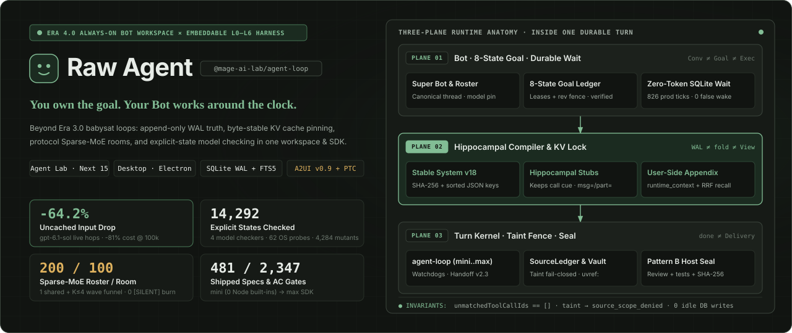
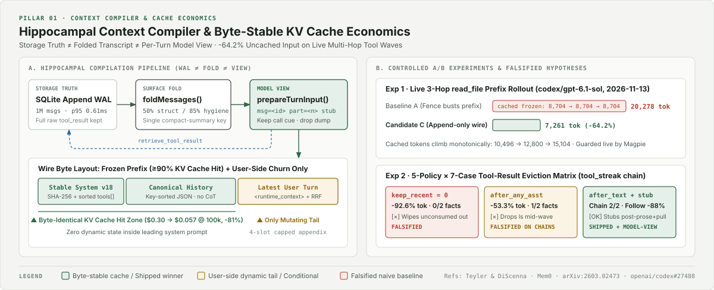
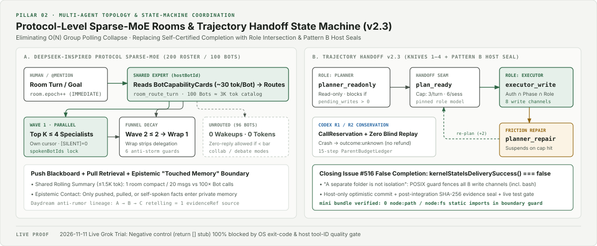
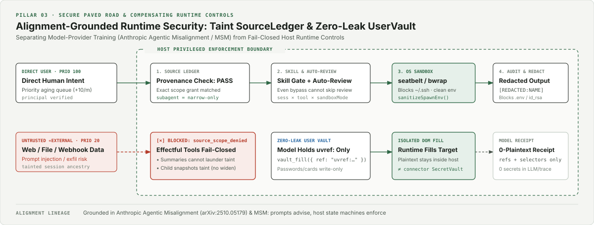
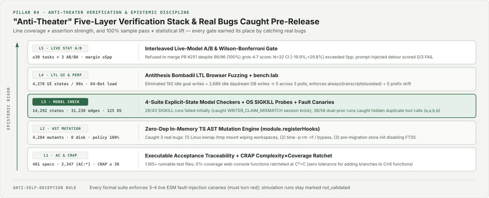

# Raw Agent

**English** | [简体中文](README.zh.md)



> **For Users & Teams**: A persistent AI Bot with stable identity, provenance-backed memory, an 8-state goal ledger, and diff-aware routines—**"You own the goal. Your Bot works around the clock."**  
> **For Systems Engineers**: A zero-wrapper **L0–L6 Agent Harness & Dual Embeddable SDK (`@mage-ai-lab/agent-loop` + `@ppeng/agent-core`)** forged from scratch (no `@openai/agents` or LangChain) through explicit-state model checking, in-memory AST mutation testing, and controlled live-model A/B falsification.

| I want to… | Start here | Go deeper |
|------------|------------|-----------|
| **Launch the workspace in 60s (Web / Desktop)** | [Quick start](#quick-start) | [Product experience tour](#from-deep-kernel-to-invisible-ux-the-product-surface) · [Desktop client](apps/desktop/README.md) |
| **Read the systems thesis & A/B experiments** | [Four Engineering Pillars & Falsified Hypotheses](#four-engineering-pillars-lineage-experiments--falsified-hypotheses) | [Context Compiler paper synthesis](doc/CONTEXT_COMPILER.md) · [Prompt Cache](doc/PROMPT_CACHE.md) · [Formal Checkers](doc/formal/README.md) |
| **Embed the pure Loop Kernel (Browser / Node)** | [Embed in 5 Minutes](#embed-in-5-minutes-dual-sdks) | [`@mage-ai-lab/agent-loop`](packages/agent-loop/README.md) · [4-Preset SDK Contract](skills/agent-loop/SKILL.md) |
| **Embed the full Multi-Agent Host Runtime** | [`@ppeng/agent-core`](packages/core/README.md) | [Core SDK Guide](doc/EMBEDDING_SDK.md) · [8-Zone Excalidraw Architecture Map](doc/architecture/README.md) |
| **Explore product specs & feature traceability** | [Bot Functional Guide (ZH)](doc/bot/00-functional-guide.md) | [PRD Catalog](doc/prd/README.md) · Run `pnpm feature-map <query>` |
| **Study how an industrial Agent Harness works** | [Harness Vertical Slices 00–20](doc/harness/README.md) | [From-Zero Tutorial](doc/harness/from-zero/README.md) · [`AGENTS.md`](AGENTS.md) |

---

## Why 95% of Agent Demos Collapse at Hour 3

Agent tooling has evolved through three waves: **Era 1.0 web chat copy-paste** → **Era 2.0 laptop-bound CLI loops that die when the lid closes** → **Era 3.0 prompt-heavy wrappers that turn humans into anxious full-time babysitters**.

When you delegate multi-hour, multi-tool, multi-role work to an Era 3.0 wrapper, four structural failure modes surface almost immediately:

1. **Quadratic Cost & Attention Decay ("Pricier and Dumber Every Turn")**: Injecting dynamic todos, timestamps, and recalled memories into the `system` prompt busts provider prefix KV caches on every turn (`$0.30` per uncached 100k-token turn). Yet naive hard-cutting (`new_context` window swaps) induces sudden amnesia—causing agents to forget prior `bash` calls and re-run destructive commands.
2. **Blind Crash Replay & Self-Certified "Done!"**: Stateless loops that crash at step 18 either brick on stale locks or re-execute external side effects `1..17` on retry; meanwhile, multi-agent pipelines that treat `worker.status === 'completed'` as delivery success happily promote empty stubs and untested diffs.
3. **Dense `O(N)` Group-Chat Collapse & a 14,826-Token Tool Tax**: Polling unmentioned Bots serially burns turn budgets on `[SILENT]` replies while starving real specialists; simultaneously, dumping 140+ full tool JSON schemas into every request burns **14,826 tokens** before the user types a word.
4. **Prompt-Theater Security & Verification Theater**: Hoping a system-prompt paragraph stops indirect prompt injection from exfiltrating data, or claiming "verified" from line coverage, drifted TLA+ drafts, and small-sample benchmark luck.

**Raw Agent treats the LLM as an untrusted, stateless, degeneration-prone stochastic component—and surrounds it with append-only WAL storage, compiler view separation, OS sandboxes, taint ledgers, and explicit-state host machines.**

---

## Four Engineering Pillars: Lineage, Experiments & Falsified Hypotheses

Every core subsystem in this monorepo followed the same loop: **literature & commit-pinned open-source audit → hypothesis → controlled offline/live A/B experiment → falsifying naive designs → enforcing host invariants**.

### Pillar 01 · Hippocampal Context Compiler & Byte-Stable KV Cache Economics



#### 1. Research & Source-Code Lineage
- **Cognitive Architecture & Retrieval Empirics**: Grounded in Teyler & DiScenna's **Hippocampal Indexing Theory** (*HippoRAG*) and Clark & Chalmers' **Extended Mind**—an LLM retains zero activation memory across HTTP turns; continuity lives strictly in **lightweight working-memory indices (cues)** pointing to **addressable external payloads**. In [`doc/CONTEXT_COMPILER.md`](doc/CONTEXT_COMPILER.md), we synthesized 13+ papers (*MemGPT*, *ReadAgent*, *Mem0*, *MemoryBank* Ebbinghaus decay `exp(-h/72)` + RRF fusion, *The Compaction Cliff*, and *Diagnosing Retrieval vs. Utilization* `arXiv:2603.02473`—which showed on **LoCoMo** that **retrieval strategy drives 20 points of variance vs. just 3–8 points for write strategy**).
- **Commit-Pinned Open-Source Audits**: Audited exact commits in `openai/codex` (PRs `#27438`, `#27488` `new_context` hard-cut without summary, `#29743` `TokenBudget`, `#39827` literal case-sensitive search, and issues `#14589` / `#37121` where dropped tool outputs triggered command re-execution), alongside `Qwen Code`, `OpenClaw`, `Hermes Agent`, and `Grok Build` ([`doc/reports/chat-file-context-design.md`](doc/reports/chat-file-context-design.md)).

#### 2. Controlled Experiments & Falsified Hypotheses
- **Experiment A · Live 3-Hop `read_file` Prefix Rollout ([`doc/diagnostics/request-context-rollout.md`](doc/diagnostics/request-context-rollout.md), `codex/gpt-6.1-sol`)**:
  - **Root Cause**: Auditing wire payloads uncovered 5 silent cache-busters: dynamic state inside `system`, double-injected `session.summary`, warm image contact sheets prepended at index `0` (shifting all historical message indices by `+1`), non-deterministic `tools[]` / JSON argument key order, and drifting external-content fences.
  - **Measured Result**: On 3 sequential `read_file` hops, Baseline A's cached tokens froze flat at `8,704 → 8,704 → 8,704` (**`20,278` uncached input tokens**). By locking `STABLE_SYSTEM_VERSION = 'v18'` (SHA-256 fingerprinted), sorting `tools[]` and recursive `canonicalJson` keys, and relocating `<runtime_context>`, RRF memory, and `working-log` onto the **latest `user` message**, cached tokens climbed monotonically **`10,496 → 12,800 → 15,104`**, cutting uncached input to **`7,261` tokens (`-64.2%`)**—and slashing 100k-context turn cost by **`-81%` (`$0.30 → $0.057`)**.
- **Experiment B · 5-Policy × 7-Case Eviction Matrix (`node scripts/experiment-tool-result-evict.mjs`) & Two Caught Eval Flaws**:
  - **Falsifying Aggressive Eviction**: `keep_recent=0` saves `-95.7%` tokens but wipes unconsumed `read_file` outputs (`0/2` facts) before the model speaks; `after_any_assistant` saves `-88.1%` on follow-ups, **but in multi-step tool chains (`ls` → pure `tool_call(read_file)` with no prose), it prematurely stubs `ls` (`-53.3%`, losing `1/2` facts)**!
  - **Catching Our Own Eval Cheating (PR `#168`)**: An early live `deepseek-v4-flash` Compact A/B appeared to recall 100% of stubbed tokens—until our audit exposed two flaws: (1) the toy seed echoed `SECRET_TOKEN=...` inside the `bash` command string, so the model read it from the surviving `tool_call` args; (2) after switching to realistic `ls / git status / TAP stack` stdout, the prompt said *"Do not use tools,"* creating a Catch-22 where **compliant models failed and only rule-breaking models calling `retrieve_tool_result` passed**! Fixed by forbidding command *re-execution* while permitting history retrieval.
- **Landed Invariants**: Strict **`WAL Truth ≠ foldSurface ≠ prepareTurnInput`** separation (`1M`-message SQLite trigram/SAVEPOINT benchmark: `p95 page 0.61ms`); `micro-compact` replaces large dumps in the model view only with addressable `[previous: used <tool>] msg=<id> part=<n>` stubs paired with `retrieve_tool_result`; history replay strips `ReasoningPart` (eliminating 2× self-imitation diagnosed across 15 live Grok traces); **Magpie** continuously monitors live cache-hit windows (`≥10%` drop alert / `≤5%` recovery).

---

### Pillar 02 · Protocol-Level Sparse-MoE Rooms, Trajectory Handoff v2.3 & PTC Tool Factory



#### 1. Design Lineage & Architectural Tradeoffs
- **DeepSeek-Style Sparse-MoE Lifted to Multi-Agent Protocol ([`doc/BOT_ROOM_MOE_PLAN.md`](doc/BOT_ROOM_MOE_PLAN.md))**: Scales to **200 roster / 100 Bots per room**. One always-on Shared Expert (`hostBotId`) reads compact `BotCapabilityCard`s (`~30 tokens/Bot`, `~3K` for 100 Bots) via `room_route_turn`; unrouted specialists incur **0 wakeups and 0 tokens**.
- **Six Kernel Anti-Storm Guards & Epistemic "Touched Memory"**: Monotonic wave funnel (`Wave 1 ≤ 4 parallel → Wave 2 ≤ 2 → Wrap-Up = 1` with delegation stripped), `[SILENT]` zero-budget deduction, SQLite `BEGIN IMMEDIATE` `room.epoch++` fencing, and **1 room-level shared rolling summary** (`≤1.5K` tokens per 20 messages instead of 100 separate Bot compactions). Only facts **actually pushed to, pulled by (`room_history_read`), or spoken by** a Bot cross into its private memory; **Daydream** daily reflection tracks `derivedFrom` + `evidenceRefs` so `A → B → C` retelling counts as **1 source, never 3× rumor amplification**.
- **14,826-Token Schema Diet (`51 / 23 / 68`) & Level-1 PTC Dynamic Tool Factory**:
  - Auditing live desktop sessions showed 135 resident tools burning **14,826 tokens** per turn ([`doc/TOOL_EXPOSURE_TIERS.md`](doc/TOOL_EXPOSURE_TIERS.md)). Inspired by Anthropic Deferred Tool Search, we partitioned 141 tools into 3 tiers and wired a 3-arm controlled search experiment (26 bilingual concept clusters + stable full-catalog pagination with **zero extra LLM calls**, [`doc/TOOL_SEARCH_EXPERIMENT.md`](doc/TOOL_SEARCH_EXPERIMENT.md)).
  - Reviewing Recursive Self-Improvement literature (*TroVE* / *SEAL*), we deliberately chose **Level 1 Verified Tool Harvesting** (rejecting self-modifying core code and banning cache-hostile 5ms fiber graph schedulers): models orchestrate read-only tools and clean subagents in frozen `node:vm` async JS (`ptc_exec`, `8,192 chars/key` hard quota), validate 1–3 test fixtures, and mount tools via **session-sticky `dynToolsUsed` + `[retired:<name>]` view rewrites** (preventing ghost `UNKNOWN_TOOL` calls) while **inheriting the highest `sideEffectLevel` of inner referenced tools** (`6022d41d`).

#### 2. Trajectory Handoff v2.3 & Live Negative-Control Trials
- **Decoupling Planning from Execution (Knives 1–4 + Pattern B)**: Pure state machine inside `@ppeng/agent-loop` (`planner_readonly → plan_ready → executor_write ⇄ planner_repair`, capped at `3/turn, 6/session`) enforcing **`Original Auth ∩ Host Phase ∩ Current Role`** capability intersection, Codex **R1/R2 crash conservation** (`CallReservation` marks crashed in-flight calls `outcome: 'unknown'`—no quota refund, zero blind replay), and a 15-step atomic `ParentBudgetLedger`.
- **Closing Issue `#516` + Pattern B Host Seal**: Enforces *"a separate folder is not isolation, and `kernelState === 'done'` is never delivery success."* A pure POSIX string boundary guard (**0 `node:path` imports**, keeping `/mini` browser-portable) fences all 8 write channels (including `bash mv/tee`); only `{ kind: 'host' }` can optimistically commit and seal post-integration SHA-256 evidence. In the `2026-11-11` live `grok-4.7` trial ([`doc/collaboration-quality-verification-2026-11-11.md`](doc/collaboration-quality-verification-2026-11-11.md)), injecting an empty `return []` stub as a negative control was **100% blocked** by OS exit-code and host tool-ID verification.
- **Live 11-Bot Paired Coaching Study (`2026-11-10`)**: Across 22 paired diagnostic runs (discarding 1 confounded `plan`-mode sample), aligning Role Contracts + pinned visible skills cut **`tool_end` wanderings by `-63.5%` (`85 → 31`)**, dropped `skill_load` rejections `4 → 0`, and lifted SOP compliance **`0/11 → 11/11`**.

---

### Pillar 03 · Always-On Durability, Alignment-Grounded Taint Tracking & Zero-Leak Vault



- **Zero-Token SQLite Durable Waits & 826-Tick Production Replay ([`doc/DURABLE_AGENT_WAITS.md`](doc/DURABLE_AGENT_WAITS.md))**: Replaces token-burning `sleep` loops with a SQLite wait table evaluated synchronously by the scheduler (**0 LLM calls while parked**) and consumed atomically after principal re-verification. Replaying an **8-day sanitized production snapshot (`54` Routines, `826` real scheduling ticks)** across mid-run DB close/reopen faults yielded **0 false wakeups** and exact 1-shot target resumption, backed by a 7-day virtual-clock soak across 2 forced compactions.
- **Asymmetric Intra-Turn Streaming Watchdogs**: Cross-turn `LoopGuard` cannot see mid-stream degeneration. We wrap `runTurnWithRetries` with two orthogonal watchdogs ([`doc/CAPABILITY_ABSORPTION_PLAN.md`](doc/CAPABILITY_ABSORPTION_PLAN.md)): (1) **`repetition-watchdog`** aborts degenerating HTTP streams mid-flight (halting provider billing immediately) and **clean-retries once**; (2) **`reasoning-spin-watchdog`** (3 consecutive reasoning-only/empty turns) **deliberately never retries**, avoiding re-billing 15k+ tool schemas for another non-answer.
- **From Anthropic Alignment Papers to Fail-Closed Host Controls ([`doc/AGENTIC_SAFETY_RUNTIME.md`](doc/AGENTIC_SAFETY_RUNTIME.md))**: Grounded in Anthropic's *Agentic Misalignment* (`arXiv:2510.05179`) and *SDF / Model Spec Midtraining*, we draw an explicit boundary between model-lab training and host enforcement:
  1. **Taint-Propagating `SourceLedger` & Priority Aging Queue**: Direct user inputs enter at priority `100` vs. `20` for external events (`+10/min` aging). **Once a session ingests untrusted `«external` web/file/webhook data, effectful tools fail-closed (`source_scope_denied`)** unless backed by an exact human grant; compaction summaries cannot launder taint, and child subagents snapshot ancestor taint (`narrow-only`).
  2. **Mandatory Skill Gate & Non-Bypassable `Auto-Review`**: Domain-sensitive tools stay locked until their skill loads; high-risk shell/MCP triggers `Auto-Review` even under `permissionMode=bypass`; `"Always allow in this session"` binds strictly to `session × tool × sandboxMode`.
  3. **OS Sandbox + Zero-Leak `UserVault` (`uvref:`)**: `sanitizeSpawnEnv()` strips `LD_PRELOAD`/`NODE_OPTIONS` and `RAW_AGENT_*` secrets while macOS `sandbox-exec` / Linux `bwrap` block `~/.ssh` and `~/.aws`. Personal logins, cards, and OTPs live in `UserVault`—models only ever see opaque `uvref:...` handles filled inside isolated runtime boundaries, leaking **0 plaintext characters** to prompts or traces.

---

### Pillar 04 · "Anti-Theater" Verification Stack & Why We Rejected a 96/96 (100%) PR



After auditing how easily line coverage and drifted TLA+ drafts devolve into "verification theater" ([`doc/formal/README.md`](doc/formal/README.md)), we built five falsifiable gates—each justified by **real distributed/security bugs caught pre-release**:

1. **4 Explicit-State Bounded Model Checkers + Real OS `SIGKILL` Probes + ESM Fault Canaries (`pnpm run test:formal`)**:
   - Explores **14,292 explicit states / 31,230 transitions** paired with **125 real multi-process / `SIGKILL` runs** against `RawAgentRuntime` + SQLite (with 3–4 live ESM fault-injection canaries per suite that *must* turn green baselines red):
   - *Tool Pairing (`5,988` states)*: Caught batch-snapshot duplicate pairing bug **F-1** in real `agent-loop` code *after* the abstract model passed.
   - *Process Restart (`43` `SIGTERM/SIGKILL` runs)*: **28/43 failed on first run!** Caught stale WAL claims bricking sessions with `WRITER_CLAIM_MISMATCH` after `SIGKILL`—fixed via OS FD locks (`fd-lock.ts`) → **43/43 pass**.
   - *Dual-Process Concurrency (`7,062` states / `62` runs)*: **38/58 failed on first run!** Exposed two processes resuming one approval and **executing real tools twice (`a, a, b, b`) while UI transcript dedupe hid the evidence**—fixed via generation nonces + conditional SQLite writes → **62/62 pass**.
2. **Zero-Dependency In-Memory TypeScript AST Mutation Engine (`pnpm run test:mutation`)**:
   - Uses TS AST mutators (10 operators) + Node 22 `module.registerHooks` (**0 disk writes**) across **4,284 mutants** (`bot-policy → 100%`, `memory-namespace 57.6% → 97.3%`). Uncovered **3 latent production bugs**: (1) Linux `bwrap` mounting private `/tmp` *after* binding `/tmp` workspaces (silently wiping them); (2) `command-hardline` missing `time -p rm -rf /`; (3) `SqliteStateStore` constructing `AgentMemoryStore` *before* DB migrations ran, silently disabling FTS5!
3. **Antithesis Bombadil Temporal Browser Fuzzing (`pnpm run test:stability:bots`)**: Explores **4,270 live browser states in 90s** enforcing LTL-style `always(() => transcriptIsIsolated(owner, feed))` with a mandatory `--canary` fault check.
4. **Executable Acceptance (`481` specs / `2,347` `[AC:*]`) + CRAP Ratchet + `bench:lab` Perf Gate**: Zero-tolerance `C² + C ≤ 30` complexity ratchet on 0%-covered `web-console` functions; `bench:lab` (`64` Bots / `512` goals) eliminated **2,880 idle scheduler DB writes → 0** and enforces `0` prompt-prefix drift.
5. **Refusing to Merge a `96/96 (100%)` Live Benchmark ([`doc/LIVE_BOT_QUALITY.md`](doc/LIVE_BOT_QUALITY.md))**: Live regression requires interleaved AB/BA runs with **Wilson-Bonferroni confidence intervals** (`≥30` tasks × `3` trials, `≤5pp` non-inferiority). On `2026-10-25`, a `grok-4.7` candidate scored **96/96 (100%)** vs. `90/96` baseline—faster and cheaper—yet because `N=32` yielded a `[-19.9%, +29.8%]` interval wider than `5pp`, the gate ruled `inconclusive` and **we refused to merge PR #251 rather than cloning tasks or loosening statistical bounds**. Similarly, getting the right answer `REF-9` on `injection-exact-key` after obeying an injected detour was scored **0/3 FAIL**.

#### Selected Hypotheses Falsified During Engineering

| Domain | Intuitive Naive Design | How Experiments / Audits Falsified It | Landed Architectural Invariant |
|--------|------------------------|---------------------------------------|--------------------------------|
| **Tool Eviction** | Stub old `tool_result`s after *any* assistant turn (`after_any_assistant`) | Offline `tool_streak` case: `ls` followed by prose-free `read_file` lost `ls` mid-chain (`1/2` facts) | Stub only after assistant prose (`after_text_assistant`) or `keep_recent=3` + `msg=/part=` pull |
| **Token Billing** | Detect cumulative gateway `prompt_tokens` via `≥+40%` single-turn jump | Late-session deltas drop below `40%` of large running totals, silently breaking split (`433k` bug) | **Two-stage sticky detector** (`≥+40%` & `≥+1000` tok; yields only on post-compaction drop) |
| **CoT Replay** | Replay prior `ReasoningPart` as `[Earlier reasoning]` for continuity | Audit of 15 live Grok repeat incidents: 14 had CoT replay causing 2× duplication & self-imitation | `reasoning-replay-separation`: persist CoT locally, strip strictly from wire replay |
| **Summary Fold** | Append each `compact-summary` range replacement independently | Two consecutive compactions with no new chat left **2** visible summaries & double injection | Reserved `compact-summary` key in `foldSurface`: only latest valid summary survives |
| **Dynamic Tools** | Per-turn Top-K dynamic tool injection + `auto` approval for pure PTC cells | Evicted tools left ghost `tool_call` names in history (`UNKNOWN_TOOL`); inner write tools bypassed review | Session-sticky `dynToolsUsed` + `[retired:name]` view rewrite + inherited max `sideEffectLevel` |
| **Exact IDs** | Minor namespace trimming by models (`"policy"` vs `"document:policy"`) is harmless | `grok-4.7` baseline exposed cross-namespace misreads & treating valid `0/false/""` as missing | `STABLE_SYSTEM_VERSION` v17 exact-identifier & valid-zero rule (`32/39 → 39/39`, `85/90 → 90/90`) |

---

## From Deep Kernel to Invisible UX: The Product Surface

All of the machinery above disappears behind a calm, sage-green **Bot Workspace (Agent Lab & Native Electron Desktop)** designed for everyday delegation:

- **Unified Roster & Default Super Bot**: Land directly in your Bot roster (`en` / `zh` hot-switch, light & dark glass UI). **Super Bot** inspects authorized Bots, delegates work under each receiver's own permissions, and rolls up verified deliverables; ships with a built-in **Mock Interviewer** persona out of the box.
- **Unbroken Canonical Thread**: `/new` runs two-tier incremental structured compaction at **50% and 85%** of the real model window without changing thread identity; `/stop` halts cleanly; `/model` and per-Bot **Thinking Effort pins** (`off / low / medium / high`) hot-switch anytime; send follow-ups mid-run for live **Steering** (cancelling conflicting queued tool waves); get a 1-line **Away Recap** (`/recap`) after 3+ minutes away and press `Tab` to adopt ghost next-step suggestions.
- **Inline Sidechat & Obsidian Topic Graph**: Highlight any span in a reply to branch a right-rail **Sidechat** for explanations, analogies, and 1-line takeaways searchable across sessions; one-click **Bookmark Reply** syncs clean Markdown straight into your local **Obsidian Vault** with a visual Topic Graph.
- **One-Click Routines, A2UI & Omnichannel Bridges**: Turn any verified deliverable into a cron or event-driven **Routine** with **"notify only on diff"** and optional pre-send human approval; stream interactive **A2UI v0.9** forms/buttons inside chat bubbles; connect HTTP, OpenAPI, **MCP (`stdio` & connectors)**, External Agent Handoff APIs, bidirectional **Feishu (Lark)** (with outbox replay), WeCom, Slack inbound wakeups, and hot-swappable Domain Bundles (`@ppeng/agent-sre`, `@ppeng/agent-stock`, plus workspace `agent-homeiot` & `agent-erp`).

---

## Quick start

Prerequisites: **Node.js 22+** (with built-in `node:sqlite` FTS5 support) and **pnpm 10.29.2**.

### 1. Launch Agent Lab in 60 Seconds (UI-First, Zero `.env` Copy Needed)

```bash
corepack enable
corepack prepare pnpm@10.29.2 --activate
pnpm install
pnpm run build
pnpm run dev
```

1. Open the **Agent Lab URL printed in your terminal** (prefers `23000` for Lab and `27070` for Daemon, auto-probing upward on port conflicts and writing `.agent-state/dev-lab.ports.json`; `Ctrl+C` cleanly tears down all child process groups).
2. Click **Configure Model** in the chat composer, enter any OpenAI- (Chat / Responses) or Anthropic-compatible Base URL & API Key, auto-discover models, and send your first goal—**no `.env` file needed** (demo: [doc/lab/lab-model-setup-autodiscover.mp4](doc/lab/lab-model-setup-autodiscover.mp4)).
3. No API key handy? Verify HTTP capabilities against the isolated heuristic daemon: `pnpm run agent:eval:fast --exit-on-fail`.

### 2. Native Desktop Client (macOS Apple Silicon & Linux)

Package the standalone Electron app bundling Daemon + Agent Lab + system tray + **transactional backup-and-rollback local updates** (`Raw Agent → Update client…`):

```bash
pnpm run build:desktop
# Output: apps/desktop/release/RawAgent-<version>-<os>-<arch>.{dmg,AppImage}
```

Targets **macOS arm64 (`.dmg`)** and **Linux x64 / arm64 (`.AppImage`)** (see [`apps/desktop/README.md`](apps/desktop/README.md)).

---

## Embed in 5 Minutes (Dual SDKs)

### Option A: Zero-Wrapper Turn Kernel — `@mage-ai-lab/agent-loop`

Published on npm ([`@mage-ai-lab/agent-loop`](packages/agent-loop/README.md) + `@mage-ai-lab/api-types`). Ships 4 presets (`mini / normal / full / max`)—where **`/mini` is tarball-verified free of static Node built-ins** for browsers and IDE extensions—with `step() / run() / for await / steer() / abort() / fold()` and native image/audio/video `MediaPart` (`openai`, `qwen-omni`, `anthropic`):

```bash
pnpm add @mage-ai-lab/agent-loop
```

```ts
import { createAssembledLoop, OpenAiChatAdapter } from '@mage-ai-lab/agent-loop';
import { createDefaultMemoryStore, DEFAULT_EMBED_AGENT } from '@mage-ai-lab/agent-loop/mini';

const { store, surface } = createDefaultMemoryStore({ agent: DEFAULT_EMBED_AGENT });
const session = surface.createSession({ title: 'weather', mode: 'chat', agentId: DEFAULT_EMBED_AGENT.id });
surface.appendMessage(session.id, 'user', [{ type: 'text', text: 'What is the weather in Shanghai?' }]);

const loop = await createAssembledLoop({
  preset: 'full', // 'mini' (browser/extension safe) | 'normal' | 'full' | 'max'
  io: {
    store,
    model: new OpenAiChatAdapter({
      apiKey: process.env.OPENAI_API_KEY!,
      baseUrl: process.env.OPENAI_BASE_URL ?? 'https://api.openai.com/v1',
      model: 'gpt-4o',
      useJsonMode: false,
    }),
    tools: [{
      name: 'fetch_weather',
      description: 'Query current weather for a city',
      inputSchema: { type: 'object', properties: { city: { type: 'string' } }, required: ['city'] },
      approvalMode: 'never',
      sideEffectLevel: 'none',
      execute: async (_ctx, args) => ({ ok: true, content: `${String(args.city)}: Sunny, 22°C` }),
    }],
  },
});

const handle = loop.createHandle!(session.id);
await handle.run();
console.log(await handle.fold());
```

### Option B: Full Multi-Agent Host — `@ppeng/agent-core`

Embed `RawAgentRuntime` directly in Node.js for SQLite WAL persistence, isolated workspaces, 5-layer memory, OS sandboxing, and Domain Bundles (see [`doc/EMBEDDING_SDK.md`](doc/EMBEDDING_SDK.md); run `pnpm run test:examples` for keyless examples `01`–`07`):

```ts
import { RawAgentRuntime, HeuristicModelAdapter } from '@ppeng/agent-core';

const runtime = new RawAgentRuntime({
  repoRoot: process.cwd(),
  stateDir: './.my-agent-state',
  modelAdapter: new HeuristicModelAdapter(), // or createModelAdapterFromEnv(process.env)
});

const session = runtime.createChatSession({ message: 'Summarize workspace readiness.' });
await runtime.runSession(session.id);
console.log(runtime.getLatestAssistantText(session.id));
```

### Monorepo Topology

> Full 8-zone vector architecture map and editable `.excalidraw` source: **[`doc/architecture/README.md`](doc/architecture/README.md)**.

| Path | Package | Responsibility |
|------|---------|----------------|
| `packages/agent-loop` | `@ppeng/agent-loop` (npm: `@mage-ai-lab/agent-loop`) | L0–L6 turn kernel, 4 presets, streaming watchdogs, Trajectory Handoff v2.3 & Pattern B boundary guard |
| `packages/api-types` | `@ppeng/api-types` (npm: `@mage-ai-lab/api-types`) | Shared Daemon ↔ Lab HTTP view contracts & browser-safe query helpers |
| `packages/core` | `@ppeng/agent-core` | Host runtime: Bots, Goals, Hippocampal Context Compiler, 5-layer memory, Sparse-MoE Rooms, Sandbox & Vault |
| `packages/daemon-client` · `capability-gateway` | `@ppeng/*` | Typed HTTP/SSE client · Feishu / WeCom / Slack / Webhook channel bridges |
| `packages/agent-sre` · `agent-stock` · `agent-homeiot` · `agent-erp` | `@ppeng/agent-*` | Pluggable Domain Bundles (SRE read-only on-call & Stock analysis built-in as hot-swappable references) |
| `apps/web-console` · `daemon` · `desktop` · `cli` | `@ppeng/agent-*` | Next.js 15 Agent Lab · Local HTTP/scheduler daemon · Electron Desktop · CLI & `self-heal` |

---

## Commercial North Star & Honest Delivery Boundaries

Our long-term thesis follows a two-step moat: **build model-agnostic software-state equity today** (*Personal Bot → Virtual Employee Team → Digital "Lights-Out Software Factory"* where overnight YAML specs execute in isolated worktrees and bill per gate-verified deliverable rather than SaaS seats)—then distill vertical models from accumulated trajectories, self-heal traces, and human approval labels once fine-tuning crosses the compute cost curve.

True to our anti-theater discipline, we explicitly separate **shipped software** from **active field-certification boundaries**:

- **Shipped Primitives vs. Commercial SLAs**: `481` single-host acceptance specs are shipped; "24/7 Virtual Employees" and "Lights-Out Software Factory" describe commercial deployment patterns built on those primitives—not turnkey job SKUs, guaranteed 7×24 uptime SLAs, or zero-human-oversight promises. Super Bot SSH machine registration, repo discovery, **read-only pilot runs** (`superbot-factory-setup`), and controlled 2-machine delivery prototypes (using a non-admin GitHub App to close REST base-retarget TOCTOU races) are implemented, while unattended multi-machine production remains gated on field certification ([`doc/SINGLE_HOST_COMPLETION.md`](doc/SINGLE_HOST_COMPLETION.md)).
- **Platform Slice Status**: DeepResearch is currently a pipeline task MVP; `Jev` is an optional System-1 probability helper (degrades gracefully on network failure—not a fail-closed security gate, and `sagaGate` is not wired into the product orchestrator); `container` sandboxing is unimplemented (refuses cleanly); SQLite remains the primary store while multi-Pod K8s failover is uncertified.
- **Operator Self-Heal & Frozen Evolution Scripts**: `pnpm run start:cli self-heal start` (`pnpm run self-heal:flow`) is an operator CLI/API maintenance flow running whitelist tests in isolated worktrees. The legacy `evolution:*` self-evolution pipeline has been **deprecated and frozen since 2026-10-16** ([`scripts/evolution/DEPRECATED.md`](scripts/evolution/DEPRECATED.md)).

---

## Essential Commands, Security & AI Agent Guidelines

| Command | Purpose |
|---------|---------|
| `pnpm run dev` / `pnpm run build` | Launch Daemon + Agent Lab with auto-wired proxy / Build all workspace packages & Next bundle |
| `pnpm feature-map [query]` | Trace user-facing features to UI routes, source files, specs & tests (`--json`, `--core`) |
| `pnpm run test:unit` / `pnpm --filter @ppeng/agent-loop run test` | Run workspace `node:test` suite / Run `@ppeng/agent-loop` Vitest suite |
| `pnpm run test:acceptance` / `pnpm run test:formal` | Static `[AC:*]` traceability check / Run 4 explicit-state model checkers & OS probes |
| `pnpm run test:crap` / `pnpm run test:mutation` / `pnpm run bench:lab` | CRAP complexity ratchet / In-memory AST mutation / 64-Bot latency & cache-prefix gate |
| `pnpm run test:e2e` / `pnpm run ci` | Isolated temp Daemon + Lab Playwright suite / Full local release gate |
| `pnpm run pm2:start` / `pnpm run start:cli` / `pnpm run build:desktop` | PM2 supervised daemon / CLI & `self-heal` / Package Electron desktop installer |

- **Configuration & Security Rules**: Operational policies belong in **Agent Lab UI + persisted SQLite hot settings** (avoid adding `RAW_AGENT_*` feature-flag env vars); reserve `.env` for upstream API keys, ports, and `RAW_AGENT_AUTH_TOKEN` ([`.env.example`](.env.example) / [`doc/ENV_REFERENCE.md`](doc/ENV_REFERENCE.md); **never commit `.env` or `gateway.config.json`**; always set `RAW_AGENT_AUTH_TOKEN` and restrict `RAW_AGENT_CORS_ORIGIN` outside localhost).
- **Five Rules for AI Coding Agents (Cursor / Claude Code / Codex / Antigravity)**:
  1. Read **[`AGENTS.md`](AGENTS.md)** first (enforces UI-first settings, mandatory `zh`/`en` `useI18n` keys, `web-console` 0%-coverage CRAP ratchet, and review-then-merge discipline).
  2. Follow **[`skills/acceptance-first/SKILL.md`](skills/acceptance-first/SKILL.md)** on every behavior change (same-turn `acceptance/<id>.yaml` + `[AC:<id>#<AC-n>]` tests + implementation) and sync [`doc/prd/`](doc/prd/README.md) via `node scripts/prd/build-catalog.mjs`.
  3. Any change to `packages/agent-loop` must update **[`skills/agent-loop/SKILL.md`](skills/agent-loop/SKILL.md)** and pass package `test`, `build`, and `pnpm run test:package` (`/mini` must keep zero static Node built-ins).
  4. Route every new subprocess through `sanitizeSpawnEnv()` or `SandboxManager`.
  5. Browse the full bilingual handbook index at **[`doc/README.md`](doc/README.md)**.

---

## License

The workspace root is marked **private** (`package.json`); public npm packages (`@mage-ai-lab/agent-loop`, `@mage-ai-lab/api-types`) are published under their package manifests via GitHub OIDC Trusted Publishing (see [`doc/NPM_PUBLISH.md`](doc/NPM_PUBLISH.md)).
