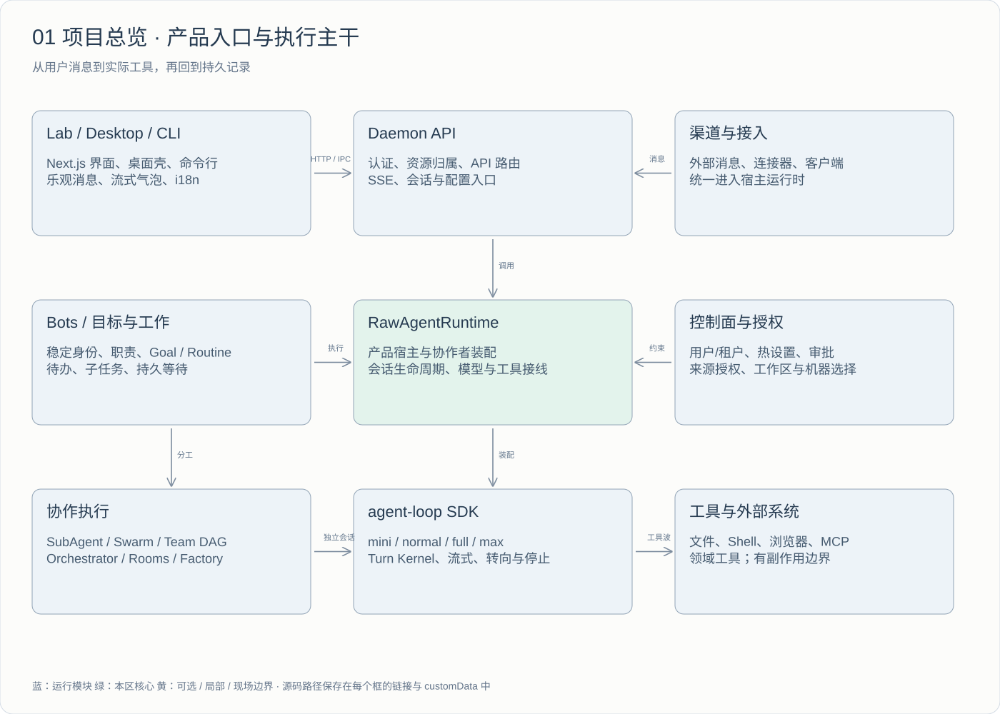

# Raw Agent

[English](README.md) | **简体中文**

> **你只管目标，Bot 全天候为你工作。**
>
> 一个越来越懂你的长期工作 Bot —— 帮你管理消息线索、处理重复任务、整理与消化信息，让工作持续向前；底层由自研零封装的可嵌入内核 **`@mage-ai-lab/agent-loop`** 与多智能体宿主 **`@ppeng/agent-core`** 驱动。

`Node.js >= 22` · `pnpm 10.29.2` · `SDK: @mage-ai-lab/agent-loop` · `已交付 481 项验收规格 / 2,347 条门禁标准` · `Web · Desktop · CLI · Embeddable SDK`

---

## 为什么选择 Raw Agent？

大多数 Agent 工具把「选技能、配连接、拆会话、盯循环、核结果」的复杂度抛给用户——每次干活都像在重新组装一台机器。**Raw Agent 把专业编排收进产品内部，把确定性与控制权留给人与开发者：**

1. **以 Bot 为统一入口，告别编排税**：每只 Bot 拥有稳定身份、实时动态表情、独立模型与思考力度档位、私有记忆、受控技能与一条永久主对话。内置总助手 **Super Bot** 可巡检名册、按接收方自身权限跨 Bot 派工并汇总成果，无需每次手动挑选工作流引擎。
2. **对话 · 目标 · 执行三层解耦，绝不「假装做完」**：回合结束不等于目标达成。系统追踪 8 种目标状态（排队 / 进行中 / 等待 / 受阻 / 暂停 / 完成 / 失败 / 取消），每次交付保留独立快照与版本谱系，并基于文件、构建或真实连接器回执做独立完成核验。
3. **一次有效交付，一键转为例行运转**：完成的交付可直接保存为定时或事件触发的 **例行任务（Routine）**，支持**「仅内容变化时通知」**、错峰补跑、发送前人工审核，既免去每天重复交代，也拒绝无更新刷屏。
4. **多 Bot 群聊不吵闹：稀疏激活、协作与辩论**：群聊内置 **Agentic Sparse-MoE** 相关性选人（无关成员静默、未达门槛可零回复），并支持一键切换 **任务协作模式**（临时负责人派工 + 公开证据汇总）与 **多轮辩论模式**（交替反驳 + 裁判裁决）。
5. **既是开箱即用的本地工作台，也是可嵌入的四档 SDK**：既可通过 **Agent Lab（Web）**、**原生桌面客户端（macOS Apple Silicon / Linux）** 与 **CLI** 直接投入使用；也可将无封装自研的 **`@mage-ai-lab/agent-loop`**（`mini / normal / full / max`，其中 `/mini` 零 Node 内置依赖，可直接进浏览器与插件）嵌入你自己的产品。

---

## 按你的目标快速导航

| 你想做什么 | 第一站 | 深入阅读 |
|------------|--------|----------|
| **立即运行产品（Web / 桌面端）** | [快速开始](#快速开始) | [Agent Lab 工作台导览](#产品能力全景已交付) · [桌面客户端](apps/desktop/README.md) |
| **审阅产品定位、功能与交付边界** | [Bot 完整功能说明](doc/bot/00-functional-guide.md) | [产品需求目录](doc/prd/README.md) · 终端运行 `pnpm feature-map <关键词>` |
| **只把 Agent 循环嵌入浏览器或后端** | [`@mage-ai-lab/agent-loop`](packages/agent-loop/README.md) | [Loop SDK 契约与四档装配指南](skills/agent-loop/SKILL.md) |
| **嵌入完整多智能体运行时宿主** | [`@ppeng/agent-core`](packages/core/README.md) | [Core SDK 稳定 API 与嵌入指南](doc/EMBEDDING_SDK.md) |
| **系统学习工业级 Agent Harness 原理** | [Harness 实现地图](doc/harness/README.md) | [从零构建教程](doc/harness/from-zero/README.md) · [8 分区架构全图](doc/architecture/README.md) |
| **参与开发或派 AI Coding Agent 改代码** | [`AGENTS.md`](AGENTS.md) | [架构手册](doc/ARCHITECTURE.md) · [验收门禁](doc/ACCEPTANCE_GATE.md) · [测试矩阵](doc/TESTING.md) |

---

## 快速开始

前置条件：**Node.js 22+**（需内置 `node:sqlite` FTS5 支持）与 **pnpm 10.29.2**。

### 1. 一键启动 Agent Lab（零 `.env` 界面优先配置）

```bash
corepack enable
corepack prepare pnpm@10.29.2 --activate
pnpm install
pnpm run build
pnpm run dev
```

1. 打开**终端打印的 Agent Lab 地址**（默认首选 Lab `23000` / Daemon `27070`，端口占用时自动顺延并写入 `.agent-state/dev-lab.ports.json`）。
2. 默认首页直达 **Bot 工作台**。点击对话区「**配置模型**」，填入任意 OpenAI / Anthropic 兼容服务商的 Base URL 与 API Key，一键自动发现模型即可开聊——**首次体验无需手抄 `.env`**（演示视频：[doc/lab/lab-model-setup-autodiscover.mp4](doc/lab/lab-model-setup-autodiscover.mp4)）。
3. 在 macOS / Linux 上按 `Ctrl+C` 退出开发启动器时，编译器、Daemon 与 Next 进程组会自动联动清理，重启可直接复用原端口。

不配置真实模型密钥时，也可以直接跑隔离的启发式契约自检：

```bash
pnpm run agent:eval:fast --exit-on-fail
```

### 2. 原生桌面客户端（macOS Apple Silicon & Linux）

Electron 桌面版内置独立 Daemon 与 Web 控制台，数据持久化在系统用户目录，并支持**带完整备份与自动回滚校验的本地安全升级**（菜单「`Raw Agent → 更新客户端…`」）：

```bash
pnpm run build:desktop
# 产物：apps/desktop/release/RawAgent-<version>-<os>-<arch>.{dmg,AppImage}
```

支持平台：**macOS arm64（`.dmg`）**、**Linux x64 / arm64（`.AppImage`）**（Windows 与 Intel Mac 不打包；未公证 DMG 首次打开说明见 [`apps/desktop/README.md`](apps/desktop/README.md)）。

---

## 产品能力全景（已交付）

> 以下能力均已按仓库 [`acceptance/*.yaml`](acceptance) 通过单机软件阶段验收（`implemented`）。完整台账可通过 `pnpm feature-map` 或 [`doc/prd/README.md`](doc/prd/README.md) 按自然语言检索。

### 1. Bot 工作台与丝滑主对话
- **名册与组织**：默认总助手 **Super Bot** + 开箱即用的 **模拟面试官** + 自定义专业 Bot；支持置顶、可折叠功能分组、拖拽编组、鼠尾草绿深浅色双主题与中英双语（`zh` / `en`）热切换。
- **永久主对话与斜杠命令**：压缩、停止、换模型均不更换主对话身份。整句 `/new` 在窗口达 **50% / 85%** 时做两级增量结构化摘要（完整保留工具调用配对与可检索原文）；`/stop` 即时止损；`/model` 切换或固定模型；单个 Bot 还可独立固定**思考力度**（关闭 / 低 / 中 / 高）。
- **实时插话（Steer）、回顾与幽灵建议**：Bot 执行中发追问即刻上屏并在下一轮转向（冲突工具波在启动前自动取消）；离开 3 分钟回来自动生成一行 **会话回顾**（或发 `/recap` / `/回顾` 当场查看）；回复结束后空输入框提供按 `Tab` 采纳的模型下一步建议。
- **原文侧聊（Sidechat）与多模态草稿**：框选任意回复词句即可在右侧发起独立追问、通俗解释或类比，支持一键凝练成一句话批注并跨会话检索；支持文件与图片拖拽入框、按会话隔离草稿与本机桌面通知。

### 2. 多目标自主推进与多 Bot 协同
- **多目标与收尾跟进**：自动区分新目标、追加约束、进度查询与闲聊；2 件以上在途工作自动展开「目标与进展」面板；内置 **收尾跟进（Finish Check & Wake）** 防止「嘴上说稍后处理却提前停机」，服务重启后自动释放陈旧锁并补发终态通知。
- **多粒度协作引擎**：支持单聊直接委派 `bot_delegate`（严格执行接收方自身权限，杜绝借身份提权）、**Sparse-MoE 群聊**、**群任务协作**、**群多轮辩论**、**Team DAG**、**Swarm 流水线**（队友完成后须经独立审查者 + 真实跑测双重门禁）与 **Orchestrator**。
- **可视化协作全景图**：「任务 → 工作流」内置多 Bot 协作关系画布，支持点击头像/连线核查回执、费用与来源会话，并可动态回放近期协作交接轨迹。

### 3. 五层记忆、每日复盘、调教闭环与知识库
- **可溯源五层记忆（`AgentMemoryStore`）**：覆盖 `session.scratch` / `session.long` / `user` / `team` / `project`，严格隔离各 Bot 私有记忆；记录来源消息/文件与替换历史，自动过滤「这次先这样」的临时指令，纠错后新值覆盖旧值而不拼接矛盾事实。
- **每日复盘（Daydream）与技能沉淀**：后台按证据分段执行每日复盘；对话内确认一次即可将有效方法提炼为可复用技能（[`doc/SKILL_CAPTURE.md`](doc/SKILL_CAPTURE.md)）；支持仓库 `skills/`、`~/.agents/` 与 Bot 间只读授权共享及分组共享条文。
- **Bot 调教与经验治理**：支持保存职责契约与固定流程技能，经验按 **候选 → 已验证 → 退役** 生命周期登记证据，仅验证通过的经验进入执行上下文（[`doc/bot/BOT_COACHING_PLAYBOOK.md`](doc/bot/BOT_COACHING_PLAYBOOK.md)）。
- **本地知识目录与 Obsidian 联动**：大目录后台非阻塞索引；任意已完成回复可一键「**收藏这条回复**」写入本地 **Obsidian 库**，并在「收藏图谱」按主题浏览；还支持浏览器内只读查看本机 Grok 缓存历史。

### 4. 多模型路由、工具面、软件连接与即时通讯
- **多协议模型与多模态路由**：原生适配 `openai-compatible`（Chat Completions & Responses）、`anthropic-compatible`、无密钥 `heuristic`，支持可选**混合视觉路由（Hybrid VL Router）**与 `vision_analyze`（不兼容结构化输出的上游可关 `RAW_AGENT_USE_JSON_MODE=0`）；工具面覆盖文件读写编辑、`bash`、`bg_run`、`glob`、`web_fetch`、LSP，以及默认需逐次审批的可选外部编程 CLI（`claude_code` / `codex_exec` / `cursor_agent`，见 [`doc/EXTERNAL_AI_CLI.md`](doc/EXTERNAL_AI_CLI.md)）与本机桌面操作开关（[`doc/LCU_COMPUTER_USE.md`](doc/LCU_COMPUTER_USE.md)）。
- **软件连接器与外部交接**：支持 HTTP、OpenAPI 导入（可筛只读操作）与 **MCP（stdio / 连接器）**，凭证写入密钥库不回显；支持授权外部系统或远端 Agent 向指定 Bot 提交独立任务（[`doc/EXTERNAL_AGENT_HANDOFF.md`](doc/EXTERNAL_AGENT_HANDOFF.md)）。
- **IM 渠道接入**：支持 **飞书** 双向对话（含发送前记账与重启重放）、**企业微信** 桥接/群机器人、**Slack** 入站事件唤醒与通用 Webhook（[`doc/IM_AGENT_INTEGRATION.md`](doc/IM_AGENT_INTEGRATION.md)）。
- **对话内交互卡片（A2UI v0.9）与领域能力包**：热开启后可在气泡内流式渲染表单与按钮，点击动作自动合成下一轮输入（[`doc/A2UI.md`](doc/A2UI.md)）；内置 `@ppeng/agent-sre`（只读运维巡检）与 `@ppeng/agent-stock`（行情/基本面/模拟源）热插拔领域包，工作区另含 `agent-homeiot`、`agent-erp` 扩展包。
- **PTC 动态工作流与动态工具厂**：通过 `ptc_exec` 生成异步 JS 编排只读工具与子任务，并可将高频代码单元收割为会话粘滞的具名动态工具（[`doc/PTC_DYNAMIC_WORKFLOW.md`](doc/PTC_DYNAMIC_WORKFLOW.md)、[`doc/DYNAMIC_TOOLS.md`](doc/DYNAMIC_TOOLS.md)）。

### 5. 纵深安全、沙箱隔离与缓存经济学
- **精细权限与会话级放行**：每只 Bot 独立权限档位（计划 / 自动 / 二次确认完全放行）；审批卡支持「**本会话始终允许**」（严格按 `会话 × 工具 × 沙箱隔离方式` 精确绑定，随时可撤销，10 分钟未批自动过期失败）。
- **OS 沙箱与零明文保险库（User Vault）**：子进程统一经 `sanitizeSpawnEnv()` 剥离注入向量，macOS `sandbox-exec` / Linux `bwrap` 拦截 `~/.ssh`、`~/.aws` 等敏感目录，工具回流自动脱敏；登录密码、银行卡与验证码存入 **User Vault**，仅向模型暴露 `uvref:` 不透明引用完成表单填充，明文绝不进入提示词或日志。
- **轮内退化看门狗与 Magpie 缓存观测**：流式复读看门狗（命中中止并干净重答一次）+ 思考空转看门狗 + 跨轮 `LoopGuard` / `RiskEngine`；追问请求保持开头稳定前缀逐字节不变以最大化上游 KV 缓存命中，并由内置 **Magpie 面板** 实时监控各模型缓存命中率与持续退化告警。

---

## 5 分钟嵌入你的应用（双层 SDK）

不需要 Web 控制台或守护进程？你可以按需嵌入纯循环内核或完整产品宿主：

### 方案 A：轻量循环内核 `@mage-ai-lab/agent-loop`（支持浏览器 `/mini` 到全功能 `max`）

已发布至 npm（[`@mage-ai-lab/agent-loop`](packages/agent-loop/README.md) + `@mage-ai-lab/api-types`），提供 `step() / run() / for await / steer() / abort() / fold()`，原生支持图片 / 音频 / 视频 `MediaPart`（OpenAI、`qwen-omni`、Anthropic）：

```bash
pnpm add @mage-ai-lab/agent-loop
```

```ts
import { createAssembledLoop, OpenAiChatAdapter } from '@mage-ai-lab/agent-loop';
import { createDefaultMemoryStore, DEFAULT_EMBED_AGENT } from '@mage-ai-lab/agent-loop/mini';

const { store, surface } = createDefaultMemoryStore({ agent: DEFAULT_EMBED_AGENT });
const session = surface.createSession({ title: 'demo', mode: 'chat', agentId: DEFAULT_EMBED_AGENT.id });
surface.appendMessage(session.id, 'user', [{ type: 'text', text: '帮我查一下上海今天的天气' }]);

const loop = await createAssembledLoop({
  preset: 'full', // mini（零 Node 依赖，可进浏览器/插件）| normal | full | max
  io: {
    store,
    model: new OpenAiChatAdapter({
      apiKey: process.env.OPENAI_API_KEY!,
      baseUrl: process.env.OPENAI_BASE_URL ?? 'https://api.openai.com/v1',
      model: 'gpt-4o',
      useJsonMode: false,
    }),
    tools: [{
      name: 'fetch_weather',
      description: '查询城市天气',
      inputSchema: { type: 'object', properties: { city: { type: 'string' } }, required: ['city'] },
      approvalMode: 'never',
      sideEffectLevel: 'none',
      execute: async (_ctx, args) => ({ ok: true, content: `${String(args.city)}：晴，22°C` }),
    }],
  },
});

const handle = loop.createHandle!(session.id);
await handle.run();
console.log(await handle.fold());
```

### 方案 B：完整多智能体宿主 `@ppeng/agent-core`

直接在你自己的 Node.js 进程里实例化 `RawAgentRuntime`，获得 SQLite 持久化、工作区隔离、审批、Skills 与领域包挂载（详见 [`doc/EMBEDDING_SDK.md`](doc/EMBEDDING_SDK.md)，运行 `pnpm run test:examples` 可一次体验 `01`–`07` 全部无密钥示例）：

```ts
import { RawAgentRuntime, HeuristicModelAdapter } from '@ppeng/agent-core';

const runtime = new RawAgentRuntime({
  repoRoot: process.cwd(),
  stateDir: './.my-agent-state',
  modelAdapter: new HeuristicModelAdapter(), // 或 createModelAdapterFromEnv(process.env)
});

const session = runtime.createChatSession({ message: '你好，请自我介绍' });
await runtime.runSession(session.id);
console.log(runtime.getLatestAssistantText(session.id));
```

---

## 架构与代码版图



> 完整 8 分区矢量图与可编辑 `.excalidraw` 源文件（每个模块框均带真实源码路径索引）见 [`doc/architecture/README.md`](doc/architecture/README.md)。

```text
Agent Lab (Next.js 15) / Desktop (Electron) / CLI / IM & Connectors
                                ↓  HTTP / SSE / 同源 Bearer 代理
                  apps/daemon（认证 · 路由 · 调度器 · 健康检查）
                                ↓
         packages/core · RawAgentRuntime（Bot / Goal / Memory / Sandbox / Vault）
                                ↓  注入 model / tools / storage / hooks
     packages/agent-loop · createAssembledLoop（默认 kernel=agent-loop, preset=max）
                                ↓
         Turn Kernel → 构建上下文 → 模型流式推理 → 工具波与审批 → 下一轮 / 收尾核验
```

### Monorepo 目录结构

| 路径 | 包名 | 职责说明 |
|------|------|----------|
| `packages/agent-loop` | `@ppeng/agent-loop`（npm: `@mage-ai-lab/agent-loop`） | 自研可嵌入 Turn 内核、四档装配、模型适配、流式看门狗与会话控制 |
| `packages/api-types` | `@ppeng/api-types`（npm: `@mage-ai-lab/api-types`） | Daemon ↔ Lab 共享 HTTP 视图类型与浏览器安全查询辅助 |
| `packages/core` | `@ppeng/agent-core` | 产品宿主运行时：Bot、Goal、五层记忆、沙箱、保险库、工具、Swarm、编排与存储 |
| `packages/daemon-client` | `@ppeng/daemon-client` | CLI 与外部工具复用 Daemon HTTP/SSE 的类型化客户端 |
| `packages/capability-gateway` | `@ppeng/agent-capability-gateway` | IM 渠道桥接（飞书 / 企微 / Slack / Webhook）与外部信息源网关 |
| `packages/agent-sre` · `agent-stock` · `agent-homeiot` · `agent-erp` | `@ppeng/agent-*` | 可插拔领域身份与工具包（内置默认展示 SRE 只读值守与行情分析两套参照包） |
| `apps/web-console` | `@ppeng/agent-lab-web` | **Agent Lab**：Next.js 15 App Router Web 工作台（`/api/*` 服务端代理至 Daemon） |
| `apps/daemon` | `@ppeng/agent-daemon` | 本地 HTTP/SSE 服务、定时与目标调度器、`/api/readiness` 健康探针 |
| `apps/desktop` | `@ppeng/agent-desktop` | **Raw Agent Desktop**：Electron 桌面客户端（macOS arm64 / Linux x64 & arm64） |
| `apps/cli` | `@ppeng/agent-cli` | 命令行交互、任务与审批操作、`self-heal` 自愈控制与重启确认 |

---

## 工程质量与形式化门禁

我们不靠「跑通一次 Demo」宣称稳定，而是用多层自动化门禁锁住每一次提交：

- **可执行验收标准门禁（`pnpm run test:acceptance`）**：`481` 份已实现规格、`2,347` 条 `Given / When / Then` 标准全部与 `1,165+` 个可运行测试文件中的 `[AC:<id>#<AC-n>]` 标签双向绑定（详见 [`doc/ACCEPTANCE_GATE.md`](doc/ACCEPTANCE_GATE.md)）。
- **可执行不变量与形式化验证（`pnpm run test:formal`）**：覆盖工具调用/结果配对、会话生命周期、重启恢复与并发写入不变量（[`doc/formal/README.md`](doc/formal/README.md)）。
- **CRAP 复杂度 × 覆盖率棘轮（`pnpm run test:crap`）与变异测试（`pnpm run test:mutation`）**：严控圈复杂度膨胀与无效断言（[`doc/CRAP_GATE.md`](doc/CRAP_GATE.md)）。
- **真实路径性能与缓存门禁（`pnpm run bench:lab`）**：对首页加载、会话首包延迟与提示词缓存前缀稳定性做回归卡点。
- **从用户原话直达源码（`pnpm feature-map`）**：输入任意功能叫法（如 `pnpm feature-map 侧聊`），秒级定位界面入口、源码文件、验收规格与回归测试命令。

---

## 商业愿景与诚实交付边界

产品的长期演进路径是：**从一只懂你的个人 Bot → 多角色虚拟员工团队 → 数字任务的「黑灯软件工厂」**（需求进入 → Super Bot 拆分派工 → 专业 Bot 执行 → 自动跑测与独立验收 → 汇总交付并沉淀例行任务）。

为了确保评估者、接入方与团队对当前阶段有 100% 透明的预期，我们严格区分**已交付的软件能力**与**待现场验证/规划中的方向**：

- **已交付组成件 vs. 商业北极星**：「24 小时虚拟员工」与「黑灯软件工厂」是建立在现有多目标、例行任务、群协作与多机配置之上的商业落地方向，**不代表**已出售开箱即用的固定岗位套餐，也**不构成** 7×24 可用性 SLA 或无人值守替代承诺。
- **多机软件工厂与平台切片**：Super Bot 配置远程 SSH 机器别名、发现仓库与发起**只读试跑**已实现（`superbot-factory-setup`）；跨机器连续盯梢与端到端无人值守生产发布仍需按具体业务流程完成现场验收（见 [`doc/SINGLE_HOST_COMPLETION.md`](doc/SINGLE_HOST_COMPLETION.md)）。DeepResearch 当前为管线保存与运行入口 MVP；容器级沙箱（`container`）尚未实现；SQLite 仍为主状态库，K8s 多 Pod 会话接管尚未完整认证。
- **运维自愈（Self-heal）与旧演进脚本说明**：`pnpm run start:cli self-heal start` / `pnpm run self-heal:flow` 是面向本仓库维护者的隔离 worktree 白名单跑测与修复流程，不是普通用户的日常聊天按钮。早期自进化流水线（`evolution:*` / `scripts/evolution*`）已于 **2026-10-16 停止维护冻结**，仅保留历史记录供查阅（见 [`scripts/evolution/DEPRECATED.md`](scripts/evolution/DEPRECATED.md)）。

---

## 常用命令速查

| 命令 | 说明 |
|------|------|
| `pnpm run dev`（或 `pnpm run dev:lab`） | 并行启动 Daemon + Agent Lab 开发环境并自动绑定端口代理 |
| `pnpm run build` | 编译全部 TypeScript 工作区包并构建 Next.js 生产前端 |
| `pnpm run test:unit` | 运行工作区核心与前端/脚本单元测试（`node:test`） |
| `pnpm --filter @ppeng/agent-loop run test` | 运行 `@ppeng/agent-loop` 的 Vitest 测试套件 |
| `pnpm run test:acceptance` | 秒级静态校验 `acceptance/*.yaml` 与测试标签完整性 |
| `pnpm run test:formal` | 运行配对、生命周期、重启与并发形式化验证 |
| `pnpm run test:e2e` | 自拉起隔离随机端口与同源 Token 的 Daemon + Lab 并执行 Playwright |
| `pnpm run ci` | 本地完整发布门禁（build + 性能 + unit + soak + acceptance + formal + fast eval + package + CRAP + regression + integration + e2e） |
| `pnpm feature-map [关键词]` | 检索产品功能台账、实现入口与绑定回归测试（支持 `--json` / `--core`） |
| `pnpm run start:daemon` / `pnpm run pm2:start` | 直接启动或使用 PM2 守护运行受监督的 Daemon |
| `pnpm run start:cli` | 启动命令行工具（`chat`、`send`、任务审批、`self-heal` 等） |
| `pnpm run build:desktop` | 打包当前系统架构对应的 Electron 桌面安装包 |
| `pnpm run doctor` / `pnpm run ai:tools` | 本机运行环境健康诊断 / 检测 `claude`、`codex`、`cursor` 等外部 CLI |

---

## 配置原则与安全隐私

- **界面优先，少堆环境变量**：模型供应商、循环档位（`GET/PATCH /api/loop/settings`）、沙箱模式、技能路由、收尾跟进、A2UI 与领域包开关等均走 **Agent Lab 设置界面 + SQLite 持久化热配置**，保存后按各自范围立即生效，无需反复改 `.env` 重启。
- **环境变量职责聚焦**：`.env` 仅用于上游密钥与地址（`RAW_AGENT_API_KEY`、`RAW_AGENT_BASE_URL`、`RAW_AGENT_MODEL_NAME`、可选视觉路由 `RAW_AGENT_VL_*`）、进程引导（端口、`RAW_AGENT_AUTH_TOKEN`、可选 OAuth `RAW_AGENT_OAUTH_*`）及 CI 回退。完整索引见 [`.env.example`](.env.example) 与 [`doc/ENV_REFERENCE.md`](doc/ENV_REFERENCE.md)。
- **安全基线**：
  - **切勿提交 `.env` 或 `gateway.config.json`**：只以 `.env.example` 与 `gateway.config.example.json` 为模板；一旦密钥误入日志或提交记录请立即轮换。
  - **同源代理与鉴权**：生产或局域网部署请设置 `RAW_AGENT_AUTH_TOKEN`（Next 服务端代理自动注入 Bearer，浏览器端不暴露 Token）并按需收敛 `RAW_AGENT_CORS_ORIGIN`，切勿将未鉴权 Daemon 暴露至公网。

---

## 给 AI Coding Agent 的协作指引

如果你是正在本仓库工作的 **Cursor、Claude Code、Codex 或 Antigravity**：

1. **先读 [`AGENTS.md`](AGENTS.md)**：了解界面优先配置、前端 i18n（`useI18n` 中英同 key）、Web 控制台 CRAP 0% 覆盖棘轮规则与审查合并约定。
2. **定位产品行为先跑 `pnpm feature-map <词>`**：修改用户可见行为或仓库技能后，按 [`skills/product-prd/SKILL.md`](skills/product-prd/SKILL.md) 更新说明并运行 `node scripts/prd/build-catalog.mjs`。
3. **验收优先工作流**：新需求或行为变更按 [`skills/acceptance-first/SKILL.md`](skills/acceptance-first/SKILL.md) 编写 `acceptance/<id>.yaml` 与带 `[AC:<id>#<AC-n>]` 标签的测试，跑通 `pnpm run test:acceptance`。
4. **Loop SDK 契约同步**：凡修改 `packages/agent-loop`，必须同步更新 [`skills/agent-loop/SKILL.md`](skills/agent-loop/SKILL.md)，并跑通该包的 `pnpm run test` 与 `pnpm run build`（确保 `/mini` 不引入任何 Node 内置模块）。
5. **子进程沙箱**：新增 `spawn` 必须走 `sanitizeSpawnEnv()` 或 `SandboxManager`，严禁裸传完整父进程环境。

---

## 文档总入口

完整中英对照手册目录见 **[`doc/README.md`](doc/README.md)**：

- **产品与交互规格**：[Bot 完整功能说明](doc/bot/00-functional-guide.md) · [Bot 01–10 分章目录](doc/bot/README.md) · [产品需求目录](doc/prd/README.md) · [Bot 调教手册](doc/bot/BOT_COACHING_PLAYBOOK.md)
- **原理与架构导读**：[8 分区 Excalidraw 架构图](doc/architecture/README.md) · [Harness 00–20 纵向切片](doc/harness/README.md) · [从零教程](doc/harness/from-zero/README.md) · [架构参考](doc/ARCHITECTURE.md)
- **SDK 与扩展接入**：[Agent Loop SDK 指南](skills/agent-loop/SKILL.md) · [Core 嵌入指南](doc/EMBEDDING_SDK.md) · [领域包开发](doc/DOMAIN_AGENTS.md) · [A2UI 协议](doc/A2UI.md) · [外部任务交接](doc/EXTERNAL_AGENT_HANDOFF.md)
- **质量、运维与路线**：[测试矩阵](doc/TESTING.md) · [CI 与发布门禁](doc/CI.md) · [Docker / Compose / Helm 部署](doc/DEPLOYMENT.md) · [npm 可信发布](doc/NPM_PUBLISH.md) · [长期路线图](doc/ROADMAP.md)

---

## 许可证

仓库根 `package.json` 标记为 **private**；公开 npm 子包（`@mage-ai-lab/agent-loop`、`@mage-ai-lab/api-types`）按各自发布配置分发（详见 [`doc/NPM_PUBLISH.md`](doc/NPM_PUBLISH.md)）。
