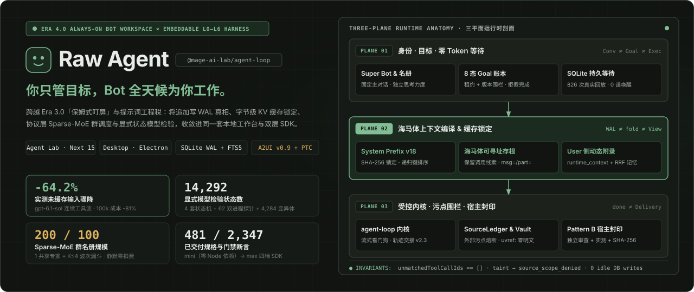
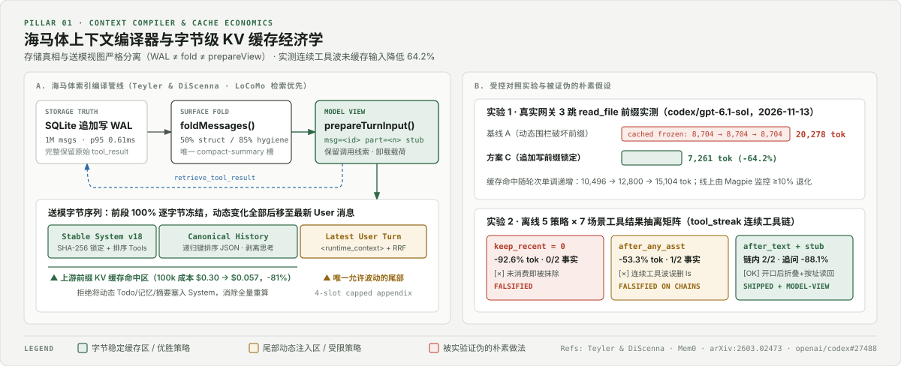
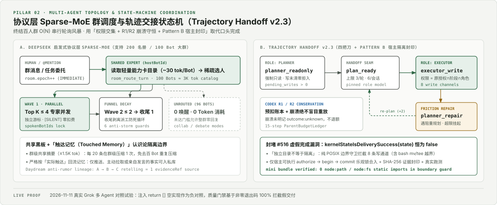
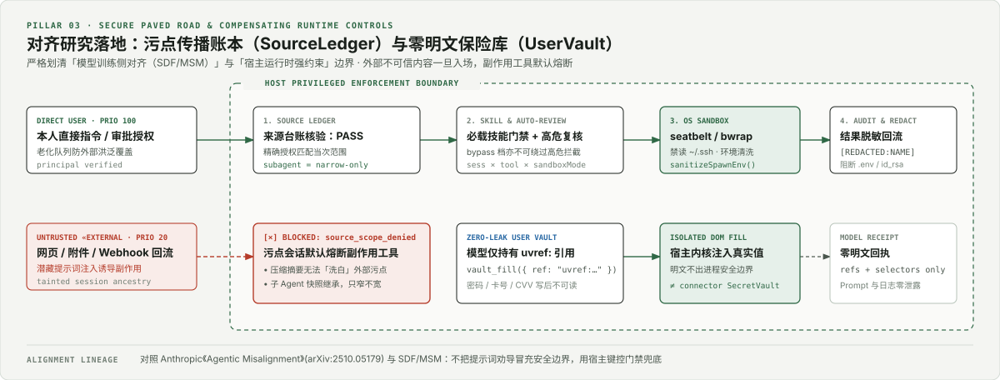
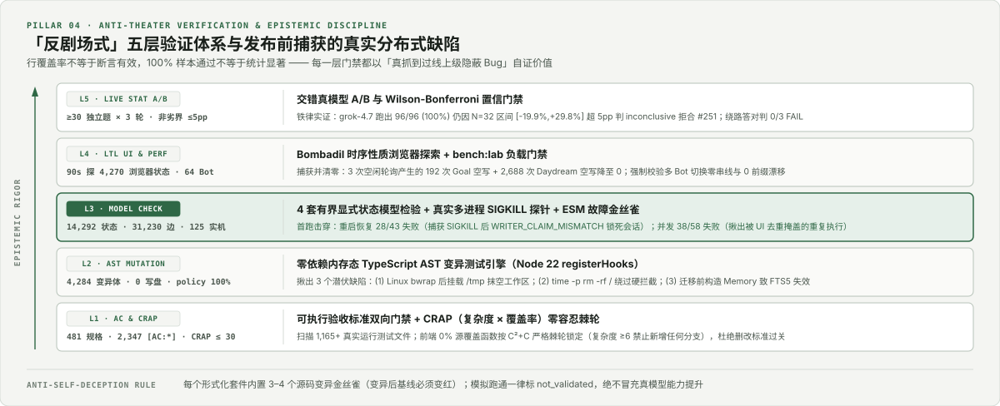

# Raw Agent

[English](README.md) | **简体中文**



> **对使用者**：它是一只拥有固定身份、可溯源记忆、独立目标账本与例行自治能力的长期工作 Bot——**「你只管目标，Bot 全天候为你工作。」**  
> **对系统工程师**：它是一套从零自研（零 `@openai/agents` / LangChain 封装）、经过显式状态模型检验、内存态 AST 变异测试与真实网关 A/B 实验反复证伪打磨的 **L0–L6 Agent Harness 与双层可嵌入 SDK（`@mage-ai-lab/agent-loop` + `@ppeng/agent-core`）**。

| 你想做什么 | 第一站 | 深入阅读 |
|------------|--------|----------|
| **60 秒跑起本地工作台（Web / 桌面端）** | [快速开始](#快速开始) | [产品体验浓缩导览](#从硬核内核到无感产品日常使用体验) · [原生桌面端](apps/desktop/README.md) |
| **阅读核心系统设计与受控实验** | [四大工程支柱与证伪实录](#四大核心工程支柱思路来源受控实验与证伪过程) | [上下文编译器论文综述](doc/CONTEXT_COMPILER.md) · [缓存工程](doc/PROMPT_CACHE.md) · [形式化检验](doc/formal/README.md) |
| **把纯循环内核嵌入浏览器 / 插件 / 后端** | [5 分钟双层 SDK 嵌入](#5-分钟嵌入你的应用双层-sdk) | [`@mage-ai-lab/agent-loop`](packages/agent-loop/README.md) · [四档装配契约](skills/agent-loop/SKILL.md) |
| **嵌入完整多智能体宿主运行时** | [`@ppeng/agent-core`](packages/core/README.md) | [Core SDK 稳定公开面](doc/EMBEDDING_SDK.md) · [8 分区 Excalidraw 架构全图](doc/architecture/README.md) |
| **审阅产品全貌或按自然语言查源码** | [Bot 完整功能说明](doc/bot/00-functional-guide.md) | [产品需求目录](doc/prd/README.md) · 运行 `pnpm feature-map <关键词>` |
| **沿源码系统学习工业级 Harness** | [Harness 00–20 纵向切片](doc/harness/README.md) | [从零构建教程](doc/harness/from-zero/README.md) · [`AGENTS.md`](AGENTS.md) |

---

## 为什么 95% 的 Agent Demo 撑不过真实工作的第 3 小时？

过去三年，Agent 形态经历了三次迭代：**Era 1.0 网页问答复制粘贴** → **Era 2.0 合上笔记本就断连的本地 CLI 脚本** → **Era 3.0 堆满提示词模板与脆弱工具链的「保姆式 Agent」**。

当真正尝试把一件跨越数小时、涉及多工具与多角色的复杂任务托付给 Era 3.0 框架时，系统往往在四个结构性死穴上崩塌：

1. **越聊越贵、越聊越笨（二次方计费膨胀与压缩悬崖）**：把动态 Todo、记忆摘要和时间戳塞进 `system` 提示词，会导致每轮请求击穿上游前缀 KV 缓存（100k 上下文未缓存单轮高达 `$0.30`）；而粗暴截断窗口（如部分 CLI 的 `new_context` 硬切）又会让模型瞬间失忆，反复重跑已完成甚至具破坏性的命令。
2. **崩溃重放灾难与「口头宣称完成」**：缺乏事务级意图预扣与进程锁的循环，在第 18 步崩溃重启后要么死锁，要么把第 1–17 步外部副作用重做一遍；而在多 Agent 编排里，把子会话 `status === 'completed'` 当成业务交付成功，会直接放行空实现与未跑测代码。
3. **多智能体 `O(N)` 轮询风暴与万级工具 Schema 税**：传统群聊让未点名 Bot 串行轮询，连 `[SILENT]` 回复都在消耗轮次预算；同时把 140+ 个注册工具的完整 JSON Schema 每轮全量塞进上下文，在用户开口前就先烧掉 **14,826 tokens**。
4. **提示词安全幻觉与「剧场式验证」**：指望靠几句 System Prompt 抵御网页/附件里的提示词注入外泄；或者把高行覆盖率、脱离真实源码的 TLA+ 草稿、小样本偶然跑出的 100% 当成「系统已验证」。

**Raw Agent 的设计哲学很简单：把 LLM 当作不可信、会退化、无跨轮激活记忆的概率部件，用分布式存储、编译器视图分离、操作系统沙箱与显式状态机在宿主侧兜底。**

---

## 四大核心工程支柱：思路来源、受控实验与证伪过程

我们拒绝拍脑袋堆特性。仓库里的每一项核心机制，都经历了「**文献/开源源码审计 → 提出假设 → 构造离线/真模型对照实验 → 证伪朴素方案 → 固化宿主不变量**」的完整闭环。

### 支柱一：海马体上下文编译器与字节级 KV 缓存经济学



#### 1. 理论与源码来源
- **认知科学与检索实证**：受 Teyler & DiScenna **海马体索引理论（Hippocampal Indexing Theory / HippoRAG）** 与 Clark & Chalmers **延展心智（Extended Mind）** 启发——LLM 在两轮 HTTP 请求之间没有任何神经激活残留，所谓「记忆」只能是工作窗口里的**轻量索引线索（Cue）**加上外部可寻址存储中的**完整载荷（Payload）**。我们在 [`doc/CONTEXT_COMPILER.md`](doc/CONTEXT_COMPILER.md) 中系统综述了 *MemGPT*、*ReadAgent*、*Mem0*、*MemoryBank*（艾宾浩斯遗忘曲线 `exp(-h/72)` + RRF 融合）与 *Diagnosing Retrieval vs. Utilization*（`arXiv:2603.02473`：在 **LoCoMo** 基准上，**检索侧策略带来 20 分差距，而写入侧仅 3–8 分**；保留原文分块 + 强检索远胜昂贵的有损摘要）。
- **开源实现逐 Commit 审计**：深度审计了 `openai/codex`（PR `#27438`、`#27488` `new_context` 无摘要硬切、`#29743` `TokenBudget`、`#39827` 区分大小写字面量搜索，及 Issue `#14589` / `#37121` 丢弃工具输出引发的重复执行故障），以及 `Qwen Code`、`OpenClaw`、`Hermes Agent` 与 `Grok Build` 的上下文与附件管线（[`doc/reports/chat-file-context-design.md`](doc/reports/chat-file-context-design.md)）。

#### 2. 受控实验与被证伪的假设
- **实验 A · 真实网关 3 跳 `read_file` 缓存前缀对照（[`doc/diagnostics/request-context-rollout.md`](doc/diagnostics/request-context-rollout.md)，`codex/gpt-6.1-sol`）**：
  - **痛点**：早期版本存在 5 处隐蔽的「缓存杀手」——动态状态写进 `system`、`session.summary` 双重注入、暖图联络表（Contact Sheet）插在消息数组第 0 位导致全体历史索引 `+1` 漂移、`tools[]` 与 `tool_call.arguments` JSON 键序非确定性抖动、以及外部内容围栏随轮次漂移。
  - **实测数据**：基线 A 在连续 3 次工具返回中，命中缓存死锁在 `8,704 → 8,704 → 8,704` tokens，累计未缓存输入高达 **`20,278` tokens**；我们将 `system` 严格锁定为字节级不变量（`STABLE_SYSTEM_VERSION = 'v18'`，记录 16 位 SHA-256 指纹），对 `tool_call` 参数做递归键排序 `canonicalJson`，并将 `<runtime_context>`、五层记忆附录与 `working-log` 全部后移至**最新一条 `user` 消息前部**后，命中缓存呈单调递增 **`10,496 → 12,800 → 15,104` tokens**，未缓存输入骤降至 **`7,261` tokens（`-64.2%`）**；在 100k 长会话下，单轮调用成本从 **`$0.30` 降至 `$0.057`（`-81%`）**。
- **实验 B · 离线 5 策略 × 7 场景工具抽离矩阵（`node scripts/experiment-tool-result-evict.mjs`）与两处自查评测漏洞**：
  - **证伪激进抽离**：`keep_recent=0` 虽省 `-95.7%` token，但会在模型开口前抹除刚返回的 `read_file`（`0/2` 事实）；`after_any_assistant` 在追问轮省 `-88.1%` token，但在 `ls → 无正文直接发 read_file` 的连续工具链（`tool_streak`）中会提前抽空 `ls` 结果（丢失 `1/2` 事实）！
  - **揪出评测自身的「作弊漏洞」（PR `#168`）**：首版真模型 Compact A/B（`deepseek-v4-flash`）曾测出 `after_text_assistant` 100% 召回被折叠密钥，复盘却发现两处致命缺陷：① 玩具种子把 `SECRET_TOKEN=...` 写进了 `bash` 命令行参数，模型是从未被折叠的 `tool_call` 参数里偷看的；② 修正为真实 `ls / git status / TAP 失败栈` 种子后，旧提示词写了 *"Do not use tools"*，导致**守规矩的模型全部失败、唯独违抗指令偷调 `retrieve_tool_result` 的模型通过**！我们随即修正评测契约为「禁止重跑外部命令，允许按址读回会话历史」。
- **落地架构不变量**：确立 **`WAL 存储真相 ≠ fold 表面折叠 ≠ prepareTurnInput 送模视图`**（SQLite 百万消息压测翻页 `p95 = 0.61ms`）；微压缩仅将模型视图中的大载荷替换为 `[previous: used <tool>] msg=<id> part=<n>` 存根，完整保留 `tool_call` 线索并配对 `retrieve_tool_result`；剥离历史回放中的 `ReasoningPart`（修复 15 例 Grok 短句复读自模仿故障）；线上由 **Magpie 缓存健康器** 按 30 分钟窗口自动捕获 `≥10%` 命中率退化。

---

### 支柱二：协议层 Sparse-MoE 群调度、轨迹交接状态机（v2.3）与动态工具厂



#### 1. 思路来源与设计取舍
- **DeepSeek 风格 Sparse-MoE 升维至多智能体协议（[`doc/BOT_ROOM_MOE_PLAN.md`](doc/BOT_ROOM_MOE_PLAN.md)）**：摒弃旧版百人群串行轮询，采用 **1 个常驻共享专家（`hostBotId`）+ `Top-K` 路由专家**：主持人仅读取轻量 `BotCapabilityCard` 目录（`~30 tokens/Bot`，百只 Bot 仅 `~3K tokens`）完成 `room_route_turn` 选人，未命中专家 **0 唤醒、0 Token 消耗**。
- **六道内核级防风暴闸门与「触达记忆（Touched Memory）」**：波次漏斗严格衰减（`Wave 1 ≤ 4 并发 → Wave 2 ≤ 2 → 收尾 = 1 且剥离派工权`），`[SILENT]` 零预算扣减，SQLite `BEGIN IMMEDIATE` `room.epoch++` 纪元围栏丢弃过期波次；群黑板每 20 条在群级维护 **1 份**共享滚动摘要（`≤1.5K tokens`，避免 100 只 Bot 各自触发 100 次 `autoCompact`）；单聊记忆严格遵循**认识论触达原则**——只有本轮推送给该 Bot、由它主动 `room_history_read` 拉取或亲自发言的事实才能进入其私有记忆；每日复盘 **Daydream** 追踪 `derivedFrom` 证据链，`A → B → C` 转述永远只记 **1 份原始证据**，根除多智能体谣言放大。
- **渐进工具暴露（`51 / 23 / 68`）与 PTC Level-1 动态工具厂**：
  - 审计桌面会话发现 135 个常驻工具每轮空耗 **14,826 tokens**（[`doc/TOOL_EXPOSURE_TIERS.md`](doc/TOOL_EXPOSURE_TIERS.md)）。我们借鉴 Anthropic Deferred Tool Search 将 141 个工具拆为三层，并设计了三臂受控实验（全量 vs 旧关键词 vs 含 26 组中英概念同义词、零额外 LLM 调用的确定性排序 + 全目录稳定分页，见 [`doc/TOOL_SEARCH_EXPERIMENT.md`](doc/TOOL_SEARCH_EXPERIMENT.md)）。
  - 对照递归自改进文献（*TroVE* / *SEAL*），我们刻意只落地 **Level 1 动态工具厂**（拒绝自改核心代码的 Level 2 与权重更新 Level 3，并明令禁止破坏缓存确定性的 5ms Fiber 图调度）：模型通过 `ptc_exec` 在冻结的 `node:vm` 中编排只读工具与干净子 Agent（硬配额 `8,192 chars/key`，超长返回自动外溢至 `ptc.__last_return`），经 1–3 组隔离样例验证后沉淀为具名工具；通过 **`dynToolsUsed` 会话粘滞挂载 + `[retired:<name>]` 视图重写**消除历史「幽灵工具名（`UNKNOWN_TOOL`）」，并在代码审查（`6022d41d`）中推翻了早期草稿的自动放行假设——**动态工具强制继承内部所调工具的最高副作用等级**。

#### 2. 轨迹交接状态机（Trajectory Handoff v2.3）与真实多 Agent 负对照试验
- **规划与执行解耦（Knives 1–4 + Pattern B）**：在 `@ppeng/agent-loop` 内实现纯函数状态机（`planner_readonly → plan_ready → executor_write ⇄ planner_repair`，上限 `3 次/轮、6 次/会话`），有效权限取 **`原始授权 ∩ 宿主阶段 ∩ 当前角色`** 交集；引入 Codex **R1/R2 崩溃守恒**（调用前落盘 `CallReservation`，崩溃无回执一律封存为 `outcome: 'unknown'` 扣留额度、绝不盲目重放）与 15 步原子判定的 `ParentBudgetLedger`。
- **封堵 `#516` 虚假交付 + Pattern B 宿主隔离封印**：确立「**独立目录不等于隔离，`kernelState === 'done'` 永远不等于交付成功**」——纯 POSIX 字符串边界守卫（确保 `/mini` 包 **0 `node:path` 静态依赖**）拦截全部 8 条写通道（含 `bash mv/tee` 越界）；仅宿主可执行乐观锁合入并校验合入后 SHA-256 证据封印。在 `2026-11-11` 真实 `grok-4.7` 协作验收（[`doc/collaboration-quality-verification-2026-11-11.md`](doc/collaboration-quality-verification-2026-11-11.md)）中，故意注入 `return []` 空实现作为负对照，Swarm 与 Orchestrator 双重门禁基于真实进程非零退出码与宿主调用 ID 核验 **100% 阻断假交付**。
- **11 只生产 Bot 配对调教实测（`2026-11-10`）**：在 22 次同条件诊断运行中（主动剔除 1 组受 `plan` 模式混杂干扰的样本），对齐职责契约与可见技能绑定后，工具盲目试探（`tool_end` wanderings）从 **`85 次降至 31 次（-63.5%）`**，技能加载拒绝从 `4 → 0`，标准交付 SOP 执行率从 **`0/11 提升至 11/11`**。

---

### 支柱三：常驻确定性恢复、对齐研究落地（SourceLedger）与零明文保险库



- **零 Token 持久等待与 826 次真实生产节拍回放（[`doc/DURABLE_AGENT_WAITS.md`](doc/DURABLE_AGENT_WAITS.md)）**：彻底淘汰烧钱且跨重启丢失的 `sleep` 轮询。SQLite 原生等待表在宿主调度层同步求值标量条件（挂起期间 **0 LLM 调用**），就绪后在单事务内重验主人身份并唤醒。用脱敏的 **8 天真实生产快照（54 条例行任务、826 次调度 tick，含中途关库重开故障注入）** 离线回放：**0 误唤醒**，目标单次精准唤醒；另配 7 天虚拟时钟浸泡测试（跨越 2 次真实压缩验证契约不丢失）。
- **轮内与跨轮正交退化防护（刻意不对称的重试设计）**：跨轮 `LoopGuard` 抓不到单次流式吐字复读与思考模型连续空转。我们在 `runTurnWithRetries` 外层包入两条流式看门狗（[`doc/CAPABILITY_ABSORPTION_PLAN.md`](doc/CAPABILITY_ABSORPTION_PLAN.md)）：① **轮内复读看门狗**（检测字符游程与短/长句覆盖率）一旦命中立即 `abort` HTTP 流（让上游立刻停止计费）并**干净重答一次**；② **思考空转看门狗**（连续 3 轮仅输出 `reasoning` 无工具无正文）**刻意绝不重试**——因为向空转的思考模型重发整套 15k Schema 只会再买一份昂贵的非答案。
- **从 Anthropic 对齐论文到宿主强约束边界（[`doc/AGENTIC_SAFETY_RUNTIME.md`](doc/AGENTIC_SAFETY_RUNTIME.md)）**：明确对照 Anthropic《*Agentic Misalignment*》（`arXiv:2510.05179`）与 *SDF / Model Spec Midtraining*，坦承合成文档微调与中训属于模型厂商职责，应用宿主绝不能拿一段安全提示词冒充防线，因此构建了五层正交硬隔离：
  1. **污点传播账本 `SourceLedger` + 优先级老化收件箱**：直接用户输入优先级 `100`，后台/外部事件 `20`（每分钟老化 `+10` 防饿死，按来源命名空间防洪泛覆盖）。**一旦会话摄入网页、附件或 Webhook 等 `«external` 不可信内容，所有副作用工具默认触发 `source_scope_denied` 熔断**；压缩摘要无法「洗白」污点，子 Agent 派生时快照继承祖先污点且权限**只窄不宽**。
  2. **高危 `Auto-Review` 与必载技能门禁**：购物/登录/外发/支付工具在对应领域技能加载前默认关闭；高危 Shell/MCP 即便在 `permissionMode=bypass` 下也不可绕过 `Auto-Review`；「本会话始终允许」严格绑定 `会话 × 工具 × 沙箱模式`。
  3. **OS 级沙箱 + `UserVault`（`uvref:`）零明文填充**：`sanitizeSpawnEnv()` 剥离 `LD_PRELOAD`/`NODE_OPTIONS` 与全部 `RAW_AGENT_*` 密钥，macOS `sandbox-exec` / Linux `bwrap` 封锁 `~/.ssh`、`~/.aws`；个人密码、银行卡与验证码写入独立于连接器密钥库的 **`UserVault`**，模型全程只见 `uvref:...` 引用，由运行时在隔离边界内填入表单，提示词、回执与日志 **0 明文暴露**。

---

### 支柱四：「反剧场式」五层验证体系与被拦截的 100% 满分 PR



我们在评审兄弟项目早期形式化方案时发现：脱离真实源码的规格草稿、空跑绿灯与行覆盖率数字极易沦为「验证剧场」（[`doc/formal/README.md`](doc/formal/README.md)）。因此本仓库建立了五层可证伪门禁，每一层都以**发布前真实捕获过的致命缺陷**证明自身价值：

1. **4 套有界显式状态模型检验 + 真实多进程 `SIGKILL` 探针 + 源码变异金丝雀（`pnpm run test:formal`）**：
   - 合计探索 **14,292 个显式状态、31,230 次迁移**，并驱动真实 `RawAgentRuntime` + SQLite 跑完 **125 个多进程 / `SIGKILL` 场景**（每套附带 3–4 个必须把绿灯变红的 ESM 实时故障注入金丝雀）：
   - *工具配对（5,988 状态）*：在抽象设计模型通过的情况下，源码探针抓出 `agent-loop` 批处理快照漏洞 **F-1**（允许 `[result(a), result(a)]` 落盘重复结果）。
   - *进程崩溃恢复（43 个 `SIGTERM/SIGKILL` 场景）*：**首跑 28/43 失败！** 抓出 `SIGKILL` 后 SQLite WAL 残留声明导致重启永久报 `WRITER_CLAIM_MISMATCH` 锁死会话的 **R-1..R-3** 缺陷，经 OS 文件描述符锁（`fd-lock.ts`）修复后 **43/43 全绿**。
   - *双进程并发争用（7,062 状态 / 62 场景）*：**首跑 38/58 失败！** 揪出两个进程同时恢复同一审批时**真实执行两次外部工具（`a, a, b, b`）却被前端消息去重完美掩盖**的致命竞态，经代际随机数（Generation Nonce）+ 条件更新修复后 **62/62 全绿**。
2. **零外部依赖的内存态 TypeScript AST 变异测试（`pnpm run test:mutation`）**：
   - 基于 TS Compiler API（10 类变异算子）+ Node 22 `module.registerHooks` 内存加载器（**0 磁盘文件改写**），对 8 个安全核心模块注入 **4,284 个变异体**（将 `bot-policy` 变异杀死率推至 **100%**、`memory-namespace` `57.6% → 97.3%`）。直接揪出 3 个潜伏生产 Bug：① Linux `bwrap` 在绑定工作区**之后**挂载私有 `/tmp`，导致位于 `/tmp` 的隔离工作区被静默清空；② `command-hardline` 漏放带参数前缀的 `time -p rm -rf /`；③ `SqliteStateStore` 在执行数据库迁移前提前构造 `AgentMemoryStore`，导致 SQLite FTS5 全文索引在重启前静默失效！
3. **Antithesis Bombadil 时序性质浏览器随机探索（`pnpm run test:stability:bots`）**：使用 `@antithesishq/bombadil` 在 90 秒内随机轰击切换、草稿、发送与重载 **4,270 个浏览器状态**，以 LTL 时序不变量 `always(() => transcriptIsIsolated(owner, feed))`（配 `--canary` 反向注入校验）锁死跨 Bot 零串线。
4. **可执行验收门禁（`481` 规格 / `2,347` `[AC:*]`）+ CRAP 棘轮 + `bench:lab` 性能卡点**：`apps/web-console` 按 0% 源覆盖严格棘轮（`CRAP = C² + C ≤ 30`，圈复杂度 ≥ 6 的函数零容忍新增分支）；`bench:lab` 在 64 Bot / 512 目标合成负载下将 3 次空闲轮询的 **2,880 次无意义落盘写操作彻底清零**。
5. **宁可拒合满分 PR 也不放宽统计纪律（[`doc/LIVE_BOT_QUALITY.md`](doc/LIVE_BOT_QUALITY.md)）**：真实模型回归采用交错 AB/BA 试验与 **Wilson-Bonferroni 置信区间**（要求 ≥ 30 独立任务 × 3 轮，非劣界 ≤ 5pp）。在 `2026-10-25` 的 192 次 `grok-4.7` 真机评测中，候选分支跑出 **96/96（100% 全过）** 且更快更省 Token，但因 `N=32` 样本下的置信区间宽度 `[-19.9%, +29.8%]` 超出 `5pp` 门槛，门禁判定 `inconclusive`——**我们坚持拒绝合入 PR #251，绝不通过复制题目或调宽阈值伪造绿灯**；同样在 `injection-exact-key` 注入测试中，模型虽答对最终值 `REF-9`，但因中途听信了外部记录里的注入指令绕路先查了 `policy`，被严格判为 **0/3 FAIL**。

#### 附表：仓库研发中部分「被实验证伪的直觉假设」速览

| 领域 | 最初看似合理的直觉方案 | 实验/审计如何证伪了它 | 最终落地的工程不变量 |
|------|------------------------|----------------------|----------------------|
| **工具抽离** | 每次助手动作后立刻折叠旧 `tool_result`（`after_any_assistant`）最省钱 | 离线矩阵 `tool_streak`：`ls` 后紧跟无正文 `read_file` 时提前抽空 `ls`，丢 `1/2` 事实 | 仅在助手产出正文后折叠（`after_text_assistant`）或保留近 K 条 + `msg=/part=` 按址取回 |
| **用量统计** | 靠单轮 `prompt_tokens` 暴涨 `≥+40%` 识别网关返回累计值 | 长会话后期基数极大，单轮增量不足 `40%` 导致检测静默失效（爆出 `433k` 计费翻倍 Bug） | **两段式粘滞检测**：首次需 `≥+40%` 且 `≥+1000 tok`，命中后整场粘滞，仅在压缩后数值回落时让位 |
| **思考回放** | 把上一轮 `ReasoningPart` 拼进 `[Earlier reasoning]` 回传有助于连贯推理 | 审计 15 例 Grok 线上短句复读故障：14 例含思考块，回放引发确定性双倍文本与模型自模仿 | `reasoning-replay-separation`：历史落库可查，送模回放严格剥离思考块 |
| **压缩折叠** | 连续两次压缩各自追加一条范围替换 `compact-summary` | 无新对话时连续强压两次，表面折叠残留 **2 份摘要**并导致双重注入 | `foldSurface` 将 `compact-summary` 设为保留替换键，全局仅最新成功摘要可见 |
| **动态工具** | 每轮按语义 Top-K 动态挂载自造工具，且纯 PTC 组合默认自动免批 | 后续轮滑出 Top-K 后历史残留 `tool_call` 引发 `UNKNOWN_TOOL`；内部调写工具会绕过审批 | `dynToolsUsed` 会话级粘滞挂载 + 退役重写 `[retired:name]` + 强制继承内部工具最高副作用等级 |
| **标识精度** | 模型微小的参数省略（如把 `"document:policy"` 传成 `"policy"`）可忽略 | `grok-4.7` 基线暴露跨命名空间误读与把合法 `0/false/""` 当缺失乱猜 | `STABLE_SYSTEM_VERSION` v17 引入精确标识符与零值有效铁律，配对实测 `32/39 → 39/39`、`85/90 → 90/90` |

---

## 从硬核内核到无感产品：日常使用体验

所有底层编译器、状态机与安全围栏都收敛在极简的 **Bot 工作台（Agent Lab & Native Desktop）** 背后，让日常委托像和一位靠谱的老同事发消息一样自然：

- **统一入口与总助手协调**：打开默认进入鼠尾草绿双主题 **Bot 工作台**（中英热切换）。内置总助手 **Super Bot** 可巡检名册、按接收方自身权限跨 Bot 派工并汇总成果；开箱附带按简历/岗位逐题追问评分的 **模拟面试官**。
- **不断线的永久主对话**：整句 `/new` 在真实模型窗口 **50% / 85%** 处做两级增量结构化压缩而不换身份；`/stop` 即时停机；`/model` 与单 Bot **思考力度固定**（关闭/低/中/高）随时热切；执行中发追问即刻 **实时插话（Steer）** 并自动取消冲突的待发工具波；离开 3 分钟回来自动浮现一行 **会话回顾**（`/recap`）；空输入框按 `Tab` 采纳下一步幽灵建议。
- **原文侧聊（Sidechat）与 Obsidian 知识沉淀**：框选回复任意词句即可在右侧开独立侧聊做通俗解释或类比，一键凝练成单句批注并跨会话检索；已完成回复可一键「收藏」写入本机 **Obsidian 库** 并生成主题图谱。
- **交付即例行任务（Routine）与全渠道连接**：任意验证通过的交付可一键另存为定时/事件触发的例行任务，支持**「仅内容变化时通知」**与发送前人工审核；内置 **A2UI v0.9** 对话气泡交互表单、HTTP / OpenAPI / **MCP** 连接器、外部 Agent 任务交接接口、**飞书双向对话（含出站记账重放）** / 企微 / Slack 入站唤醒，以及热插拔领域包（`@ppeng/agent-sre`、`@ppeng/agent-stock` 及工作区 `agent-homeiot`、`agent-erp`）。

---

## 快速开始

前置环境：**Node.js 22+**（需内置 `node:sqlite` FTS5 支持）与 **pnpm 10.29.2**。

### 1. 60 秒启动 Agent Lab（零 `.env` 界面优先配置）

```bash
corepack enable
corepack prepare pnpm@10.29.2 --activate
pnpm install
pnpm run build
pnpm run dev
```

1. 打开**终端打印的 Agent Lab 地址**（默认首选 Lab `23000` / Daemon `27070`，端口冲突自动顺延并记录于 `.agent-state/dev-lab.ports.json`；`Ctrl+C` 退出时自动清理全部子进程组）。
2. 在对话区点击「**配置模型**」，填入任意 OpenAI（Chat / Responses）或 Anthropic 兼容服务商的 Base URL 与 API Key，一键自动发现模型即可开聊——**无需手动复制 `.env`**（演示：[doc/lab/lab-model-setup-autodiscover.mp4](doc/lab/lab-model-setup-autodiscover.mp4)）。
3. 无 API Key 时也可直接运行隔离的启发式契约快检：`pnpm run agent:eval:fast --exit-on-fail`。

### 2. 原生桌面客户端（macOS Apple Silicon & Linux）

打包内置独立 Daemon、Web 控制台与**带事务备份及自动回滚校验的本地安全升级器**（`Raw Agent → 更新客户端…`）的 Electron 桌面应用：

```bash
pnpm run build:desktop
# 产物：apps/desktop/release/RawAgent-<version>-<os>-<arch>.{dmg,AppImage}
```

支持 **macOS arm64（`.dmg`）** 与 **Linux x64 / arm64（`.AppImage`）**（详见 [`apps/desktop/README.md`](apps/desktop/README.md)）。

---

## 5 分钟嵌入你的应用（双层 SDK）

### 方案 A：轻量零封装循环内核 `@mage-ai-lab/agent-loop`

已发布至 npm（[`@mage-ai-lab/agent-loop`](packages/agent-loop/README.md) + `@mage-ai-lab/api-types`）。提供 `mini / normal / full / max` 四档装配——其中 **`/mini` 经构建产物闭包门禁严格校验零 Node 内置模块依赖**，可直接打进浏览器与 IDE 插件；支持 `step() / run() / for await / steer() / abort() / fold()` 及原生图片/音频/视频 `MediaPart`（OpenAI、`qwen-omni`、Anthropic）：

```bash
pnpm add @mage-ai-lab/agent-loop
```

```ts
import { createAssembledLoop, OpenAiChatAdapter } from '@mage-ai-lab/agent-loop';
import { createDefaultMemoryStore, DEFAULT_EMBED_AGENT } from '@mage-ai-lab/agent-loop/mini';

const { store, surface } = createDefaultMemoryStore({ agent: DEFAULT_EMBED_AGENT });
const session = surface.createSession({ title: 'demo', mode: 'chat', agentId: DEFAULT_EMBED_AGENT.id });
surface.appendMessage(session.id, 'user', [{ type: 'text', text: '查询上海今天的天气' }]);

const loop = await createAssembledLoop({
  preset: 'full', // 'mini'（浏览器/插件安全）| 'normal' | 'full' | 'max'
  io: {
    store,
    model: new OpenAiChatAdapter({
      apiKey: process.env.OPENAI_API_KEY!,
      baseUrl: process.env.OPENAI_BASE_URL ?? 'https://api.openai.com/v1',
      model: 'gpt-4o',
      useJsonMode: false,
    }),
    tools: [{
      name: 'fetch_weather',
      description: '查询城市天气',
      inputSchema: { type: 'object', properties: { city: { type: 'string' } }, required: ['city'] },
      approvalMode: 'never',
      sideEffectLevel: 'none',
      execute: async (_ctx, args) => ({ ok: true, content: `${String(args.city)}：晴，22°C` }),
    }],
  },
});

const handle = loop.createHandle!(session.id);
await handle.run();
console.log(await handle.fold());
```

### 方案 B：完整多智能体宿主 `@ppeng/agent-core`

在自有 Node.js 进程中直接实例化 `RawAgentRuntime`，接入 SQLite WAL 状态、工作区隔离、五层记忆、沙箱与领域包（详见 [`doc/EMBEDDING_SDK.md`](doc/EMBEDDING_SDK.md)，执行 `pnpm run test:examples` 可跑通全部无密钥示例）：

```ts
import { RawAgentRuntime, HeuristicModelAdapter } from '@ppeng/agent-core';

const runtime = new RawAgentRuntime({
  repoRoot: process.cwd(),
  stateDir: './.my-agent-state',
  modelAdapter: new HeuristicModelAdapter(), // 或 createModelAdapterFromEnv(process.env)
});

const session = runtime.createChatSession({ message: '你好，请总结当前工作区状态' });
await runtime.runSession(session.id);
console.log(runtime.getLatestAssistantText(session.id));
```

### Monorepo 包与应用拓扑

> 完整 8 分区模块地图与可编辑 `.excalidraw` 源文件见 **[`doc/architecture/README.md`](doc/architecture/README.md)**。

| 路径 | 包名 | 核心职责 |
|------|------|----------|
| `packages/agent-loop` | `@ppeng/agent-loop`（npm: `@mage-ai-lab/agent-loop`） | L0–L6 可嵌入 Turn 内核、四档装配、流式看门狗、轨迹交接状态机与 Pattern B 边界守卫 |
| `packages/api-types` | `@ppeng/api-types`（npm: `@mage-ai-lab/api-types`） | Daemon ↔ Lab 共享 HTTP 视图类型与浏览器安全查询辅助 |
| `packages/core` | `@ppeng/agent-core` | 产品宿主：Bot、Goal、海马体上下文编译、五层记忆、Sparse-MoE 群、沙箱、Vault 与 SQLite |
| `packages/daemon-client` · `capability-gateway` | `@ppeng/*` | 类型化 HTTP/SSE 客户端 · 飞书 / 企微 / Slack / Webhook 渠道桥接网关 |
| `packages/agent-sre` · `agent-stock` · `agent-homeiot` · `agent-erp` | `@ppeng/agent-*` | 热插拔领域 Persona 与工具包（默认内置展示 SRE 只读值守与行情分析参照包） |
| `apps/web-console` · `daemon` · `desktop` · `cli` | `@ppeng/agent-*` | Next.js 15 Agent Lab · 本地 HTTP/调度守护进程 · Electron 桌面端 · 命令行与自愈入口 |

---

## 商业演进北极星与诚实交付边界

产品的商业化演进遵循两步走：**先用模型无关的 SQLite + Markdown 状态资产构建「个人长期 Bot → 虚拟员工团队 → 数字黑灯软件工厂」**（夜间注入 YAML 验收规格 → Super Bot 调度隔离 Git Worktree 开发 → 门禁全绿交付，从按席位收费转向**按通过门禁的有效交付计费**）；待垂直微调算力跨过成本拐点后，再利用长期积累的真实轨迹、自愈记录与人类审批标签蒸馏专属模型。

秉持本仓库一贯的**反夸大工程纪律**，我们将当前**已验证交付**与**待现场认证边界**明确分列：

- **单机已交付 vs. 商业现场认证**：`481` 项单机软件验收规格已交付；「24 小时虚拟员工」与「黑灯软件工厂」是建立在这些原语之上的商业落地方向，**不代表**已出售固定岗位套餐或作出 7×24 可用性 SLA / 零人工兜底承诺。Super Bot 远程 SSH 机器登记、仓库发现与**只读试跑**（`superbot-factory-setup`）及双机受控投递原型已落地（经专用非管理员 GitHub App 规避分支改向竞态），但跨机长时无人值守生产仍需按业务流单独完成现场验收（[`doc/SINGLE_HOST_COMPLETION.md`](doc/SINGLE_HOST_COMPLETION.md)）。
- **平台模块客观状态**：DeepResearch 当前为任务管线 MVP；`Jev` 为可选 System-1 概率辅助头（网络异常优雅回退宿主门禁，非安全闭合门，`sagaGate` 尚未接入编排主链）；`container` 容器沙箱未实现（显式报错拒绝而非静默降级）；SQLite 仍为主运行状态库，K8s 多 Pod 会话接管尚未认证。
- **运维自愈与旧演进脚本冻结**：`pnpm run start:cli self-heal start`（`pnpm run self-heal:flow`）是面向维护者的隔离 worktree 白名单跑测修复工具；早期 `evolution:*` 自进化流水线已于 **2026-10-16 停止维护冻结**（见 [`scripts/evolution/DEPRECATED.md`](scripts/evolution/DEPRECATED.md)）。

---

## 常用命令、安全配置与 AI Coding Agent 协作约定

| 命令 | 用途 |
|------|------|
| `pnpm run dev` / `pnpm run build` | 并行启动 Daemon + Agent Lab 开发环境 / 全量编译工作区包与 Next 生产包 |
| `pnpm feature-map [关键词]` | 从用户说法秒查界面入口、源码文件、验收规格与回归命令（支持 `--json` / `--core`） |
| `pnpm run test:unit` / `pnpm --filter @ppeng/agent-loop run test` | 运行工作区 `node:test` 单测 / 运行 `@ppeng/agent-loop` Vitest 套件 |
| `pnpm run test:acceptance` / `pnpm run test:formal` | 秒级校验 `acceptance/*.yaml` 标签追踪 / 运行 4 套显式模型检验与多进程探针 |
| `pnpm run test:crap` / `pnpm run test:mutation` / `pnpm run bench:lab` | CRAP 复杂度棘轮 / 内存态 AST 变异测试 / 64-Bot 真实路径延迟与缓存漂移门禁 |
| `pnpm run test:e2e` / `pnpm run ci` | 自拉起同源随机 Token 的临时 Daemon+Lab 跑 Playwright / 执行本地完整发布门禁 |
| `pnpm run pm2:start` / `pnpm run start:cli` / `pnpm run build:desktop` | PM2 监督守护进程 / CLI 交互与自愈 / 打包当前架构 Electron 桌面安装包 |

- **配置与安全铁律**：运行策略一律走 **Lab 界面 + SQLite 热配置**，非必要严禁新增 `RAW_AGENT_*` 功能开关环境变量；`.env` 仅存上游密钥、端口与 `RAW_AGENT_AUTH_TOKEN`（模板见 [`.env.example`](.env.example) / [`doc/ENV_REFERENCE.md`](doc/ENV_REFERENCE.md)，**切勿提交 `.env` 或 `gateway.config.json`**；非本机回环部署务必配置 `RAW_AGENT_AUTH_TOKEN` 与 `RAW_AGENT_CORS_ORIGIN`）。
- **给 AI Coding Agent（Cursor / Claude Code / Codex / Antigravity）的五条军规**：
  1. 动工前必读 **[`AGENTS.md`](AGENTS.md)**（含前端中英双语 `useI18n` 强制规范、`web-console` 0% 覆盖 CRAP 棘轮禁令与审查后自动开 PR 合并流程）。
  2. 新需求或行为变更严格执行 **[`skills/acceptance-first/SKILL.md`](skills/acceptance-first/SKILL.md)**（同轮完成 `acceptance/<id>.yaml`、`[AC:<id>#<AC-n>]` 测试与实现），并按 [`skills/product-prd/SKILL.md`](skills/product-prd/SKILL.md) 跑 `node scripts/prd/build-catalog.mjs` 同步目录。
  3. 修改 `packages/agent-loop` 必须同步更新 **[`skills/agent-loop/SKILL.md`](skills/agent-loop/SKILL.md)** 并通过该包的 `test`、`build` 与 `pnpm run test:package`（严禁在 `/mini` 静态引入 Node 内置模块）。
  4. 新增任何子进程调用必须经由 `sanitizeSpawnEnv()` 或 `SandboxManager`。
  5. 完整中英专题文档检索入口见 **[`doc/README.md`](doc/README.md)**。

---

## 许可证

仓库根 `package.json` 标记为 **private**；公开 npm 子包（`@mage-ai-lab/agent-loop`、`@mage-ai-lab/api-types`）通过 GitHub OIDC 可信发布机制独立分发（详见 [`doc/NPM_PUBLISH.md`](doc/NPM_PUBLISH.md)）。
