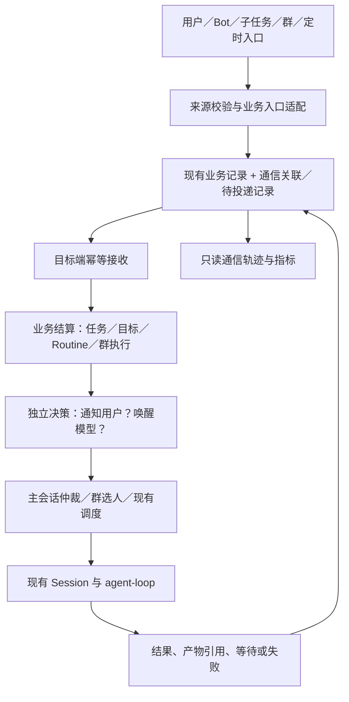

# Bot 通信与调度改造开发计划

日期：2026-10-28
状态：R1–R4 已有合入实现，单机 R5 的观察与结果隔离已补强，跨机器组合验收后置；原六份通信草稿不等同于待重建的新系统。当前范围见 [单机收尾记录](SINGLE_HOST_COMPLETION.md)。
范围：组织寻址、群聊、Bot 单聊、同 Bot 子任务、跨 Bot 委派、定时任务的消息流与结果回流。
目标：沿现有执行架构统一通信契约，优先交付结果可靠回流与按需唤醒，再优化调度、选人与可观测性。

## 0. 运行日志复核后的实施决定（v2，优先于后文原阶段顺序）

2026-10-28 对本机主状态库、Session trace 和 cron 配置做只读分析，聚合截止 14:10（Asia/Shanghai）。私人聊天摘录和完整审计保留在本机 `.agent-state/review-evidence/bot-communication-20261028/REVIEW.md`，聚合与复算脚本同目录；不把私人运行正文提交到版本库。

实际使用核心是“机器/项目 Bot 长期负责开发，外部 CLI 执行，定时任务盯进度并续接 SOP，Super Bot 监督和协助”。应优先让已有工作持续推进，而不是先把所有通信机制抽象完。

复核依据摘要（只代表留存记录，不是全量历史或版本成功率）：

- 824 次定时运行，13 条正式委派（其中 2 条明确是验收）；开发主线并非主要经正式委派表承接。
- 同一机器任务存在直接消息执行成功、后续 cron/委派来源被 source_scope_denied 拒绝的工具记录；当前 bypass 设置与独立来源授权并不等价。
- 监督者读取大量历史和会话运行状态，用户仍需要追问是否获得新回复、状态是否过期。
- 一个 2 小时 55 分钟的主会话窗口有 37 条带 usage 的模型结果、0 次工具启动；同窗口 35 次 Routine，其中 32 次 silent。静默不等于重新检查成功。
- 两次群派工回合显示 completed / cost_budget，公开回复为零、成员仍 running；costUsd 为零，根因仍需复现，不能直接解释为真实费用耗尽。
- 旧 cron 复制的 SOP 与后续指令冲突；追问及格式偏好也进入了持久目标；Routine 摘要出现嵌套与重复正文。

### 新实施顺序

| 批次 | 可独立交付的结果 | 复用原计划 | 新增验收 |
|---|---|---|---|
| R0 | 固化真实失败样本；判清来源授权、run 结果边界、群结束状态 | P0 | 三份新草稿中的对应场景 |
| R1 | 已授权工作的四入口续跑一致；拒绝可解释且不假静默 | P1 最小关联、P2 状态分类 | bot-source-authorization-continuity |
| R2 | 同一工作关联目标/外部 job/watcher/SOP；完成后接下一阶段并结束临时盯梢 | P2、P4 生命周期部分 | bot-watch-work-continuity |
| R3 | Super 先拿新鲜证据再互动；紧凑状态卡、带请求关联的回执 | P1 request/reply、P6 精简工作卡 | bot-supervision-freshness |
| R4 | 群里派活有可靠接收，进入持久工作，单聊追问与原群结果相连 | P2 群适配、P6 状态解释 | bot-watch-work-continuity + 原结果草稿 |
| R5 | 单次执行精确采集结果；普通通知不重复回灌；按证据变化唤醒 | P2、P3 | 三份新草稿 + 原结果/唤醒草稿 |
| R6 | 根据实测负载再做选人、公平调度、完整通信轨迹 | 原 P4 其余、P5、P6 其余 | 原六份草稿 |

R1–R5 首批不新增一套 WorkItem 状态系统：沿用 BotGoal/GoalExecution、群目标和现有外部执行记录，用 workRef/parentWorkRef 建立关联。回复地址至少区分内部结算与公开展示；工作来源不能借此扩张权限。

外部 job 最小引用：所属 Bot、机器别名、仓库/worktree、分支、进程标识及启动时间、退出码/报告引用、HEAD、当前阶段、最近成功观察时间。PID 单独不能识别执行，模型口头说“已完成”不能替代证据。

监督状态至少区分 sessionStatus、workStage、externalWorkerStatus、observedAt、reportedAt、evidenceRef、blocker、nextAction；查询支持指定 Bot、活跃工作与 changedSince。新回复包含旧证据时不得刷新 observedAt，超时只标未回复，不猜机器故障。

授权实现必须先完成 R0 的具体设计：复用有效、可撤销的工作授权引用，给只读监督提供按资源校验的查询能力，保留源内容不构成授权的规则；不得通过默认允许所有 bash 或关闭来源保护解决续跑。

watcher 必须分“直到交付”与“长期健康巡检”。只有有明确交付终态的临时 watcher 才自动结束；长期巡检保持原计划。先观察再判无变化，没有新观察与检查失败分别呈现。SOP 保存引用和版本，用户局部覆盖可追溯，规则更新不自动扩大权限。

### 原计划取舍

- 保留统一契约，但先做 workRef、请求/回执、证据采样时间、有效授权引用与 SOP/run 版本，不先建完整总线。
- 把紧凑工作卡提前；完整因果图后置。用户应先看见“外部执行还在跑/等什么/下一步”，再考虑图形诊断。
- 把机器与项目绑定前置；智能选人后置。明确点名和机器归属优先于负载分数。
- 原“2 秒合并/最长 5 秒”“每处理 5 项前台给后台一次机会”只是未验证候选，不作为首批生产默认或核心成效指标。原草稿继续为 draft，R6 实施前以负载证据复核，不能冒充已批准行为。
- 原 21–28 人日估算及 PR-0–PR-8 顺序仅保留为旧范围参考。新增真实需求改变了范围，R0 之后重估，不能据旧估算承诺交期。

首批指标改为：监督证据新鲜度、未回复被识别时间、外部完成至下一 SOP 阶段的延迟、无观察却宣告无变化的次数、临时 watcher 终态后残留次数、同工作被用户重复下达/催促次数、群派工接收与回流完整率。保持零越权、零重复副作用的故障测试目标。

新增三份草稿：

- [来源授权连续性](../acceptance/bot-source-authorization-continuity.yaml)
- [监督新鲜度与回执](../acceptance/bot-supervision-freshness.yaml)
- [工作与盯梢连续性](../acceptance/bot-watch-work-continuity.yaml)

## 1. 原技术阶段设计（作为 R0–R6 的工作项库）

采用渐进改造：现有业务记录继续作为状态事实来源，在 core 产品层增加薄的通信适配层、投递记录和策略判断。保留群调度、目标调度、Routine 调度各自职责，不新增外部消息中间件，不创建第二套目标系统。

原交付顺序如下；实际执行以第 0 节的日志复核顺序为准：

1. P0：固定当前行为基线，梳理所有写入与唤醒点。
2. P1：统一消息关联与可靠接收，首先贯通 A 委派 B、B 回到 A 的纵向链路。
3. P2：统一执行结果结算，覆盖子任务、群协作和定时任务。
4. P3：分离接收、状态更新、用户通知与模型唤醒；加入可恢复的合并窗口。
5. P4：统一主会话入口仲裁，补齐排队期限、公平性和定时积压处理。
6. P5：结合授权、能力和负载选人，保留显式点名与群模式语义。
7. P6：完成用户可读的通信轨迹、配置界面和完整故障回归。

P1–P6 保留为技术工作项编号。首批改为 R1–R5 的必要纵向切片，具体复用上表。每个可交付切片独立验收、review、提交 PR 并按仓库规则合并，不攒成一个大 PR。

## 2. 已核对的现状与复用边界

以下是代码检查结论，不代表本轮已经运行回归或压测。

| 链路 | 已有实现 | 本次补强 |
|---|---|---|
| Bot 间消息、委派 | bot-work.ts 有消息表、任务表、幂等键、队列容量、会话租约、结果回送、relayHop、wake 和重启恢复 | 提升跨入口关联一致性、结果类型与回送目的地的校验 |
| 持久目标 | goals/types.ts / runtime-host.ts / scheduler.ts 有目标版本、执行 fence、wait、证据、事件去重与结果收口 | 复用为唯一目标判定来源，消除适配路径语义差异 |
| 同 Bot 子任务 | concurrent-fork.ts、fork-inheritance.ts 提供并行、父上下文检索和结果回父目标 | 统一父子关联和回执，不改变权限与记忆范围 |
| 群聊 | rooms/index.ts 有公共历史、成员上下文、三种回复模式、群预算；anti-storm.ts 有限速 | 统一事件类型、选人理由与外部结果接入；不重写群执行器 |
| 定时任务 | routine-runtime.ts 有租约、预检、恢复、静默、通知及群投递；cron-store.ts 已有 coalesce/skip/catch_up | 复用漏跑策略，补充“已排队后过期”和主会话公平调度 |
| 通知 | notification-decision.ts 已有变化判断、静默时段和日预算；Routine 已有摘要合并 | 提取可复用策略，补齐跨子任务的合并与持久唤醒 |
| 插话 | core/session/steer-drain.ts 重导出 agent-loop 的实现，另有 inbox、ack、工具连续性约束 | 默认在 core 排定入口，不把 Bot 业务规则塞进 SDK |
| 来源与审批 | SourceLedger、approval/unattended-approval.ts 记录来源、无人值守唤醒及审批约束 | 通信关联只补充追踪，不替代授权证据 |
| 组织 | functional-groups.ts 支持用户范围的分组、共享条文和群归类 | 用作候选选人参考，不新增上下级权限继承 |

关键基线：

- Bot 定时任务在其 canonical 主会话执行；忙时进入插话队列；非 Bot 例行任务仍可创建独立工作会话。以 bot-routine-main-session 为准。
- doc/bot/06-memory-skills-routines.md 的独立会话描述滞后，需要在 P0 文档 PR 修正。
- 群代码现有 coordinator / all-members / task-collaboration；产品文档需补齐三种模式。
- 群任务协作切片已落地，不表示 bot-room-tasks / bot-room-goal-intake 的完整规格已经验收。
- bot-reliable-messaging 仍是 approved；本计划不把有实现误写成规格全部完成。

## 3. 必须保持的行为

1. 主单聊仍是用户与 Bot 的长期工作主线；定时任务不因本改造回到“默认新建 Routine 会话”的旧行为。
2. 同 Bot 子任务沿真实父链继承权限；跨 Bot 使用接收方权限；群主持人没有代批权。
3. 用户、租户、Bot 私有记忆、群成员和共享条文边界保持现有约束。
4. 群只把实际推送、读取和发表的内容计入触达记录；公共结果不能自动带出私聊或审批正文。
5. 目标完成仍由既有目标服务核验；投递成功、执行结束、目标达成分别记录。
6. 取消和目标修改只影响对应执行；未知外部效果先核对，不能自动重复操作。
7. 协议重试提供至少一次投递与幂等处理，不承诺任意外部副作用“恰好一次”。
8. 配置通过 Lab UI + 持久化 API/KV 生效；不增加 RAW_AGENT_* 功能开关。
9. 不使用消息正文声明的身份、权限、优先级或回复地址作为授权依据。
10. 历史聊天、产物和任务记录不为本次迁移重写；缺失的历史因果关系标为未知。

## 4. 目标架构与状态所有权

| 数据 | 唯一权威 |
|---|---|
| 目标状态、完成核验 | 现有 BotGoalService；群目标仍归群侧 |
| 委派状态、attempt、交付 | bot_work_tasks 与现有 delivery |
| Routine 运行、审批、发布状态 | RoutineRunStore 与既有审批记录 |
| 群回合、成员执行、协作证据 | BotRoomService 与群协作记录 |
| Session 是否可写、是否运行 | 现有 writer/lease 与运行时；通信层不发明第二把执行锁 |
| 消息投递状态、原因、下次重试 | 新增薄投递记录；不拥有业务完成状态 |
| 页面时间线、统计 | 从以上记录生成的只读投影，可重建 |

拟新增 core/src/communication/ 目录，包含 types、validation、adapters、delivery、result、wake-policy、dispatch-policy、trace-read-model。只有对应阶段需要时才建文件，不预建空框架。现有 API 与工具签名首先保持兼容，内部适配后逐条迁移。

### 4.1 消息信封 v1（拟定）

| 字段组 | 内容与规则 |
|---|---|
| 身份 | schemaVersion、eventId、principal、可信 source、destination；均由宿主从已授权上下文解析 |
| 类型 | request / control / result / progress / notification；禁止只从文本猜测控制命令 |
| 关联 | correlationId、causationId、sourceRecordRef；有目标时携带 goalId、goalRevision、executionId、attempt/fence |
| 回流 | resultTo 指定内部结算对象；publishTo 指定用户可见目的地，分别校验 |
| 内容 | 有界摘要、contextRefs、artifactRefs、evidenceRefs；正文不是凭证或权限声明 |
| 调度 | notBefore、deadlineAt、dedupKey、sourcePolicyVersion；只对适用来源设置 |
| 顺序 | 会话内原有 seq 和业务版本优先；不要求跨所有会话的全局总顺序 |

eventId 标识一次逻辑事件；重新投递保留 eventId；重新执行业务产生新 execution/attempt。不得混用重发和重做。

回复位置丢失或权限撤销时：内部结果仍可在合法范围内结算，公开投递记为受阻并显示原因；不能自动回退到无关用户、私聊或群。返回公开群的内容只允许显式公开产物及面向该群的摘要。

### 4.2 事务与崩溃语义

- 同 SQLite 事务覆盖业务状态变化与待投递意图；优先复用已有 result 队列能力，确有跨入口缺口才增加窄的 outbox 表。
- 目标端以 principal + consumer + eventId 去重；投递回执与目标端状态修改尽可能同事务。
- 目标端提交成功而发送端未收到回执：允许重投，目标端幂等处理。
- 外部网络调用不放进 SQLite 事务。副作用结果未知沿用现有 unknown / 核对流程。
- cron 文件配置与 SQLite 非原子：复用现有 occurrence receipt / checkpoint，不声称跨文件原子性。
- 接收、模型执行、业务结算分开领取；继续使用现有租约和 fence，失去执行权的旧 worker 不得提交新结算。
- 投递失败重试有限退避，达到上限转待处理；人工“重发结果”不会变成“重跑任务”。
- 只针对未完成记录回填；历史链路不靠文本反推身份或猜测关联。

## 5. P0：基线和边界固定（1–2 人日）

交付：
- 列出单聊、bot-work、fork、room、Routine、Team/Swarm 等入口的持久化、唤醒、结算和审批调用点。
- 对已存在的基线测试做结果记录；优先复用，不为实现细节制造镜像测试。
- 保存可复现 workload、旧版 commit、环境、mock 模型、时钟控制和指标口径。
- 修正两处文档滞后：Bot 定时主会话；群三种回复模式。
- 确认多进程执行受支持的部署范围；测试租约并发，不因此承诺跨机器共享本地 SQLite。

现有关键测试：
routine-bot-session、routine-continuation、routine-lease、routine-room-delivery、
bot-work、bot-goal-result-return、bot-concurrent-subagents、bot-immediate-steer、
steer-tool-continuity、routine-failure-governance。

完成条件：基线通过或明确记录已有失败与影响；每条接入链路有当前调用位置和状态所有者。不得把既有失败算成本次新增，也不得以基线失败为由跳过受影响行为验证。

## 6. P1：统一关联与可靠接收（3–4 人日）

验收草稿：bot-communication-contract。

纵向切片：A 主单聊委派 B → B 执行 → 结果回到 A 原任务；暂时沿用现有唤醒行为。

工作项：
1. 定义 v1 消息信封、内部类型校验与来源绑定，目标/任务字段按消息类别约束。
2. 给 bot-work 消息与结果加兼容关联；API 返回既有字段，同时提供可选 correlationId。
3. 建立接收回执和相同幂等键不同载荷冲突校验；保留原始任务 ID。
4. 把业务更新与结果投递意图放在同一事务边界；移除该链路第二个独立发送入口。
5. 提供内部查询与结构化日志，证明关联可贯穿，不等到 P6 才有诊断手段。
6. 新增版本化迁移与索引；禁止按全库聊天文本扫描来建立关联。

代码入口：
packages/core/src/bots/bot-work.ts、bot-delivery.ts；
packages/core/src/stores/migrations/index.ts；
packages/core/src/learning/sources.ts；
apps/daemon/src/routes/bot-work.ts；
拟新增 packages/core/src/communication/{types,validation,delivery}.ts。

验收重点：重复提交只接收一次；幂等键冲突拒绝；跨用户伪造拒绝；结果回原请求；崩溃重投不重复执行；旧格式任务可继续。
回退：只切回已兼容 v1 元数据的旧业务适配器；未完成记录继续由原处理器接管，不丢弃回执。

## 7. P2：统一执行结果结算（4–5 人日）

验收草稿：bot-communication-result。

工作项：
1. 定义 result 契约：执行状态、业务引用、版本/attempt/fence、证据、产物、等待条件和摘要。
2. 子任务与跨 Bot 结果先调用现有目标服务结算，再决定展示和唤醒。
3. 群协作通过群侧适配器登记证据，保持群目标与 Bot 单聊目标隔离。
4. Routine 结果接入共同投递契约；保留原有审批前发布、静默、比较策略与群投递规则。
5. 审核 Team DAG / Swarm / factory / evolution 结果适配点，只迁移真实已接入能力；缺失能力明确显示。
6. 旧版本、重复、取消后迟到结果：归档可见但不能完成新目标或重启取消任务。
7. 发布地址失效与执行失败分开显示；公开摘要不含私聊过程或敏感产物。

代码入口：
bots/concurrent-fork.ts、bots/goals/{runtime-host,scheduler,runtime-dispatch,adapters}.ts；
rooms/{index,task-collaboration}.ts；cron/routine-runtime.ts；
拟新增 communication/result.ts 及来源适配器。

验收重点：子任务回父目标；跨 Bot 再开子任务仍回原目标；重复结果只结算一次；旧 attempt 不污染新 attempt；审批拒绝/批准分别收口；未知副作用不自动重做；群公开投递范围正确。
回退：结果业务状态仍在原服务中；新投递未发完时先排空或由兼容桥接管。不能把“关闭新通知”理解为清空结果。

## 8. P3：接收与唤醒分离（3–4 人日）

验收草稿：bot-communication-wake。

工作项：
1. 把业务结算、用户通知、模型唤醒做成三个独立步骤。
2. 唤醒纯策略返回 run / defer / no-run；通知纯策略返回 publish / digest / silent，并记录 reason。
3. progress / receipt 默认只更新记录；有依赖需要继续执行、用户需要答复、阶段全部收齐时才申请模型轮次。
4. 为同 principal、同目标版本、同发布目的地创建持久化合并窗口；不跨目标合并结果正文。
5. 失败、待审批、结果不明等需要人行动的事件直接呈现，不能因普通进度合并而延迟；是否重跑模型另判。
6. 明确父任务的依赖集合：等待全部、首个有效结果、独立完成事件。集合未闭合或部分任务卡住时仍受最大等待时间约束。
7. 复用 Routine 静默时段、变化比较、通知预算；不能出现两套互相覆盖的通知策略。
8. 复用 relayHop 和群限速，补充同因果链的重复唤醒去重；通知及回执不自动生成新请求。
9. 在现有 Lab 设置中提供合并开关/窗口，持久化立即生效；内部幂等机制不作为用户开关。

代码入口：
bots/bot-work.ts、bots/goals/scheduler.ts；
cron/{notification-decision,routine-delivery-policy,routine-runtime}.ts；
runtime/scheduler-host.ts、services/autonomous-scheduler.ts；
拟新增 communication/wake-policy.ts。

拟定新策略默认：普通进展 2 秒合并窗口、从首条起最长 5 秒；需要人处理的状态立即可见。生产默认启用前以 P0 workload 验证；既有已保存通知设置优先，不静默覆盖。

验收重点：3 个已知依赖在窗口内结束只产生一次父模型恢复；一个提前失败立即可见；零依赖的通知不唤醒；重启恢复窗口不漏发；不断到来的进度不能无限延长窗口；明确请求讨论仍能触发群调度。
回退：只恢复逐条通知/唤醒策略，不恢复重复结算；保留尚未发布的合并成员引用。

## 9. P4：主会话入口仲裁与积压（4–5 人日）

验收草稿：bot-communication-scheduling。

工作项：
1. 为主会话待处理来源建立统一候选视图，原队列仍保存原消息。
2. 控制类事件优先走现有 steer/abort 安全点；用户新工作优先于普通后台工作，必须匹配确切目标，不能全局误取消。
3. 对可执行候选采用确定性优先级和 aging；不让持续用户输入永久饿死后台任务。
4. 不在任意工具中间强制抢占；保持 tool_call 与 tool_result 配对、单 writer 与现有审批恢复协议。
5. 定时任务沿用 missedPolicy 的 coalesce/skip/catch_up；新增的排队失效期限只约束尚未开始的 occurrence。
6. 区分整个计划的 expiresAt 与单次排队的 latestStart/deadline；过期记录保留可解释原因。
7. latest-only 合并仅在同 Routine、同规则版本、未开始且未产生副作用时适用；有独立业务语义的事件不得默认合并。
8. 队列满保持明确拒绝、可重试和原消息不丢；容量核算不能在新旧视图重复计数。
9. 配置 UI 放在现有 Bot/定时任务设置中；默认漏跑策略不变，新增排队期限默认不设置。

代码入口：
runtime/scheduler-host.ts、bots/bot-work.ts；
cron/{cron-store,cron-facade,routine-runtime,routine-deadline}.ts；
session/{step-inbox,steer-drain,steer-interrupt,inbox-overflow}.ts；
BotCronPanel.tsx、RoutineSchedule.tsx、bot-work/RoutineRuns.tsx。

SDK 决策：先使用 core 宿主仲裁和现有公开接口。如果不能保证工具连续性或单写者，单独提交 agent-loop 契约 PR；必须同步 skills/agent-loop/SKILL.md，并在 packages/agent-loop 跑 pnpm run test 与 pnpm run build。mini 不得静态引入 Node 内置模块。

验收重点：用户控制不被后台积压遮挡；Bot 定时仍在主会话；审批等待不重复启动；过期未开始任务按策略跳过；已运行任务不因排队期限被误重做；持续高优先级流下后台满足公平性；重启与队列满不丢单。
回退：只对新候选恢复旧顺序；已经接受的期限/取消规则持续有效，避免回退后重新执行已跳过工作。

## 10. P5：组织与群的能力寻址（3–4 人日）

验收草稿：bot-communication-routing。

工作项：
1. 从现有 Bot 描述、技能/工具允许名单、连接健康、队列和运行状态生成能力快照，不新增必须手填的组织表。
2. 先过滤同 principal、可访问 Bot、当前群成员及任务必需授权，再按能力相关性与负载排序。
3. 明确点名/引用优先；被点名者不可执行时解释或排队，不悄悄换其他人。
4. coordinator 模式优化候选；all-members 保持全员语义；task-collaboration 仅负责人邀请群内协作者。
5. 负载只用于排序，不等于权限；技能标签只能作为候选信号，实际执行仍做权限和能力检查。
6. 支持任务语境下“请开发组处理”解析为候选集，由合适负责人承接；普通提及组名不自动广播，歧义才请求补充。
7. 无合格候选时给出缺失原因，不选择无权执行者兜底。纯闲聊的相关性零回复基线保持。
8. 领取前重新校验成员/权限/连接；能力快照失效不会导致越权。
9. 记录选择依据、未选原因与策略版本，供 P6 展示；初版不新增每条消息一次的 LLM 选人调用。

代码入口：
bots/functional-groups.ts、rooms/{speaker-score,scheduling,host-route,task-collaboration}.ts；
bots/goals/{routing,adapters}.ts、bots/bot-work.ts；
拟新增 communication/routing.ts。

验收重点：明确点名不扩散；组请求不全员广播；移出群后不领取；能力不足明确说明；负载选择可解释；全员模式保持；用户/群权限不被寻址扩大。
回退：恢复原相关性排序；身份与资格过滤必须保留，不能把安全校验当作实验策略回退。

## 11. P6：通信轨迹、配置收口与发布（3–4 人日）

验收草稿：bot-communication-observability。

工作项：
1. 在现有活动、任务交付、群协作和 Routine 记录中增加“查看处理过程”，默认折叠，不新增一级导航。
2. 轨迹显示请求、选人、排队、执行、审批、结果、核验和发布；点击定位原消息/会话/产物。
3. 展示用户语言的等待原因、下一步、结果去向；事件 ID 等诊断字段仅在详情。
4. 查询拟用 GET /api/bot-communications/:correlationId，支持游标分页；按 principal 和源记录权限过滤每一节点，correlationId 不是访问凭证。
5. 部分记录删除或不可见时显示缺口，不跳到无关会话，不暴露隐藏用户身份或私聊摘要。
6. 日志及指标记录计数、时延、来源和原因，不把完整正文/私有上下文放进指标标签。
7. 通信元数据设置保留上限与清理流程；先保护活跃任务、未投递记录和幂等保留窗口，再清理已终结详情。
8. 所有新增界面用 useI18n，zh/en 同 key；列表自动刷新保留滚动，状态更新不引起整页跳动。
9. 完成适配器死代码清理、文档与操作说明；兼容读路径仅在历史/回退窗口验证后删除。

主要入口：
apps/daemon/src/routes/{bot-work,bot-history,bot-rooms}.ts 与新只读查询路由；
apps/web-console/components/BotActivityList.tsx；
components/bot-work/{TaskDelivery,BotWorkState,RoutineRuns}.tsx；
components/play-group/RoomCollaborationHistory.tsx；
apps/web-console/lib/{api,types}.ts、lib/i18n/messages/{zh,en}。

回退：隐藏新增视图即可，原有对话和任务入口可用；底层已接收记录不因 UI 回退清除。

## 12. 原 PR 拆分、依赖与投入估算（已被 v2 顺序替代）

以一名熟悉仓库的开发者为单位，含本阶段测试与 review 的粗估，不是交付日期承诺。真实模型和跨进程问题可能增加投入；P0 后重估。

| PR | 内容 | 依赖 | 预计人日 |
|---|---|---|---|
| PR-0 | 行为基线、调用点清单、文档纠偏 | 无 | 1–2 |
| PR-1 | P1 信封与跨 Bot 纵向可靠链路 | PR-0 | 3–4 |
| PR-2 | P2 子任务/委派结果统一与版本防护 | PR-1 | 2–3 |
| PR-3 | P2 群/Routine/已接入专项结果适配 | PR-2 | 2 |
| PR-4 | P3 唤醒判断、合并、策略 UI | PR-3 | 3–4 |
| PR-5 | P4 主会话仲裁与公平性 | PR-4 | 2–3 |
| PR-6 | P4 Routine 排队期限与设置 | PR-5 | 2 |
| PR-7 | P5 能力寻址与选择原因 | PR-4；完整发布依赖 PR-6 | 3–4 |
| PR-8 | P6 用户轨迹、最终回归与清理 | PR-6、PR-7 | 3–4 |

总计约 21–28 人日，按单人连续工作约 4–6 周；首批 P1–P3 连同 P0 约 11–15 人日。暂不假设多 Agent 并行。可在不共改业务写路径时拆前端与查询实现，但不把并行作为进度前提。

第一批验收完成后即可得到：结果可关联、可恢复、不会因重复回执反复结算，普通状态无需反复叫醒模型。无需等待智能选人和完整轨迹页面才产生收益。

## 13. 验证矩阵与发布门槛

### 13.1 必测业务场景

| 场景 | 关键断言 |
|---|---|
| A → B → B 子任务 → A 原目标 | 每层关联准确，证据可查，原目标核验一次 |
| 两目标同时运行，修改其中一个 | 修改不影响另一个；旧版本结果不能完成新版本 |
| 群负责人邀请两成员 | 只有受邀且有任务者执行；群结果不归到某只 Bot 私聊目标 |
| Routine 到点且主会话繁忙 | 保留主会话身份并排队；不另建 Bot Routine 会话 |
| Routine 报告发群 | 只投递不自动讨论；明确讨论请求才能唤醒成员 |
| 结果已接收但回执丢失 | 重投不产生重复工作、重复结算或重复公开消息 |
| 结果待发布时成员移除/授权撤销 | 内部合法结算保留，公开投递受阻且不换目的地 |
| 审批跨重启与租约过期 | 正确继续原执行或收口，不重放已成功副作用 |
| 持续输入、后台积压、队列满 | 控制及时、后台有机会执行、容量不重复计数、拒绝可解释 |
| 中英文切换与列表刷新 | 叶子 key 一致，展开/滚动不被刷新重置 |

### 13.2 故障注入点

对接受请求后、领取前、工具执行后、结果落盘后、接收方提交后但 ack 前、通知合并到期前、取消后迟到结果分别注入进程终止/异常。
对重复、乱序、缺失源记录、租约抢占、时钟快进、相同幂等键不同内容、不可访问回复地址做确定性测试。
工具外部副作用用记录实际调用次数的 stub 验证；不能只断言“函数被调用”。

### 13.3 命令与工作流

- 实施某阶段前，把对应草稿改 approved，notes 加 assumedApproval: standing-order-2026-10-22；按条目写带 [AC:<id>#<AC-n>] 的失败测试，再实现，全部通过改 implemented。
- 不删或弱化旧标准，不把旧 approved/implemented 改回 draft；取消需求使用 retired + retiredReason。
- 先运行受影响测试和编译，再按阶段运行 pnpm run test:unit、pnpm run test:acceptance。静态验收门禁通过不等于行为测试通过。
- P2/P4/P6 增加对应重启/并发/故障验证，复用 test:restart、test:concurrency、test:bot:faults、test:bot:soak:performance。
- 新 UI 跑 i18n 测试、build:web-console 与对应 Playwright；E2E 前遵循现有 Next dev/生产构建互斥规则。
- SDK 有改动必须在 packages/agent-loop 执行 pnpm run test 和 pnpm run build，并同步 SDK Skill。
- 最终候选按仓库 CI 门禁执行；真实模型质量评测独立报告，不能用 heuristic 或 mock 通过冒充真实模型质量认证。
- 完成后先 review，修复发现，再提交、开 PR、合并；不 force push、不绕 hooks。计划本身不触发业务实施。

### 13.4 可量化目标（拟定门槛）

P0 保存基线数据后冻结 workload 和判定脚本；以下数字是开发目标，不是现状测量结果。

| 指标 | 口径与门槛 |
|---|---|
| 错归属、越权发布、取消后重启任务 | 确定性回归 0 次 |
| 重投导致重复业务结算/重复外部调用 | 在幂等与故障样本中 0 次；未知结果必须进入核对 |
| 已接收消息丢失 | 故障样本 0 条；所有接收成功项有可查询处理状态 |
| 合并收益 | 3 个依赖在同窗口结束，父恢复模型调用 1 次；持续进度最长 5 秒出一次摘要 |
| 调度公平性 | 所有候选均可运行、无审批阻塞且负载有界时，连续处理 5 项前台工作后至少给一项就绪后台工作机会；控制指令除外 |
| 请求接收性能 | 固定硬件/负载下 p95 相比 P0 不退化超过 10%；不计模型耗时 |
| 控制处理 | 假模型/工具可控场景，下一个合法安全点前应用；不承诺中断不可取消外部工具的绝对毫秒时延 |
| 追踪完整性 | 新接入的委派/子任务/Routine/群链路具备来源、去向和状态原因；旧记录允许明确缺口 |

“无需模型的进度消息唤醒数”和“每个目标完成的模型调用数”作为前后对比指标；不凭空承诺固定百分比成本下降。

## 14. 上线、兼容与回退

1. 先部署兼容读写的新结构，原业务处理器仍唯一执行；仅做追踪投影不触发额外副作用。
2. 每条链路通过后切到新适配器。只保留一个实际消费者，不双跑新旧执行器。
3. 活跃旧记录在首次领取时按原 ID 补关联；无法确定来源时留 legacy/unknown，不自动重放。
4. 迁移仅新增字段/表/索引，保留原记录；数据库版本号按实施时最新迁移追加，不在计划中占号。
5. 回退目标是上一兼容版本；不承诺任意古老二进制可安全读取新行为。出现 unknown 或部分执行，优先停新派发、保留记录、核对后继续。
6. 新用户可选策略由 UI/API 保存，不通过新 env 切换；内部适配迁移版本由代码/存储版本控制，不暴露一排临时开关。
7. 双写只允许“业务记录 + 非执行投影”，且同事务或有可恢复回填；禁止双写两套任务状态作为权威。
8. 合并窗口与幂等墓碑的保留时间要覆盖允许的重试/回放窗口；窗口外旧事件拒绝或人工核对，不能清理后误当新工作。
9. 旧适配器删除前，证明没有活跃记录依赖且回退窗口结束；终态历史继续可读。

## 15. 风险与首批取舍

| 风险 | 处理方式 |
|---|---|
| 统一通信层变成第二套编排器 | 不拥有目标/执行状态，只处理信封、投递与策略；业务仍调用原服务 |
| 合并通知拖延必要响应 | 紧急状态直接呈现，最大窗口固定，依赖收集与通知分别管理 |
| 主会话竞争 writer、审批来源错归 | 单入口仲裁复用租约；执行领取时绑定来源，不能让排队来源提前覆盖当前审批身份 |
| 权限快照过期 | 发送、接收、执行、展示引用时分别按当前范围校验 |
| 把群公开结果和私聊结算混在一起 | resultTo 与 publishTo 分离；公开资料显式白名单 |
| 迁移期间重复运行 | 业务幂等 ID 不变，每条链路一个消费者，兼容只读投影 |
| 计划范围扩成群长期任务系统重写 | 只接现有协作切片；完整群目标/接力规格另行收口 |
| 新策略使旧任务顺序意外变化 | 默认保留已有漏跑/通知配置；策略版本和选择理由落盘，未开始任务才适用新期限 |

首批不引入消息中间件、跨机器分布式总线、组织权限树、自动共享私聊、模型自主扩大广播范围或全新的一级管理页面。通信问题先在现有 daemon/core/SQLite 边界内解决。

## 16. 实施入口与验收草稿索引

| 阶段 | 草稿 |
|---|---|
| P1 | [bot-communication-contract](../acceptance/bot-communication-contract.yaml) |
| P2 | [bot-communication-result](../acceptance/bot-communication-result.yaml) |
| P3 | [bot-communication-wake](../acceptance/bot-communication-wake.yaml) |
| P4 | [bot-communication-scheduling](../acceptance/bot-communication-scheduling.yaml) |
| P5 | [bot-communication-routing](../acceptance/bot-communication-routing.yaml) |
| P6 | [bot-communication-observability](../acceptance/bot-communication-observability.yaml) |

本次文件是规划与草稿，不宣称上述能力已经实现。开始开发时从第 0 节 R0 真实样本基线与 R1 授权续跑切片推进；后续优先级以 v2 为准。
