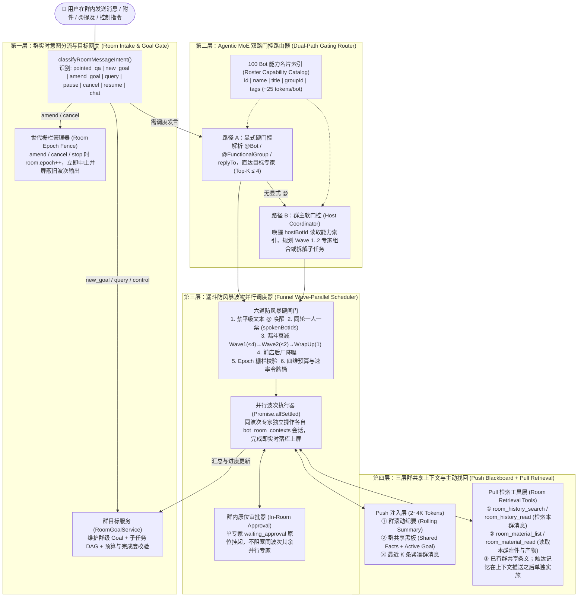

# Bot 群聊模式（6~100 Bot 规模 Agentic MoE）技术开发文档

**Implementation status**：决策已锁定（2026-10-21）。验收规格为 `draft`，待负责人确认后再实现；确认前不改 `acceptance/bot-rooms.yaml` 等已批准文件的状态与正文。  
关联文档：[`BOT_CAPABILITY_PLAN.md`](BOT_CAPABILITY_PLAN.md) · [`BOT_MULTI_GOAL_DESIGN.md`](BOT_MULTI_GOAL_DESIGN.md) · [`docs/plans/2026-10-13-bot-mode-multi-agent-development.md`](../docs/plans/2026-10-13-bot-mode-multi-agent-development.md)

---

## 1. 背景、目标与设计原则

### 1.1 背景与核心痛点

当前群聊模块（[`packages/core/src/rooms/`](../packages/core/src/rooms/index.ts)）面向 2~8 个 Bot 的轻量圆桌讨论设计，采用 **「全员入队 + 串行轮询 + 模型自觉输出 `[SILENT]` 跳过 + 剥夺群内一切派单/协同工具 + 审批踢回 1:1 私聊」** 的机制。当目标规模扩展至 **单群 6~100 个 Bot 组织会话并协同完成复杂任务** 时，存在四大阻塞性瓶颈：

1. **规模与调度瓶颈（Dense $O(N)$ 轮询）**：全局名册与群成员硬编码上限 50，单轮发言预算上限 20；未 `@` 时全员排进 `turn.botIds` 串行调用 LLM，且输出 `[SILENT]` 依然扣减 `botTurns` 预算，导致前 20 个无关 Bot 耗尽预算，后排真正对口的专家 Bot 永远无法被唤醒，单轮耗时高达数分钟。
2. **任务分配与协同断层**：[`filterRoomTools`](../packages/core/src/rooms/tool-policy.ts) 一刀切封禁了 `bot_delegate`、`task_*`、`spawn_*`、`team_*`；`hostBotId`（群主）仅作字段存储而无调度权；触发人类审批（`waiting_approval`）时被强制踢回 1:1 私聊且结果不回流群聊，导致多 Bot 协作链断裂。
3. **历史资料共享与上下文找回失效**：群记忆按 `room:${roomId}:${botId}` 隔离，同群 Bot 无法共享记忆；[`selectUnseen`](../packages/core/src/rooms/index.ts) 对超出 200 条或 120KB 的未读群消息直接截断丢弃并强推游标；[`history_search`](../packages/core/src/session/history-retrieval.ts) 不索引 `bot_room_messages` 且群内禁调 `bot_room_messages`，导致稀疏唤醒的专家 Bot 永久丢失早期需求与前序附件。
4. **用户问题分流与目标管理缺失**：[`BotGoalService`](../packages/core/src/bots/goals/service.ts) 与并发分叉仅对 `canonicalBotChat === true`（1:1 私聊）生效；群聊用户在任务执行中途追问进度、补充约束或喊停时，消息只能在 FIFO 队列末尾干等当前串行回合跑完。

### 1.2 核心架构范式：Agentic Sparse MoE（智能体稀疏专家混合架构）

本方案将 6~100 Bot 群聊重塑为 **「带公共黑板、多波次并行调度与六道防风暴硬闸门的 Agentic Sparse MoE 系统」**：

- **常驻共享专家（Shared Expert）**：激活 `hostBotId`（群主 / PMO 协调员），负责意图分诊、门控选人、子任务拆解、目标跟踪与收尾汇总。
- **路由专家池（Routed Experts）**：按职能组（[`BotFunctionalGroup`](../packages/core/src/bots/functional-groups.ts)）与轻量能力名片（`BotCapabilityCard`）待命，**默认 0 唤醒、0 Token 消耗**。`routing = sparse-all`：含 2~3 人小群在内的所有群都稀疏唤醒。未点名时由群主选人；第一切片可以串行执行被选中的人，并行波次紧随其后。每波次人数仍受 Top-$K$（默认 $K \le 4$）约束。
- **漏斗收敛防风暴（Funnel Anti-Storm Guardrails）**：在 Runtime 内核层通过「星型单向唤醒、同轮一人一票锁、波次席位单调衰减（$4 \to 2 \to 1$）、前店后厂降噪、Epoch 世代栅栏、四维硬熔断」六道闸门，从物理机制上杜绝群聊乱聊风暴。
- **推拉结合的三层群上下文（Push Blackboard + Pull Retrieval）**：每次唤醒仅注入轻量「群滚动纪要 + 群共享条文 + 最近窗口」（Push），同时赋予群成员 `room_history_search` / `room_history_read` / `room_material_read` 主动找回早期历史与群产物全文的能力（Pull）。群共享条文沿用已有 `bot_shared_context` 的群范围，不另建一套黑板。
- **触达记忆（在上下文推送之后单独实施）**：Bot 保留自己的单聊记忆，群内发言时仍可使用；只有该次群回合实际推送给它、它用群内只读工具取回、或它自己发出的群内容，才成为它的信息源，并可以在之后的单聊里使用。未入选、未推送的群消息不因「它在群里」进入单聊。

### 1.3 仓库工程约束（必须遵守）

1. **配置走 Lab UI 与持久化 KV，禁加功能开关环境变量**：所有群容量、波次并发度、单轮预算、审批策略等配置存入 `daemon_control`（`bot.roomSettings`），通过 `PATCH /api/bot-rooms/settings` 热更新生效，**不新增 `RAW_AGENT_*` 环境变量**。
2. **保持 `@ppeng/agent-loop` 边界纯净**：群门控、波次调度、群纪要与群目标管理全部位于 `packages/core/src/rooms/` 与 `packages/core/src/bots/` 产品宿主层，复用现有 `runSession`、`enqueueSteer`、`cancelSession` 契约，不把群业务逻辑塞入 `packages/agent-loop`。
3. **前端 i18n 双语对齐**：所有 Web Console 新增文案必须使用 `useI18n()`，同步维护 `apps/web-console/lib/i18n/messages/{zh,en}/`。
4. **验收优先（Acceptance-First）**：进入代码开发前，按工作包拆分起草 `acceptance/<feature-id>.yaml`，经用户确认后编写带 `[AC:<id>#<AC-n>]` 标签的失败测试，再实现代码。已批准标准只在用户确认替代关系之后改写；本次草稿不修改旧文件的 `implemented` 状态。规范里的 `retired` 作用于整份规格。`bot-rooms.yaml` 的 AC-1、AC-4、AC-5、AC-6、AC-7、AC-8 仍然有效，不能把整份标为 retired。

### 1.4 已锁定决策与审查必改项（2026-10-21）

负责人已拍板，第四节、第六节与之冲突时以本节为准。

1. **routing = sparse-all**。所有群（含 2~3 人小群）都稀疏唤醒，不再「未点名则全员轮流」。静默不占有效发言预算。小群未点名时仍必须有人回复（群主或被选中的成员），不能变成群里沉默。群成员仍至少 2 人，继续遵守 `play-bot-group` 的 AC-1、AC-2。点名直达、容量、静默不计预算、未点名由群主选人，放在同一个可合并切片；该切片里被选中的成员可以串行。不存在「切片合并后未点名仍然全员轮流」的中间态。
2. **approval = private-default**。默认仍转到该 Bot 私聊，结果不自动回群，与 `bot-rooms` AC-8 一致。群内原位批准只作为 Lab 里另行打开的策略，不进第一批实现，对应草稿 `bot-room-inline-approval`，须单独批准。
3. **memory**。负责人原话：「我想要都有，他保留自己的单聊记忆，同时能接入群里的信息，如果群聊的内容，他也可以融入到单聊里，因为他触达了这个信息，只要他的触达，就算他的信息源」。触达 = 该 Bot 在某次群回合中实际收到的上下文：推给它的纪要、最近消息、它用群内只读工具取回的原文与附件，以及它自己发出的群消息。未入选、未推送的群消息不算它的信息源。只发生在私聊的审批过程不回写进群历史。隐私后果：单聊记忆可能在群里被说出来；该 Bot 触达过的其他成员群消息会进入它之后的单聊。这是明确要的打通，不改回「互不打通」。记忆打通单独成阶段，放在群上下文推送之后。

审查必改项的落点：

| 必改 | 落点 |
| :--- | :--- |
| 已批准发言规则与审批规则不能被实现悄悄改写 | 新规格 `draft` 写明替代句；批准前不改旧文件。见第 6 节 |
| 同波并行不能共用一个 `cursor` / `currentSessionId` | 第 4.2.3 节；并行放在阶段 2，先改成每位成员一条运行记录 |
| 群主选人不能拖到协同工具阶段 | `room_route_turn` 随阶段 1；`room_assign_task` / `room_request_peer` 仍在阶段 5 |
| 群目标不能写入 `bot_goals:${botId}` 或单聊会话 | 第 4.6 节；阶段 7 使用独立的群目标 |
| 黑板不另做一套记忆命名空间 | 群规约继续用已有群共享条文；触达记忆见第 4.7 节、阶段 4 |
| 原位审批不能把整群留在 `waiting_approval` | 第一批保持私聊移交；原位阶段若批准，等待只挂在该成员上 |
| 配额只有接口、没有 Lab，且 50 / 1~20 仍写死 | 阶段 1 用 Lab 持久化设置替换硬编码上限；已有群自己的发言预算保持到用户修改该群 |
| 限流、世代栅栏、中途插话要能收回 | 第 4.3、4.6 节：限流只暂停继续安排；过期回复不入群；已发生且无法确认的外部动作标为待核对 |
| 短句附和过滤会吞掉真实短回答 | 第 4.3 节：默认关闭 |

---

## 2. 缺口与交付工作包映射（Gap-to-Work-Package Matrix）

| 编号 | 现有问题 / 缺口描述 | 涉及源码位置 | 对应工作包 | 核心验收指标 |
| :--- | :--- | :--- | :--- | :--- |
| **G01** | `BOT_ROSTER_CAP = 50` 及单群成员上限 `50` 阻断 100 Bot 规模 | `bots/types.ts`, `rooms/index.ts` | **W1** | 支持名册 200 Bot、单群 100 Bot，支持将整个职能组一键加入群聊 |
| **G02** | 未 `@` 时全员入队串行执行，`[SILENT]` 扣减 `botTurns` 导致后排专家饿死 | `rooms/scheduling.ts`, `rooms/index.ts` | **W1** | 所有群（含 2~3 人）未 `@` 都由群主稀疏选人，小群不能沉默；显式 `@` 只唤醒目标；`[SILENT]` 不扣有效发言预算。与容量、Lab 配额同一可合并切片，该切片内可串行 |
| **G03** | `hostBotId` 仅作字段保存，无主持、分诊、派单与收尾职责 | `rooms/index.ts` | **W1, W3** | 群主承担默认门控路由、任务拆解与最终汇总收尾（Shared Expert） |
| **G04** | 单轮 `while` 全串行 `await runSession`，多专家响应延迟累加 | `rooms/index.ts` | **W1** | 同波次内最多 $K$（默认 4）个专家并行 `runSession`，按完成先后实时落库上屏 |
| **G05** | 开放多 Bot 协同后存在互相 `@` 乒乓死循环、废话附和、多波次发散风暴风险 | `rooms/scheduling.ts`, `rooms/index.ts` | **W2** | 六道防风暴闸门生效：平级 `@` 不触发调度、同轮一人一票、波次 $4\to2\to1$ 衰减、Epoch 栅栏拦截 |
| **G06** | `filterRoomTools` 封禁全部协同工具，群内无法拆解子任务或请求专家接力 | `rooms/tool-policy.ts` | **W3** | 群主可用 `room_assign_task` / `room_shared_context_set`；专家可用 `room_request_peer` / `room_task_checkpoint` |
| **G07** | 群内触发 `waiting_approval` 被强制踢回 1:1 私聊且结果不回群 | `rooms/human-step.ts`, `bots/bot-work.ts` | **W3 默认保持；原位另批** | 第一批保持 `bot-rooms` AC-8：转到私聊，结果不回群，其他被选中的成员继续。群内原位批准只在 Lab 另行打开，且不进第一批 |
| **G08** | 群会话记忆与单聊记忆隔离，触达过的群内容回不到单聊，单聊记忆也不能在群里使用 | `memory/bot-memory-scope.ts` | **W4 之后的触达阶段** | 群规约仍走已有群共享条文。触达记忆单独阶段：单聊记忆在群里可用；实际收到的群内容可进入该 Bot 之后的单聊；未推送的不注入 |
| **G09** | 超 200 条 / 120KB 未读消息直接丢弃且游标前移，每次塞入完整 JSON 消耗大量 Token | `rooms/index.ts` | **W4** | 引入群级滚动纪要（`bot_room_summaries`）+ 紧凑消息格式，单次唤醒上下文控制在 2~4K Tokens |
| **G10** | `history_search` 不搜群消息，非触发消息的附件与群产物无法被后发 Bot 读取 | `session/history-retrieval.ts`, `bot-materials.ts` | **W4** | 群内开放 `room_history_search` / `room_history_read` / `room_material_read`，支持按需找回任意早期消息与附件产物 |
| **G11** | `BotGoalService` 仅支持 1:1 私聊，群聊无目标状态机，用户中途追问/改需求被 FIFO 阻塞 | `bots/goals/runtime-host.ts`, `rooms/index.ts` | **W5** | 群支持 `RoomGoal` 状态机；用户中途发消息实时识别 `query / amend_goal / pause / cancel`，秒回查询或实时 `Steer` 在途 Bot |
| **G12** | 前端群头部平铺所有成员、2s 轮询无波次/目标状态、百人规模下 UI 溢出 | `PlayBotGroupChat.tsx`, `BotRooms.tsx` | **W6** | 群头部折叠抽屉（按职能组/活跃状态过滤）、展示群目标看板与波次进度、原位审批卡片 |

---

## 3. 系统总体架构设计



---

## 4. 详细技术方案设计

### 4.1 容量模型与三级组织拓扑（W1）

#### 4.1.1 动态配额设置（`bot.roomSettings`）
在 `packages/core/src/rooms/settings.ts` 中新增持久化配置读写，替代硬编码常量：

```ts
export interface BotRoomGlobalSettings {
  /** 全局可创建的普通 Bot 上限，默认 200（范围 10–500） */
  rosterCap: number;
  /** 单群最大成员 Bot 数量，默认 100（范围 2–200） */
  maxRoomMembers: number;
  /** 单波次最大并行发言专家数（Top-K），默认 4（范围 1–10） */
  maxWaveSpeakers: number;
  /** 单轮最大波次深度（含收尾波），默认 3（范围 1–5） */
  maxWavesPerTurn: number;
  /** 单群每分钟最大 Bot 消息数（防风暴令牌桶），默认 15（范围 5–60） */
  maxMessagesPerMinute: number;
  /**
   * 审批去向。默认且第一批唯一生效值是 `private_handoff`（移交私聊，结果不回群）。
   * `in_room` 只在 `bot-room-inline-approval` 单独批准后才提供 Lab 开关，不进第一批。
   */
  approvalMode: 'private_handoff' | 'in_room';
}
```

#### 4.1.2 轻量能力名片索引（`BotCapabilityCard`）
为了在 100 个 Bot 的群里让群主（或门控算法）以极低 Token 成本精准选人，在 `packages/core/src/rooms/capability-index.ts` 中构建群成员能力目录：

```ts
export interface BotCapabilityCard {
  botId: string;
  name: string;
  title: string;
  /** 所属职能组 ID 与名称（来自 BotFunctionalGroupService） */
  groupId: string | null;
  groupName: string | null;
  /** 提炼自 description / allowedSkills 的简短能力摘要（截断至 ≤ 120 字符） */
  summary: string;
  /** 技能名与工具域标签（最多 8 个） */
  tags: string[];
}
```
- **Token 预算控制**：单个 Bot 的 `BotCapabilityCard` 紧凑序列化后仅约 **25~35 Tokens**，100 个 Bot 全量目录仅约 **2.5K~3.5K Tokens**，完全可以在群主分诊回合一次性注入。
- **职能组联动（`@职能组名`）**：
  - 扩展 `POST /api/bot-rooms/:id/members` 支持传入 `{ groupId: string }`，将该职能组下所有有效 Bot 批量加入群聊。
  - 扩展 [`resolveMentions`](../packages/core/src/rooms/index.ts) 支持匹配 `@<职能组名称>`（如 `@安全组`、`@后端组`），命中后展开为该组在群内的成员列表，并交由门控层选出 Top-$K$ 代表响应。

---

### 4.2 Agentic MoE 门控路由与分波次并行调度器（W1）

#### 4.2.1 升级后的 `BotRoom` 与 `BotRoomTurn` 数据模型

```ts
export interface BotRoom {
  id: string;
  title: string;
  principalId: string;
  principal: BotPrincipal;
  status: 'active' | 'paused';
  hostBotId: string;
  /** 单调递增的世代号；用户改需求、急停或重置时 +1，用于拦截过期波次输出 */
  epoch: number;
  /** 单轮最大有效发言气泡数（1–50，默认 12；[SILENT] 不计入） */
  maxBotTurns: number;
  maxToolCalls: number;
  maxCostUsd: number;
  /** 单轮最大墙钟耗时（毫秒，默认 180_000） */
  maxWallClockMs: number;
  botIds: string[];
  createdAt: string;
  updatedAt: string;
}

export interface RoomPeerRequest {
  fromBotId: string;
  targetBotId: string;
  reason: string;
}

export interface BotRoomTurn {
  id: string;
  roomId: string;
  messageId: string;
  /** 创建该 Turn 时的 Room Epoch；发布消息前校验是否等于 room.epoch */
  epoch: number;
  status: RoomTurnStatus;
  /** 分波次执行计划：waves[0] 为第一波并行专家，waves[1] 为第二波，以此类推 */
  waves: string[][];
  /** 当前执行到的波次索引 */
  waveCursor: number;
  /** 兼容旧字段：展平后的已计划发言成员快照 */
  botIds: string[];
  mentionedBotIds?: string[];
  replyToMessageId?: string;
  /** 当前波次正在并行运行的 sessionId 列表 */
  activeSessionIds?: string[];
  /** 本轮已经实际公开发言过的专家 botId 集合（一人一票防乒乓锁） */
  spokenBotIds: string[];
  /** Wave 内专家通过 room_request_peer 提交的待排期下游接力申请 */
  pendingPeerRequests?: RoomPeerRequest[];
  /** 是否需要在最后一波由 hostBotId 做收尾汇总 */
  wrapUpRequired?: boolean;
  maxBotTurns: number;
  /** 实际产生非空公开回复的次数（[SILENT] 不递增此计数） */
  botTurns: number;
  /** 返回 [SILENT] 的次数（受独立上限保护） */
  silentChecks: number;
  toolCalls: number;
  costUsd: number;
  costStatus: 'unknown' | 'estimated';
  cursor: number;
  currentSessionId?: string;
  startSeq?: number;
  startCostUsd?: number;
  startedAt?: string;
  partialResult?: string;
  silentBotIds?: string[];
  handedOffBotIds?: string[];
  terminationReason?: string;
  createdAt: string;
  updatedAt: string;
}
```

#### 4.2.2 双路门控选人算法（`scheduleMoERoomTurn`）
在 [`packages/core/src/rooms/scheduling.ts`](../packages/core/src/rooms/scheduling.ts) 中，废除「未提及成员全员排在末尾」的旧逻辑，改为双路门控。此规则对所有群生效，含 2~3 人小群。第一切片合并后不允许再出现未点名全员轮流。`budget()` 的 1~20、单群 50 与 `BOT_ROSTER_CAP = 50` 改为读取 `bot.roomSettings`；已有群已保存的发言预算保持不变，直到用户修改该群。`create_room` 的人数说明与同一上限对齐。Lab 提供这些配额的保存入口，保存后立即生效。

1. **路径 A：显式硬门控（用户包含 `@Bot`、`@职能组` 或 `replyTo` 引用）**
   - 若用户明确 `@` 了无效名字（未命中任何群成员或职能组），直接返回空波次 `waves: []`，由系统提示或群主简短提醒，**不再唤醒全群成员陪跑**。
   - 若命中 $M$ 个目标 Bot：
     - 当 $M \le \text{maxWaveSpeakers}$（如 $\le 4$）时，直接生成 `waves: [namedBotIds]`（完全不唤醒其余 $100 - M$ 个 Bot！）；
     - 当 $M > \text{maxWaveSpeakers}$（例如用户 `@研发组` 命中 15 个 Bot）时，先按用户消息与各 Bot `BotCapabilityCard` 的关键词/标签重合度（BM25 / 词法打分）选出 Top-`maxWaveSpeakers` 放进 `Wave 1`，并在需要时将 `hostBotId` 设为 `wrapUpRequired: true`。
2. **路径 B：群主软门控路由（用户未 `@` 任何人，面向全群提问或下达任务）**
   - 不论 2 人、3 人还是 100 人，都走这条路径，不把非群主成员自动排进全员队列。
   - **Step 1（群主分诊）**：`waves[0]` 固定只放入 `[room.hostBotId]`（常驻共享专家）。第一切片里，群主之后被点出的成员可以按顺序串行发言。
   - **Step 2（群主路由决策）**：群主回合注入全群 `BotCapabilityCard[]` 能力索引，并暴露 `room_route_turn`（本切片只做选人，不包含子任务看板）。工具随阶段 1 落地：
       ```ts
       // room_route_turn 工具输入契约
       interface RoomRouteDecision {
         mode: 'direct_answer' | 'select_experts';
         /** 阶段 5 才接受 assign_tasks；阶段 1 的工具拒绝该模式 */
         /** 选出的第一波并行专家 botId 列表（最多 maxWaveSpeakers 个） */
         wave1BotIds?: string[];
         /** 可选的第二波接力专家 botId 列表（最多 Math.ceil(maxWaveSpeakers / 2) 个） */
         wave2BotIds?: string[];
         /** 给被选中专家的聚焦指令或视角要求 */
         focusByBotId?: Record<string, string>;
         /** 是否在专家发言完毕后由群主做最终总结 */
         wrapUp?: boolean;
       }
       ```
     - 若群主判断是简单问题（`mode: 'direct_answer'`），群主直接给出可见回复，本轮结束。
     - 若群主选定专家（`mode: 'select_experts'`），Runtime 校验名单（必须是当前成员、未超过人数上限、不含已发言者）后写入后续发言顺序。第一切片按该顺序串行；阶段 2 再改为同波并行。
     - **小群禁止沉默**：成员数为 2 或 3 且用户未点名时，群里必须出现至少一条可见回复，来自群主或被选中的成员。若被选成员全部沉默，改由群主给出这条可见回复。更大的群不因此把未入选成员叫起来。

#### 4.2.3 发言执行：先串行稀疏，再并行（`executeWaveParallel`）

阶段 1 只保证选人是稀疏的：群主先发言或先选人，被点出的成员按顺序逐个 `runSession`。这一阶段不引入 `Promise.allSettled`。

阶段 2 才做同波并行。并行之前必须改掉现在这份共享回合：

- 今天 `BotRoomTurn` 只有一个 `cursor` 和一个 `currentSessionId`，`publish()` 的幂等键是 `reply:${turn.id}:${turn.cursor}`，`budgetHookForSession` 对同一行累加 `toolCalls`。多个成员同时完成时会丢更新。
- 改为 **一份调度单 + 每位成员一条运行记录**。发言预算、工具预算和已发言集合在单线程里汇总后再落库。幂等键包含 `botId`。每个 `(roomId, botId)` 仍用自己的 `bot_room_contexts` 会话，模型调用可以重叠；共享的不是会话，而是必须单点提交的调度单。
- `claimTurn` 今天一看见 `waiting_approval` 就占住整群。第一批审批仍走私聊移交，该成员按已移交结束，不把整轮留在 `waiting_approval`。原位审批若日后批准，等待只记录在该成员身上，不能挡住同波其他人，也不能挡住后续用户消息。

并行阶段的执行顺序：

1. 取出当前波次候选，去掉已退群、已禁用、以及本轮已公开发言的 Bot（收尾时的群主除外）。
2. 按 `maxWaveSpeakers` 截断后，为每位成员准备各自的群上下文会话。
3. 并发等待各位 `runSession`。先完成的先把可见回复写入群历史。
4. 一位失败或被移交私聊时，其他成员已经发出的回复保留。
5. 接力申请（`room_request_peer`）属于阶段 5，不在阶段 2 提前开放。阶段 2 只执行阶段 1 已经排好的名单，并守住一人一轮一次公开发言、停止后旧回复不入群。

---

### 4.3 六道防乱聊风暴硬闸门（W2）

在 `packages/core/src/rooms/anti-storm.ts` 中集中实现内核级防风暴纯函数与拦截器，**任何模型幻觉或 Prompt 越狱均无法绕过**：

1. **第一道闸：平级文本 `@` 零唤醒（No P2P Text Wake）**
   - `resolveMentions` 仅在人类调用的 `BotRoomService.send()` 中执行；Bot 回复写入 `bot_room_messages` 时**永不调用** `resolveMentions`，也永不自动生成新 Turn。
2. **第二道闸：同轮一人一票锁（At-Most-Once Speaker Lock）**
   - 在 `nextWaveMembers(turn)` 中强制过滤：`!turn.spokenBotIds.includes(botId)`（仅当 `isWrapUpWave && botId === room.hostBotId` 时允许群主做第 2 次收尾总结发言）。
   - 任何专家一旦在 `publish()` 中发出了有效气泡，立即写入 `turn.spokenBotIds.push(botId)`。哪怕其他专家通过 `room_request_peer` 再次点名它，内核直接拒绝并提示 `"Bot already spoke in this turn"`。
3. **第三道闸：漏斗形波次衰减（Funnel Wave Decay）**
   - 硬性规定单轮波次深度上限 `maxWavesPerTurn = 3`（不含群主开场分诊）：
     - `Wave 1`（主专家波）：最多 `K` 人（默认 `4`）；
     - `Wave 2`（接力/评审波）：最多 `Math.max(1, Math.floor(K / 2))` 人（默认 `2`）；
     - `Wave 3`（收尾波）：最多 `1` 人（固定为 `hostBotId`），且在 `Wave 3` 的会话中由 `filterRoomTools` 强制移除 `room_request_peer` 与 `room_assign_task`。
   - 接力波次随阶段 5 开放。阶段 2 只并行执行阶段 1 已经排好的名单。
4. **第四道闸：前店后厂降噪与低熵附和拦截（Low-Entropy Echo Filter）**
   - **过程留抽屉**：Bot 在 `bot_room_contexts` 中的所有 `tool_call`、`tool_result`、思考片段与子代理交互均留在其工作会话内，主群 `bot_room_messages` 只写入最终文本结论。
   - **`[SILENT]` 零预算扣减 + 附和拦截默认关闭**：
     - 当输出命中 `isSilenceToken(output)` 时，仅记录 `turn.silentChecks++` 和 `turn.silentBotIds`，**不递增 `turn.botTurns`**。沉默只结束该成员这一次，不把没被点名的成员叫来替补。终止条件改为「本轮排定的发言者都已结束」，不能再用 `silentChecks >= room.botIds.length`（稀疏唤醒时绝大多数成员本就没有上场）。
     - 2~3 人且未点名时，若排定发言者全部沉默，群主必须再给出一条可见回复，避免小群沉默。
     - `isLowValueEcho` **默认关闭**。未打开时，「是」「42」「已完成」这类短回复照常发到群里。用户在 Lab 打开后，只把「未被点名、且这次没有实质动作」的短附和降为沉默。
5. **第五道闸：世代栅栏（Epoch Fencing）**
   - 当用户发送 `amend_goal`、`cancel`、`stop` 或新话题抢占时，原子执行 `room.epoch += 1`。
   - 在 [`BotRoomService.publish()`](../packages/core/src/rooms/index.ts) 的 SQLite `BEGIN IMMEDIATE` 事务内，第一步校验：
     ```ts
     const latestRoom = this.rawRoom(room.id);
     if (turn.epoch !== latestRoom.epoch || latestRoom.status !== 'active') {
       turn.status = 'cancelled';
       turn.terminationReason = 'stale_epoch_fenced';
       this.saveTurn(turn);
       return; // 严禁过期波次的结果写入 bot_room_messages 主群流
     }
     ```
6. **第六道闸：四维预算熔断 + 滑动窗口速率令牌桶（Circuit Breakers & Rate Limiter）**
   - 每次模型完成一步或准备开启下一波次前，同时检查：
     - `turn.botTurns >= room.maxBotTurns`（有效发言气泡数上限）
     - `turn.toolCalls >= room.maxToolCalls`（工具调用数上限）
     - `turn.costUsd >= room.maxCostUsd`（估算成本上限）
     - `Date.now() - Date.parse(turn.startedAt) >= room.maxWallClockMs`（单轮超时上限）
   - 此外，在写入 Bot 的可见群消息前检查该群最近 60 秒内的条数。达到 `settings.maxMessagesPerMinute` 时，**只暂停继续安排新的发言**，并在群里说明恢复时间。不把 `room.status` 写成 `paused`（那和用户点击停止是同一把锁，下一分钟不会自己恢复）。暂停期间用户仍可以发消息。用户点击停止时，已经开始、尚未发布的回复不再进入群历史；已经发生且无法确认的外部动作按现有待核对路径显示，世代号不能把已执行的动作撤销。

---

### 4.4 任务分配、群内协同与原位审批闭环（W3）

#### 4.4.1 分角色精细化群工具策略（重构 `packages/core/src/rooms/tool-policy.ts`）
改变原先一刀切封禁所有协同工具的做法，按 **「群主（Host）vs. 成员专家（Member）vs. 收尾回合（Wrap-Up）」** 分级授权：

| 工具名称 | 群主 (`hostBotId`) | 普通群成员 (`Member`) | 收尾波 (`isWrapUp`) | 功能与安全边界说明 |
| :--- | :---: | :---: | :---: | :--- |
| `room_route_turn` | ✅ | ❌ | ❌ | 阶段 1。群主从能力名片中选择本轮发言成员并附带聚焦提示。内核拒绝非成员、已发言者和超员名单 |
| `room_assign_task` | ✅ | ❌ | ❌ | 阶段 5。群主拆解并指派群级子任务。落在群自己的任务板上，不写入单聊目标、Swarm 或 `bot_work_tasks` |
| `room_shared_context_set` | ✅ | ❌ | ❌ | 阶段 3。群主把已达成的规约写入已有群共享条文（`scope='room'`），不新建记忆命名空间 |
| `room_request_peer` | ✅ | ✅ | ❌ | 阶段 5。申请一名同群成员在后续补充。受一人一次与人数上限约束。阶段 2 不开放 |
| `room_task_checkpoint` | ✅ | ✅ | ✅ | 阶段 5。汇报所领群子任务的进度与产物 |
| `room_history_search` / `read` | ✅ | ✅ | ✅ | 阶段 3。全文搜索或按序号区间回读本群历史。不放宽单聊历史检索的跨会话授权 |
| `room_material_list` / `read` | ✅ | ✅ | ✅ | 阶段 3。列出或读取本群附件与产物。读取沿用现有资料路径与权限校验 |
| `message_agent` | ✅ | ✅ | ❌ | 保持现状。1:1 私聊仍不写回群，3 跳限制不变，对应 `bot-rooms` AC-7，本方案不改写 |

#### 4.4.2 审批：默认私聊，原位批准另行批准后再做

**第一批（阶段 5 及之前）保持现有行为，对应 `bot-rooms` AC-8。** 成员走到需要本人审批、登录或验证时，调用现有 `handRoomHumanStepToPrivateChat`：群里只有一句简短说明，不展示审批卡片或凭证；真人在该 Bot 的私聊里处理；结果留在私聊，不自动写回群；该成员这一轮按已移交结束，其他被选中的成员继续发言。`approvalMode` 的生效值固定为 `private_handoff`。第一批的 Lab 不提供会把审批留在群里的开关。

**`bot-room-inline-approval` 不进第一批。** 只有负责人单独批准该草稿之后，才允许把策略改成 `in_room`，并实现下面的行为：

1. 审批留在该成员的群上下文会话上，群里出现批准 / 拒绝卡片（申请人和动作摘要，不贴凭证原文）。
2. 等待记在该成员的运行记录上，不把整轮标成 `waiting_approval`，因此不同波的其他成员照常把回复发到群里，后续用户消息也不被这一个等待挡住。
3. 用户在群里批准后，用现有 `resumeApprovedBotSession` 恢复该成员的群会话，把最终文字发回群。拒绝则不执行该步，群里显示已拒绝，整群不因此失败。
4. 策略仍关着时，行为与 AC-8 相同。私聊里的审批过程本身不写入群历史。

---

### 4.5 三层共享上下文、群滚动纪要与历史找回（W4）

为了彻底解决 **「100 个 Bot 稀疏唤醒导致冷门专家失忆」** 以及 **「每轮重复往私有 session 塞 120KB JSON 历史导致 Token 爆炸」** 两大问题，采用 **Push + Pull 三层上下文架构**：

#### 4.5.1 第一层（Push）：群级滚动纪要（Room Rolling Summary）
新增表 `bot_room_summaries`：
```sql
CREATE TABLE IF NOT EXISTS bot_room_summaries (
  room_id TEXT PRIMARY KEY,
  through_seq INTEGER NOT NULL DEFAULT 0,
  summary_md TEXT NOT NULL DEFAULT '',
  key_decisions_json TEXT NOT NULL DEFAULT '[]',
  updated_at TEXT NOT NULL
);
```
- **触发时机**：每当 `bot_room_messages` 新增消息达到 `20` 条（或未归档增量字符超过 `24,000` 字符）时，在 Turn 收尾后异步（或在下一 Turn 开始前增量）生成/更新一次群纪要。
- **结构化内容（控制在 $\le 1,500$ Tokens）**：
  - `### 群当前目标与背景 (Objective & Context)`
  - `### 已达成共识与关键决策 (Consensus & Decisions, 附 [seq:N] 引用锚点)`
  - `### 各专家近期产出摘要 (Recent Deliverables, 附 materialId / seq 锚点)`
  - `### 待解决分歧与下一步 (Open Questions & Next Steps)`
- **100 Bot 共享复用**：这份纪要存储在 `room_id` 级别，全群 100 个 Bot 共享读取，避免 100 个 `bot_room_contexts` 会话各自独立触发昂贵的 LLM `autoCompact`！

#### 4.5.2 第二层（Push）：每次唤醒的紧凑增量视图（Compact Turn View）
改造 [`BotRoomService.historyForTurn`](../packages/core/src/rooms/index.ts)：
- 唤醒某个群成员 Bot 时，注入的 Prompt 由以下 4 个紧凑模块组成：
  1. **`[Room Rolling Summary]`**：上述群级滚动纪要（涵盖 `seq <= summary.throughSeq` 的全部历史精华与 `seq` 锚点）。
  2. **`[Room Shared Blackboard & Active Goal]`**：群级共享 KV（`bot_shared_context`）、当前活跃的 `RoomGoal` 与子任务看板、以及群文件/产物清单摘要（`id, fileName, producerBot, createdAt`）。
  3. **`[Recent Room Messages]`**：仅取最近 `30` 条消息（或自该 Bot 上次发言后的最新 30 条），且**格式化为紧凑的 `[#seq 发送者]: 正文` Markdown 文本**，不再塞入冗余的 `JSON.stringify` 元数据信封！
  4. **`[Omitted History Retrieval Hint]`**：如果该 Bot 有更早的未读消息被折叠进了 Rolling Summary，明确提示：`"Earlier messages (#1..#N) are summarized above. Call room_history_search or room_history_read(fromSeq, toSeq) if you need exact verbatim details, or room_material_read(materialId) to inspect shared files."`
- 同时在 [`BotRoomService.context()`](../packages/core/src/rooms/index.ts) 创建群成员会话时，默认补上 `SESSION_CUT_META: true`（开启会话双层压缩保护），防止单个高频发言专家的私有群上下文无限膨胀。

#### 4.5.3 第三层（Pull）：群历史全文检索、群共享记忆与资料库
1. **群历史检索工具（`room_history_search` & `room_history_read`）**：
   - 在 `packages/core/src/rooms/room-retrieval-tools.ts` 中新增两个 `approvalMode: 'never'` 的只读工具，仅允许检索 `ctx.session.metadata.roomId` 所属群的 `bot_room_messages`（严格校验 `room.botIds.includes(botId)`）：
     - `room_history_search({ query, senderBotId?, limit? })`：在 `bot_room_messages` 中匹配关键词，返回 `{ seq, messageId, senderName, createdAt, excerpt }[]`。
     - `room_history_read({ fromSeq, toSeq, limit? })`：按序号区间（一次最多读取 20 条）拉取群消息完整正文与关联的附件 ID。
2. **群资料与产物共享（`room_material_list` & `room_material_read`）**：
   - 无论附件是用户在第 1 条消息上传的，还是 `@架构Bot` 在第 10 条消息生成的 Artifact 文件，均自动关联到当前 `roomId`。
   - 任何群成员调用 `room_material_list()` 即可看到本群所有可用附件与产物的 `{ materialId, name, kind, sourceSender, seq }`；调用 `room_material_read({ materialId, offset?, limit? })` 即可分页读取经过 `fenceExternalContent` 安全包裹的文本内容。
3. **群共享条文（不是新的记忆命名空间）**：
   - 公共结论写入已有 `bot_shared_context` 的 `scope='room'`，由现有附录注入。`MemoryScope` 不新增 `room`。
   - 不在本阶段把单聊记忆读进群，也不把群内容写回单聊。触达规则见第 4.7 节，排在本阶段之后。

---

### 4.6 用户问题分流与群目标管理（W5）

#### 4.6.1 群级目标状态机（`RoomGoalService`）

群目标是独立聚合，存储键使用 `roomId`（`bot.room-goals:${roomId}`）。不写入 `bot_goals:${botId}`，不把 `goal.sessionId` 设成 `room:${roomId}`，也不走 `canonicalBotChat` 那条单聊执行循环。单聊多目标规格 `bot-multi-goal-coordination` 保持原样。意图分类只复用 `classifyGoalIntents` 这个纯函数；`pointed_qa` 等群专有意图包在外层，避免改动单聊语义。指代不清时先澄清，不擅自取消，与单聊多目标的澄清规则一致。

子任务记在群目标下，不进 Swarm，也不进 `bot_work_tasks`：
  ```ts
  export interface RoomGoalSubTask {
    id: string;
    goalId: string;
    goalRevision: number;
    title: string;
    assigneeBotId: string;
    blockedBy: string[];
    status: 'queued' | 'running' | 'waiting_approval' | 'completed' | 'failed' | 'cancelled';
    summary?: string;
    materialIds?: string[];
    updatedAt: string;
  }
  ```

#### 4.6.2 用户中途发消息的实时意图分流（Non-Blocking Room Intake）
改造 [`BotRoomService.send()`](../packages/core/src/rooms/index.ts)：当用户在群聊中发送消息时，如果群当前已有正在运行的 Turn（`activeTurns(roomId).length > 0`），**不再无脑排入 `queued` 队尾干等**，而是立即调用 [`classifyGoalIntents`](../packages/core/src/bots/goals/intake.ts) 进行实时分流：

| 识别出的用户意图 (`kind`) | 典型用户话术示例 | 群正在运行时的实时响应行为（不卡死队列） |
| :--- | :--- | :--- |
| **`query`（进度查询）** | 「现在做到哪一步了？」「谁还在跑？」 | **直接回执**：不另开模型回合，读当前调度单和群目标看板，在群里回复进度。正在进行的工作不被取消 |
| **`pointed_qa`（点名追问空闲成员）** | 「@DBA 顺便问下订单表索引建了吗？」 | 被点名的成员当前没有在跑时，在**同一轮调度循环**里让它回答。`process()` 持有房间锁期间不能再起第二个 `process()`。该成员已在途时，不并行跑它的同一群上下文 |
| **`amend_goal`（修改需求/追加约束）** | 「等等，接口必须兼容 v1 格式，不要删旧字段！」 | 说清了哪一件事才改。`room.epoch` 增加，群目标修订号增加并追加约束。对在途会话调用现有 `enqueueSteer`（接到 `BotRoomHost`，不改 `@ppeng/agent-loop`）。来不及停下的旧动作标为待核对，不能算作按新约束完成。旧回复在世代变化后不得再写入群历史 |
| **`pause` / `cancel`（暂停/取消）** | 「先停一下」「取消刚才的性能压测任务」 | 说清了成员或子任务时，只取消该对象。看不出指哪一件事时，群里先追问，不停止全体。针对整群时增加世代并取消当前在途会话 |
| **`reprioritize`（调整优先级）** | 「先把登录模块的修复提上来优先做」 | 更新对应 `RoomGoal` / `RoomGoalSubTask` 的 `priority`，下一波次调度立即按新优先级排期 |
| **`new_goal` / `chat`（新任务/新话题）** | 「接下来帮我做一套监控大盘」 | 新的群目标单独保留，不替换或误标完成已有群目标。Bot 自己的单聊目标不因群里的新话题被替换 |

`enqueueSteer` 与 `cancelSession` 已在宿主运行时。阶段 7 只给 `BotRoomHost` 接上 steer。不修改 `packages/agent-loop`，因此不必同步 `skills/agent-loop/SKILL.md`。

### 4.7 触达记忆（上下文推送之后，W4 之后单独阶段）

负责人要的是双向打通，按触达边界，而不是把两个记忆库整库合并。

- **触达** = 该 Bot 在某次群回合中实际收到的上下文：推给它的纪要、最近消息、它用群内只读工具取回的原文与附件，以及它自己发出的群消息。
- 未入选、未推送、也没有被它取回的群消息，不算它的信息源，不注入它之后的单聊。
- 群内发言时，它仍可使用自己的单聊记忆。加入群或加入职能组，仍然不会把私人历史自动摊给其他 Bot；它若在回复里说出单聊记忆，其他成员会看到这句话。
- 触达过的群内容，之后可在该 Bot 的单聊里使用。其他成员发出、且这次确实推送给它的话，也会进入它之后的单聊。
- 只发生在私聊的审批过程不回写进群历史。`message_agent` 的私聊链仍不回写群历史（`bot-rooms` AC-7）。

这替代 `bot-rooms` AC-3 里「私人历史不会自动复制入群且群工作不写入私人对话」这一句的隔离口径：私人对话原文仍不整段复制进群记录；群工作里它触达过的部分可以进入它自己的单聊；它也可以在群回复中使用单聊记忆。待该阶段规格被批准后，再请负责人确认改写 AC-3 的这一句。本次不改 `bot-rooms.yaml`。`bot-functional-groups` AC-10（加入分组或群聊不会因此自动向其他 Bot 公开私人历史）继续有效。

---

## 5. HTTP API 与前端 Web Console 改造方案（W6）

### 5.1 Daemon HTTP API 扩展（`apps/daemon/src/routes/bot-rooms.ts`）

| 方法 | 路径 | 说明 |
| :--- | :--- | :--- |
| `GET` | `/api/bot-rooms/settings` | 读取全局群聊配额与策略配置（`rosterCap`, `maxRoomMembers`, `maxWaveSpeakers`, `approvalMode` 等） |
| `PATCH` | `/api/bot-rooms/settings` | 更新全局群聊配额与策略配置（保存至 `daemon_control` 立即生效） |
| `POST` | `/api/bot-rooms/:id/members` | 支持 `{ botId?: string, botIds?: string[], groupId?: string }` 单个、批量或按职能组整组入群 |
| `GET` | `/api/bot-rooms/:id/summary` | 获取该群当前的 `Room Rolling Summary`、活跃 `RoomGoal`、子任务看板与群共享产物列表 |
| `POST` | `/api/bot-rooms/:id/goals/:goalId/actions` | 群目标控制动作：`pause` \| `resume` \| `cancel` \| `amend` \| `reprioritize` |
| `POST` | `/api/bot-rooms/:id/approvals/:approvalId` | **不进第一批。** 仅当 `bot-room-inline-approval` 单独批准后，才在群内批准或拒绝，并恢复该成员、把最终文字发回群 |

### 5.2 前端交互重构（`apps/web-console/components/play-group/`）

1. **百人规模成员栏（`PlayBotGroupChat.tsx`）**：
   - 主聊天区保持对话记录，不把成员卡、移出和加入铺回正文。这与草稿 `bot-group-members-off-canvas` 一致；负责人原话允许放在「群聊设置」或专门的成员列表。
   - 超过 6 人时，群聊设置（或该成员列表）里不再要求一眼铺开所有人：展示群主、正在发言的人，以及可搜索、可按职能组切换、可整组加入或移出的列表。整组移出后仍至少 2 人。
   - 正在发言是这一轮的状态，可以出现在对话旁边，不把整块成员管理放回主区。
2. **输入区 `@` 自动补全支持「职能组 + 能力标签搜索」**：
   - 在输入框键入 `@` 时，下拉列表置顶展示群内的 **职能组（如 `@架构组 (6人)`）**，并支持通过 Bot 的 `title` 或 `tags` 模糊匹配（例如输入 `@数据库` 即可匹配到名称为 `Orion` 但职责为 `DBA / 数据库专家` 的 Bot）。
3. **群目标看板与波次进度条（`RoomGoalBanner.tsx`）**：
   - 在群聊天流顶部可折叠展示当前活跃的 **Room Goal 卡片**：显示目标名称、当前波次（如 `Wave 1/3 · 3 位专家并行处理中`）、子任务列表（含负责 Bot 头像与状态徽章）以及「暂停 / 补充约束 / 取消」快捷按钮。
4. **群内原位审批卡片（`RoomInlineApprovalCard.tsx`，不进第一批）**：
   - 默认策略下群里不出现批准按钮，只保留转到私聊的那句说明。
   - 仅当负责人单独批准 `bot-room-inline-approval` 且用户在 Lab 打开该策略后，才在对应位置展示审批卡片（申请人和动作摘要、「批准并继续」/「拒绝」）。凭证原文不进群。
5. **Lab 配额**：名册上限、单群人数、每轮发言人数放在现有设置里，中英文走 `play` 文案。整组移出后成员仍至少 2 人。不新增一级导航，群聊仍在对话区。

---

## 6. 分阶段实施与验证计划（Phased Rollout Plan）

每个阶段对应一份 `acceptance/<id>.yaml`，当前都是 `draft`。负责人确认某一份之后，才把该份改为 `approved`，先写带标签的失败测试，再实现。确认前不改 `bot-rooms.yaml`、`play-bot-group.yaml` 的状态和正文。规范中的 `retired` 作用于整份规格；`bot-rooms` 不能整份废弃。被替代的是其中点名的句子，批准后再请负责人确认改写那几条。

不改 `packages/agent-loop`。不接入 Swarm、orchestration、`spawn_*`、`task_*`、`bot_delegate`。不加 `RAW_AGENT_*`。

### 阶段 1 · `bot-room-sparse-routing`（第一个可合并切片）

容量、点名直达、静默不占有效发言预算、未点名由群主稀疏选人，同一批合并。被选中的成员本阶段可以串行。合并之后，任何群（含 2~3 人）都不再「未点名则全员轮流」。

- **改动**：`rooms/settings.ts`、`scheduling.ts`、`index.ts`，`capability-index.ts`，只负责选人的 `room_route_turn`，名册上限与 `create_room` 的人数说明，Lab 配额保存。硬编码 50 与发言预算 1~20 改为读取持久化设置。已有群自己的发言预算保持到用户修改该群。
- **本阶段不做**：同波并行、子任务、接力、纪要检索、触达记忆、原位审批、群目标、成员抽屉。
- **验证**：点名两人只产生两次模型调用；未点名时不叫全员，2~3 人小群仍有一条可见回复；点名落空不叫醒全群；沉默不减少剩余有效发言次数，也不把没点名的人叫来替补；少于 2 人不能建群或减员。

### 阶段 2 · `bot-room-wave-dispatch`

紧随阶段 1。未点名路径已经是稀疏的，这里只加上同时发言、一人一轮一次公开发言、停止后旧回复不入群。

- **改动**：调度单改为每位成员一条运行记录后再做同波并行；一人一次；停止与世代变化后丢弃尚未发布的回复；已发生且无法确认的外部动作标为待核对；限流只暂停继续安排并说明恢复时间。短句过滤默认关闭。
- **依赖**：阶段 1 的选人结果。
- **验证**：先完成的先出现；同一轮不公开发言第二次，群主只在收尾可以再总结一次；停止后进行中的回复不再出现；一位失败时其他人的回复还在；未点名的大群仍然不叫全员。

### 阶段 3 · `bot-room-recall`

群上下文推送：纪要、已有群共享条文、最近消息，以及按本群取回原文和附件。

- **改动**：`rolling-summary.ts`、`room-retrieval-tools.ts`、群主写入已有 `bot_shared_context` 的群范围。资料读取沿用现有路径校验。不改单聊历史检索的授权，不打通单聊记忆。
- **依赖**：阶段 1。可与阶段 2 并行开发，合并放在阶段 2 之后。
- **验证**：很长的群历史之后，新被叫醒的成员看得到结论摘要和最近消息，并能取回早期原话与附件；其他群和别人的单聊取不到；无权用户读不到。

### 阶段 4 · `bot-room-touched-memory`

放在阶段 3 之后。按第 4.7 节的触达边界打通单聊记忆与群内容。

- **改动**：`memory/bot-memory-scope.ts` 及群回合实际推送内容的记录。不把未入选的群消息注入单聊。
- **依赖**：阶段 3 的纪要、最近消息和只读取回，否则没有可记录的触达。
- **验证**：群内发言能用上自己的单聊记忆；触达过的群内容之后在单聊里能用；没推送给它的群消息不出现在单聊；私聊审批过程不回写群历史。

### 阶段 5 · `bot-room-tasks`

群主派子任务，成员申请一名后续补充的人。审批仍是私聊移交。

- **改动**：`room_assign_task`、`room_request_peer`、`room_task_checkpoint`。子任务存在群目标之下的任务板，不进单聊目标、Swarm 或 `bot_work_tasks`。
- **依赖**：阶段 2 的一人一次与运行记录。
- **验证**：群里能看到负责人和进度；接力只增加通过校验的一名，且不让已发言的人再说一次；需要本人处理的步骤仍去私聊，结果不回群，其他人的回复继续出现。

### 阶段 6 · `bot-room-inline-approval`（不进第一批）

草稿保留，须单独批准。批准前继续执行 `bot-rooms` AC-8。即使负责人确认了其他阶段，这一份也保持 `draft`，直到单独书面同意群内原位审批。

- **改动**：Lab 策略开关、群内卡片、按成员挂起、批准后把最终文字发回群。
- **依赖**：阶段 2 的成员运行记录。不与阶段 5 绑在同一次合并里。

### 阶段 7 · `bot-room-goal-intake`

群自己的目标，以及运行中的进度、改约束、暂停和取消。

- **改动**：独立群目标存储；`send()` 在已有运行中的轮次里分流；steer 接到现有宿主，不进 agent-loop。进度用看板回执。点名空闲成员在同一调度循环里回答。
- **依赖**：阶段 2；子任务展示依赖阶段 5。
- **验证**：进度很快出现且工作不被取消；说清的约束只改那一件事，来不及停下的动作标为待核对；指代不清时先追问；Bot 的单聊目标不被群话题替换。

### 阶段 8 · `bot-room-console`

对话区里的百人界面。文案进 `play` 的中英文字典。不新增一级导航。

- **改动**：`components/play-group/`，Lab 配额设置，`@` 职能组与职责补全，目标条。默认不出现群内批准按钮。
- **依赖**：阶段 1 的配额与成员数据；目标条依赖阶段 7。原位卡片只在阶段 6 被单独批准后才做。
- **验证**：超过 6 人时，主聊天区不铺成员卡；群聊设置或成员列表里可以搜索、按职能组查看并整组加入或移出，移出后仍至少 2 人；语言切换后新文案跟着变；默认审批看不到群内批准按钮。
