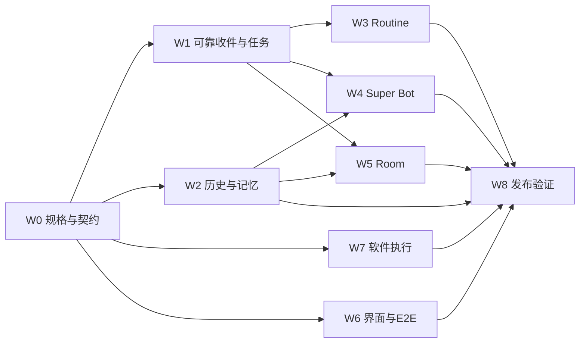

# Bot 模式多 Agent 协作开发计划

状态：实施与集成验收中。用户已授权按本计划多 Agent 补齐开发；主要功能已实现，本地全量单测、浏览器、故障恢复和代码质量门禁已通过；完整性能、24h 和真实环境证据仍待验收。尚未满足 W8 发布门槛。逐项状态与实际证据见 [实施与验收记录](../reports/2026-10-13-bot-mode-implementation-review.md)。以下保留原批准范围和验收标准，不以状态更新降低门槛。

基线：`96d55dc`（2026-10-13）；实施开始时重新记录实际 HEAD、工作区差异与基线测试。目标是完成持久 Bot、可靠后台工作、多 Bot 协作、群会话、软件调用及默认 Super Bot 的纵向闭环。

用户已要求完整补齐前述 gap，并选定 Super Bot 首版范围：查看状态、分派任务、联系任意有权访问的 Bot、汇总结果。创建其他 Bot、修改其权限或配置、由 Super Bot 管理 Routine 不属于首版管理工具范围；用户仍可在原管理界面执行已有操作。

## 1 实施原则与范围

1. 先统一身份、持久收件、执行状态和恢复契约，再让 Routine、Super Bot、Room 接入。原有 Agent Loop 继续承担模型执行，不另建 Bot 推理循环。
2. 消息、委派任务、Routine 单次运行、Room 发言保留各自语义；共用事务接收、幂等、执行租约和会话唤醒基础，避免把全部业务压成无差别 Job。
3. 每个工作包必须包含用户入口、接口、持久化、实际执行、状态/结果展示及异常路径；仅添加类型、工具声明或页面不算交付。
4. 依照 [验收优先流程](../../skills/acceptance-first/SKILL.md)先登记标准、编写失败测试再实现。先前用户已授权按分析补全开发；此次仅规划。实际启动时把已有授权映射到规格，不重复索取相同授权。未在本计划内的新行为另行确认。
5. 配置走 Lab 与持久化设置，不增加功能开关类环境变量；用户文案 zh/en 同步。软件凭据沿用现有凭据机制。
6. 不用真实模型或第三方服务替代确定性的正确性测试；也不把 mock 全绿宣称为真实模型记忆质量、真实软件可靠性已验证。

### Gap 到交付映射

| ID | 要补齐的能力或缺口 | 工作包 | 主要验收证据 |
|---|---|---|---|
| G01 | 默认 canonical 与用户 canonical 路由不一致 | W0、W1 | 同一身份的 Lab、Routine、Bot 通信均路由正确；跨用户隔离测试 |
| G02 | 无 userId 的 Bot 自动事实记忆未形成闭环 | W0、W2 | 安装级身份和登录身份分别可记忆、召回，且互不误归属 |
| G03 | 压缩后的历史正文不能检索与按时间回读 | W2 | 原文搜索、上下文展开、时间定位、权限测试 |
| G04 | 历史全量加载与长会话性能 | W2、W6 | 游标分页、稳定排序、前端按需加载、规模基准 |
| G05 | 压缩预算不随实际使用模型窗口变化 | W2 | 固定模型、默认模型、fallback 模型、未知窗口回退测试 |
| G06 | 长期记忆质量及修改删除管理 | W2 | 多次压缩事实集、记忆纠错删除后召回、来源可追溯 |
| G07 | 忙碌或审批中通信拒收，回报可能丢失 | W1 | 并发派工与回报、审批期间收件、结束竞争、去重 |
| G08 | 通信只有 fire-and-forget，任务结果无强关联 | W1、W4 | 消息接收与任务完成分离、task/reply 关联、状态汇总 |
| G09 | 定时非空闲不补跑，一次性触发后即关闭 | W3 | 队列运行、一次性运行记录、失败与中断恢复 |
| G10 | Routine 无运行历史、结果、时区、错过触发策略 | W3、W6 | DST、停机、运行详情、手动重试与重启测试 |
| G11 | 对话创建 Routine 默认不可用，UI缺一次性/间隔/事件 | W3、W6 | 自然语言工具调用与创建表单/API贯通 |
| G12 | 后台任务混入私人主对话并互相影响 | W3 | 独立工作上下文，结果摘要返回主对话且原结果可打开 |
| G13 | 无默认 Super Bot 和可靠管理闭环 | W4、W6 | 幂等初始化、默认选择、查状态、派工、收件、汇总 |
| G14 | 无真正的多 Bot 群会话 | W5、W6 | 独立房间、成员、共享历史、提及、预算与停止 |
| G15 | 插件已授权但无 host executor | W7 | 已绑定执行器实际调用、返回结果、取消、失败、撤权 |
| G16 | OpenAPI 仅有声明，无实际请求执行 | W7、W6 | 导入、绑定、验证、调用、结果回流完整流程 |
| G17 | 软件连接授权与健康状态缺 Bot 粒度 | W7、W6 | 按 Bot 绑定、凭据选择、探测状态、撤销即时生效 |
| G18 | 写操作完成确认与中断后的重复执行风险 | W1、W7 | 调用尝试记录、幂等键、未确认结果、人工核对路径 |
| G19 | 恢复、迁移、并发、长期运行与发布证据不足 | W8 | 故障注入、迁移回滚、压力/浸泡、完整CI与验收报告 |

以上 G01–G19 全部纳入计划；分期决定依赖顺序，不删除后续功能。

## 2 共享设计决定

### 2.1 身份和 Bot 归属

- 内部请求必须携带明确的 principal（tenant/user 或安装级本地身份）、Bot 与会话绑定。登录用户采用自己的绑定；未开启登录的本地安装使用持久、明确的安装级身份，不靠临时环境变量伪造用户。
- Bot 名册定义与用户工作上下文分离。同一身份的主会话有唯一约束；缺失时修复自己的绑定，不静默回退另一用户或公共主会话。
- Super Bot 为每个可用身份创建独立工作上下文，显示名统一为 Super Bot；稳定内部标识和绑定用于去重，不通过显示名判断是否已存在。
- 历史无归属数据保留在安装级旧命名空间；仅在归属证据充分时迁移，不把旧 Bot 记忆批量分配给第一个登录用户。提供可诊断的迁移结果。
- 不自动读取其他 Bot 的私聊和私有记忆。Super Bot 通过状态、委派结果及明确授权的通信统筹。隐藏属于展示属性，有权访问者明确指定时仍可联系；禁用/暂停属于独立状态。

### 2.2 持久接收与任务状态

| 对象 | 最小契约 | 明确不代表什么 |
|---|---|---|
| Bot 消息 | messageId、principal、sender/recipient、目标上下文、kind、replyTo、taskId、幂等键、接收时间、处理状态 | accepted/processed 不等于委派完成 |
| 委派任务 | taskId、owner、requester、目标、输入、状态、attempt、deadline、结果引用、失败原因 | 工具调用成功或消息已送出不等于任务成功 |
| Routine occurrence | routineId、occurrenceId、计划时间/时区、实际触发时间、状态、任务引用、结果 | lastTriggeredAt 不等于 lastSucceededAt |
| Room turn | roomId、成员快照、触发消息、发言者、序号、预算、终止原因 | Room 发言不写成对方私人用户消息 |
| 软件调用尝试 | invocationId、所属任务、连接器/执行器、幂等键、状态、结果引用 | 请求已发出不等于外部写入已确认 |

- 消息持久化提交后才返回 accepted；消息记录与待处理标记必须原子提交。数据库唯一约束处理重复请求，客户端重试不重复创建同一项委派。
- 消息状态：pending → processing → processed/failed；任务状态：queued → running → waiting_approval/completed/failed/cancelled/unknown。需要恢复等待关系时由明确事件驱动，不从对话文字推测。
- 每个会话仅一个执行者。收到新消息时若正在运行或等待审批，只持久接收；结束、审批解除和调度 tick 均检查待处理工作，解决入队与结束之间的竞争。
- 队列有容量与背压：默认每Bot最多1000条待处理、每身份最多10000条，Lab可调整。超限在接收前返回明确可重试状态；已accepted的消息不能被淘汰来腾空间。大结果使用持久结果引用，不把完整产物反复塞入消息。
- 顺序以收件箱序列确定；任务结果消息带原 taskId/replyTo，可在 Super Bot 忙碌时保存。消息类通知和新任务分开处理，不依靠所有消息都算 relay hop。
- 委派支持截止时间、取消、失败原因和人工重试；普通回报不计入无界递归转发。跨任务链仍有 hop/预算限制。
- 共用持久化应优先采用现有 SQLite 事务机制；不引入外部消息队列。是否为现有表扩展或新增专表由 W0 写入版本化契约，迁移由集成负责人统一落地。

### 2.3 恢复和副作用

- 交付语义为至少一次接收/唤醒加幂等消费，不承诺对任意外部软件的端到端 exactly-once。
- 运行租约和尝试记录区分未启动、运行中、已提交结果。重启后的未开始工作可恢复；结果已提交的工作不重做；可能已执行副作用但未确认的尝试标为 unknown，提供核对和明确重试入口。
- 每次认领携带递增执行代号，提交结果时校验当前持有者；过期执行者不能覆盖新状态。租约到期本身不证明旧进程已停止，也不授权重放未知写操作。
- 可证明安全的读取操作允许有限自动重试；写操作仅在执行器提供幂等保障或明确确认未开始时自动重试。不得因超时、断网或重启直接重复写入。
- 审批仅由既有批准路径处理；排队、重试、Super Bot 和群调度不能绕过。停止执行也不能把已经发生的外部效果宣称回滚。

### 2.4 历史与记忆

- 原始历史、当前工作状态、长期记忆三层独立。原文检索返回稳定消息引用与前后文；压缩摘要和记忆均保留来源引用。
- 历史按 Bot 归属、时间、关键词检索；游标分页基于稳定序列，避免并发新增造成跳页/重复。检索覆盖压缩前原文，而非只搜 summary。
- 提供模型可用的历史检索/回读工具和用户可用的历史面板；删除/纠错记忆不会继续从旧缓存召回，历史原文保留策略向用户明确呈现。
- contextWindow 按本轮实际模型解析，覆盖 Bot pin、默认模型和 fallback；未知窗口使用公开且可编辑的保守回退。50%/85%规则同时考虑系统/工具预算与闭合工具波，不裁断调用配对。
- 保留滚动摘要、原文归档和记忆预算；不依赖尚无消费逻辑的 sessionCut 标记证明能力完成。

### 2.5 Routine

- 支持 cron、一次性、间隔及已有事件来源类型，Lab 与对话工具均可使用；启用策略在 Lab 持久保存，Bot 不依赖新增环境变量获得常规调度能力。
- 新任务保存 IANA 时区，UI默认用户浏览器时区，提交后显示明确时区。本用户场景为 Asia/Shanghai；不把它硬编码为所有用户默认。
- DST重复时隙中，同一Routine的同一重复本地计划时刻只触发一次，采用第一次时区偏移；同日其它计划时刻照常触发。缺失时刻跳过并记录。cron的去重键包含routineId、规则版本、IANA时区和本地计划日期/时分，对重复时隙归一，不能仅用UTC instant去重；间隔/一次性用计划instant，事件用事件标识。
- 周期错过默认 coalesce 一次并记录漏过次数，可选 skip 或有界 catch-up（最多10次）；同一Routine默认串行，不重叠执行。一次性任务关闭未来触发后，已创建运行仍必须完成或显示终态。
- 预检跳过记录 skipped，不记为执行成功。预检异常遵循当前失败时唤醒行为并显示原因。
- 后台工作使用独立运行上下文，继承所属Bot的身份、工具与记忆规则，成果以摘要与链接回主会话。原会话失效可按绑定修复；Bot明确禁用时暂停并解释原因。
- 运行详情提供 queued/running/waiting_approval/completed/failed/cancelled/unknown/skipped、尝试、结果、时间与操作；配置与运行历史分开。

### 2.6 群会话

- Room有独立成员、共享消息序列、历史和访问控制，成员为持久Bot与用户；私聊历史不自动复制进去。
- 首版采用确定性提及调度：用户明确选择或 @ 成员；未指定时由房间设置的主持Bot处理；点名多个成员按队列发言。模型文本中的名字不能自行生成授权或无限唤醒。
- 每个触发回合默认最多8次Bot发言，房间可配置为1–20；同时设置工具/费用预算，支持暂停、停止、成员退出。到限返回明确终止状态。
- Room复用可靠收件与执行基础，但不把房间上下文注入成员的私人主会话。Bot可读取自己获准的记忆，写入群历史的内容受成员可见范围约束。
- 首版支持共享文本与已有附件引用、历史分页、发言者身份、状态与停止；不把音视频会议和跨安装房间协议列为已支持。

### 2.7 软件调用支持边界

- 保留并回归现有CLI、MCP、浏览器与LCU真实执行链；为已授权插件声明补明确executor绑定，不把任意JSON声明视为可执行代码。
- 首版声明式插件支持受控HTTP/OpenAPI执行器与已有MCP执行器绑定。CLI/浏览器/LCU沿用现有专用工具，不在插件manifest中引入任意宿主代码执行。
- OpenAPI首版支持3.0/3.1的HTTP操作、path/query/header参数、JSON请求/响应、Bearer/API-key凭据引用、本地引用解析；远程引用、OAuth交互授权、XML/SOAP、回调和二进制上传在导入时明确标为unsupported，不假装绑定成功。
- 同一接口支持分页约定、超时、取消、响应大小限制、错误归一化；外部地址受现有网络访问策略约束，重定向后仍校验，工具结果脱敏。
- 每个Bot可选择连接绑定与凭据引用；显示configured/ready/degraded/unavailable以及最后探测时间，不把configured当成ready。撤销后下一次调用即拒绝。
- 写操作按2.3记录与恢复。软件支持矩阵记录验证过的协议、平台和实际操作；不承诺任意软件任意流程。

## 3 Agent 分工和文件所有权

最多同时7个Agent：集成负责人加6个执行Agent。每个工作包负责人同时负责后端单测、接口测试和使用说明；界面Agent负责产品入口与浏览器E2E，不能成为所有测试的唯一负责人。

| Agent | 主职责 | 独占修改区域 | 对外契约与审阅者 |
|---|---|---|---|
| L 集成负责人 | W0契约、迁移、公共入口集成、W8发布判定 | core runtime入口、公共导出、storage总装、迁移注册、daemon路由注册、package.json、CI、验收规格汇总 | 所有公共契约单一负责人；关键状态实现由B/C交叉审阅 |
| A 通信与Super Bot | W1持久收件/委派，随后W4默认Super与管理工具 | 新bot messaging/delegation/super模块、message-agent工具、对应独立路由及测试 | 发出queue/status/result契约；C与D审阅并发和回报 |
| B 历史与记忆 | W2原文检索、分页、记忆身份、模型窗口及质量 | session/history、memory、compact host、model catalog相关字段、独立历史路由和测试 | 向F提供分页/搜索/记忆接口；E审阅原文与权限 |
| C Routine | W3触发、时区、occurrence、恢复、运行详情 | cron模块、routine路由、scheduler-host中cron块、对应测试 | 接A队列，向F提供运行接口；A审阅不重复执行 |
| D Room与独立验证 | W5房间与发言调度；空档验证A/W4状态机 | 新room模块、room路由及测试，不改私人Bot通信语义 | 接A队列，向F提供room接口；B审阅历史隔离 |
| E 软件执行 | W7插件/OpenAPI executor、Bot连接绑定、尝试记录 | connectors、discovery执行器及专用工具、对应路由和测试 | 向F提供绑定/健康接口；L/D审阅真实执行与恢复 |
| F Lab与E2E | W6各切片UI、i18n、浏览器纵向测试 | web-console组件、lib、样式、语言文件、e2e | 接各后端契约；完成模块的A–E轮值独立验收 |

共享文件不由多个Agent同时编辑。Agent向L提交需要的注册项或小补丁，L串行集成；C对scheduler-host的改动结束后，L再加入消息/room调度钩子。B改model目录前读取该目录AGENTS.md。

优先使用各Agent独立Git worktree和分支，依赖上游已合入的契约提交；不得复制用户凭据。若执行环境必须共享工作区，严格采用上述独占区，禁止全局格式化、全量回退和并发写入同一构建输出。构建和集成测试由L集中执行或使用隔离输出。

每个Agent交付包包含：变更文件、契约版本、规格ID、先失败后通过证据、实际执行的命令/结果、迁移影响、故障路径、未解决问题。未解决项不能被写成“完成”。

## 4 开发工作包与依赖

| 工作包 | 负责人 | 进入条件 | 完成条件 |
|---|---|---|---|
| W0 规格和契约 | L，各Agent审阅 | 记录基线、读取本计划 | G01–G19全部映射用户验收；身份、状态、错误、API/schema、事件与迁移契约定版；验证基线归档 |
| W1 可靠Bot工作底座 | A，L集成 | W0 | 持久收件、唯一消费、单会话执行、审批等待、任务结果、超时/取消、unknown恢复及观测贯通 |
| W2 持续对话和历史 | B，F接UI | W0身份/模型契约 | 原文可搜可分页可回读，记忆来源/纠错/删除、自动提取身份、模型预算、多次压缩质量与规模测试通过 |
| W3 可靠Routine | C，F接UI | W0；调度集成依赖W1 | cron/once/interval/event端到端，时区/DST/错过策略、独立运行、状态/结果、重试与恢复通过 |
| W4 Super Bot | A，F接UI | W1；W2身份与固定会话基础 | 默认唯一实例、保留用户选择、管理工具、任意有权Bot通信、并发派工/回报/汇总全闭环 |
| W5 Room | D，F接UI | W1稳定；W2历史接口 | 创建房间、成员、共享历史、@发言、预算、停止与恢复，私聊隔离通过 |
| W6 Lab与E2E | F | W0提供API契约即可设计；逐包接实际接口 | 每个工作包均有可操作界面、空/忙/失败态、zh/en、加载/滚动稳定和真实后端E2E |
| W7 软件executor | E，F接UI | W0身份/调用尝试契约 | 插件/OpenAPI实际执行、按Bot绑定、健康、撤权、取消、结果、写入未知态测试通过 |
| W8 发布验证 | L，D独立审阅，全部Agent修复 | W1–W7集成在同一候选提交 | 全部验收有实际通过证据；CI、故障、规模、真实模型/软件矩阵、迁移/回滚、浸泡满足发布门槛 |

依赖图：



分批集成顺序：

1. 契约与兼容迁移测试；A做W1，B做W2，E做W7并行；C/D先写调度/Room失败测试和接口适配，F按契约完成界面骨架与失败E2E。
2. W1完整通过后C接Routine，A接Super，D接Room；B/E继续完成各自真实链路；F按历史→Routine→Super→Room→连接器顺序接入。接口有稳定版本后即可提前接入，不必等整批结束。
3. 每个切片以“后端实现 + 产品入口 + 测试”合入集成分支；不得把只有声明或UI占位的切片标记完成。采用独立PR/提交序列，记录depends-on；创建PR时附加到本任务。
4. 所有功能在同一候选SHA验证。模型、浏览器、操作系统差异记录支持矩阵；失败归原负责Agent修复，修复后重跑受影响层及最终门禁。

## 5 验收规格安排

保留 [默认Super Bot草案](../../acceptance/default-super-bot.yaml)，启动实现时同步已授权状态与说明。其它规格在W0登记为用户场景，建议ID如下；这是待创建文件清单，不是现有实现声明。

| 规格ID | 覆盖 |
|---|---|
| bot-identity-continuity | G01–G02；身份、绑定、安装级历史迁移 |
| bot-history-memory | G03–G06；全文/分页、纠错删除、窗口及长期质量 |
| bot-reliable-messaging | G07–G08、G18；可靠收件、委派、结果、故障语义 |
| bot-routine-lifecycle | G09–G12；调度、时区、执行记录、隔离与恢复 |
| default-super-bot | G13；已有AC-1至AC-10，保持选定管理范围 |
| bot-rooms | G14；房间、成员、历史、提及、预算与停止 |
| bot-software-execution | G15–G18；插件/API执行、绑定、健康及未知写入 |
| bot-release-readiness | G19；规模、兼容、重启、观测和发布证据 |

对现有bots、bot-dual-compact、bot-forever-chat、bot-gateway-delivery等规格先做兼容对照，避免新规范与旧规范冲突。特别是“定时提示直接写主会话”迁移到独立运行需要保留可观察结果，不删除旧测试来掩盖回归。任何确需调整的已批准标准必须说明用户已授权的行为变更与理由。

## 6 验证方案与明确门槛

### 6.1 每项能力的验证层

| 层次 | 必须覆盖 | 通过要求 |
|---|---|---|
| 单元与状态机 | 合法/非法状态转换、幂等、租约、游标、时区/DST、窗口、参数映射、预算 | 新规格逐条有行为断言；无skip/todo替代 |
| API集成 | 真实SQLite、身份权限、重启后重读、后台执行、跨模块结果关联 | 不只stub服务内部返回值；验证持久记录及用户可见状态 |
| 浏览器E2E | 默认Super、历史检索、Routine与运行详情、群聊、软件绑定与结果 | 启动真实daemon+Lab；关键流程无测试重试掩盖失败 |
| 故障注入 | 接收提交前后、认领前后、模型执行中、审批中、外部写后未记结果、完成后未通知 | 已接收工作不丢失；不假成功；不重复提交已知完成任务；未知副作用明确显示 |
| 并发压力 | Super派给多个Bot、同时回报、Routine撞上私聊、Room停止、队列入队与执行结束竞争 | 会话单执行者不变式、无消息误归属、无永久滞留 |
| 迁移回滚 | 旧Bot/ownerless/隐藏/旧记忆/cron文件、重复迁移、中断恢复、新旧二进制数据兼容 | 数据可读、归属不漂移、已触发运行不消失，回滚步骤经过演练 |
| 模型与软件实测 | 支持模型多轮召回；HTTP/MCP测试服务；浏览器及支持OS桌面场景 | 记录版本、动作、预期与结果，按支持矩阵逐项通过 |

长时与规模目标为本计划的验收预算，尚非测量结果：

- 标准性能环境固定为4 vCPU、8 GiB内存、SSD、仓库规定Node版本；记录实际硬件与基线。50个Bot（含Super）、单Bot十万条消息、总计百万条历史、20并发读请求。
- 本地状态/分页接口p95 ≤500ms，索引后历史检索p95 ≤1s；50条历史首屏p95 ≤2s；持久接收API p95 ≤500ms；空闲且可运行工作在两个正常调度周期内启动。指标不包含上游模型生成和第三方响应时间。
- CI跑至少1000条有固定seed的状态转换/故障序列；候选发布跑至少10000条与真实子进程kill/restart组合；seed及失败轨迹保留。
- 多轮记忆场景至少200轮、12次压缩、100条带来源事实及冲突/修正/删除。确定性测试对关键约束、未完成事项、事实来源100%正确；真实支持模型至少3次独立运行，关键约束无遗漏且无伪造完成，非关键事实召回≥95%。未达标不宣称该模型具备验证过的长期助手能力。
- 候选执行24小时浸泡（使用有确定输出的模型与本地软件服务），持续混合人类消息、Routine、派工回报及群发言；无崩溃、无已接收数据丢失、无未解释的重复副作用、无持续增长的未处理队列。内存高水位在预热后的稳定窗口不持续增长，增长超过20%需定位并解决。
- 相同候选SHA的关键E2E与并发故障套件连续3次通过，记录每次独立结果；不得仅凭失败后重试成功放行。

W0必须将固定负载协议存为版本化workload配置，供W8复用，默认如下。测试产物记录配置hash、seed、候选SHA与硬件；W8不得为获得通过而临时减少负载。

| 项目 | 固定协议 |
|---|---|
| API读基准 | 20个客户端，整体40请求/秒；分页50%、历史搜索30%、任务/状态查询20%；5分钟预热、15分钟测量，使用相同数据集和seed |
| 混合写负载 | 50个Bot中10个活跃；正常2个顶层工作/秒；人类消息40%、Routine20%、Super委派20%、Room触发20%；派工/Room每项最多3个下游Bot，其回报计入派生负载而非另算顶层输入 |
| 消息与工具体积 | 输入1KiB、模型输出2KiB、普通工具结果8KiB；另含1%的1MiB产物引用场景，记录真实字节数 |
| 可控执行时间 | 模型服务每轮100ms，每项最多3轮；本地软件读取50ms、写入100ms；审批样本5秒后由测试操作者明确批准或拒绝；超时/unknown由独立故障场景验证 |
| 突发和热点 | 每小时一次20个顶层工作/秒、持续60秒；该期间50%工作集中到同一个Bot，验证背压和排队，不更改accepted后的契约 |
| 浸泡与排空 | 30分钟预热后连续24小时测量；结束时停止新增输入，所有可运行队列在120秒内排空；已终态及明确等待人工核对的unknown单独列账，不伪装成待运行排空 |
| 内存采样 | 每10秒记录daemon及其工作子进程总RSS；预热后首个30分钟p95为基准，后续每个30分钟窗口p95不得超过基准120%，同时报告趋势与队列长度 |

如果标准环境不可用，记录环境差异并先完成可执行验证；该项保持未验证，不降低门槛或以单测替代。

### 6.2 现有命令与新验证的接入

现有发布基础以 [.github/workflows/release-gate.yml](../../.github/workflows/release-gate.yml) 为准，至少保留：

```sh
npm run build
npm run test:unit
npm run test:acceptance:full
npm run test:formal
npm run test:package
npm run test:crap
npm run agent:eval:fast -- --exit-on-fail --out test-results/fast-eval
npm run agent:eval:verify
RAW_AGENT_MODEL_PROVIDER=heuristic npm run test:regression
RAW_AGENT_MODEL_PROVIDER=heuristic npm run test:integration
RAW_AGENT_MODEL_PROVIDER=heuristic npm run test:e2e
```

`test:acceptance:full`已收集unit/vitest/e2e结果，调度实际执行时复用同一候选的完整JUnit，避免无变化的重复运行；重复运行只用于上述稳定性验证。静态验收通过不能替代结果模式。

新增故障/规模/长期评估脚本由W8接入明确CI或候选发布任务，保存结果与退出码；不得只写存在性检查。`test:formal`当前是可执行不变式/MockLLM回归，不代表完成形式化证明；`agent:eval:verify`不是实模型质量验证。

修改agent-loop时必须同步其SKILL并在包内执行test和build。E2E使用独立构建产物，避免next dev覆盖生产.next。已有CI对失败文件的重试结果必须保留，Bot新增关键路径出现flaky时不得仅靠重试放行。

### 6.3 可观测性和回滚

- 日志与trace串联principal、bot、message、task、occurrence、room、invocation与attempt；不记录凭据值。用户界面能解释queued、blocked、failed和unknown，提供结果与失败原因。
- 至少观测队列长度/最老等待、运行耗时、重试、审批等待、unknown数、Routine错过、历史查询延迟和模型/软件调用成本。
- 数据迁移采用版本化、可重复执行和可恢复策略。备份不仅含SQLite，还含cron配置、归档和相关文件；凭据按既有安全存储处理。
- 优先扩展式迁移保留旧读路径，先双读验证再切换；不可逆清理不进入首版发布步骤。旧二进制无法读取新schema时，用经过演练的候选回退构建或停机一致性恢复，明确回滚窗口与新写入保留方案，不能盲目覆盖数据库。
- 发布报告包含候选SHA、规格覆盖、JUnit、故障/性能/浸泡数据、模型与软件支持矩阵、迁移回滚演练和未验证项。存在关键缺口时结果为not ready。

## 7 每轮协作与完成定义

L先发布契约版本和文件分配，Agent回复依赖与首个失败场景后开始。Agent发现共享契约不够时发出变更提案，由L合并再通知全部消费者；不得私自增加新的默认权限或重启策略。

日常交接按“已验证行为、尚未完成、契约变化、下一依赖”汇报。L维护G01–G19映射及工作包状态；独立审阅者应从用户流程、故障与持久化结果检查，不只阅读实现函数。

工作包完成必须同时满足：代码已接实际入口；前后端契约一致；数据能重读；关键异常有状态；对应验收测试通过；既有行为回归通过；说明与i18n齐全。跨包集成失败时仍视为未完成。

发布ready必须满足W8全部门槛，真实验证矩阵缺项不能被“外部依赖”四字带过。完成代码与测试不自动执行生产部署、合并或发布；这些动作在具备具体候选与报告后按用户指令执行。

## 8 启动时各 Agent 可直接领取的任务

- L：记录基线；将八组规格与G01–G19对齐；发布身份、消息/任务、Routine/Room、软件调用契约；建立串行迁移与导出注册清单。
- A：先复现“Super忙碌时worker回报拒收”和“入队遇执行结束”两场景；完成持久收件后再做Super初始化与管理工具。
- B：先证明“压缩前原话可检索”和“分页期间新增不跳漏”；完成身份记忆与真实模型窗口联动，建立长期事实集。
- C：先复现“忙碌的一次性任务关闭却未执行”；按occurrence实现时区、错过策略、独立运行和结果详情。
- D：先为Room共享历史、成员隔离、@调度和停止预算写失败测试；独立检查A的状态机不变式，再接稳定队列。
- E：先用本地HTTP/MCP服务证明“授权声明仍不可执行”的失败；实现绑定到实际executor的闭环及未知写入恢复。
- F：先按契约写默认Super、历史检索、Routine、Room、连接器五条失败E2E；分批接实际后端，不用固定成功数据替代。

当前交付：W0 规格已登记，W1–W7 主要实现位于开发工作区，统一冻结构建上的本地回归与门禁已通过；W2/W7 的真实质量与规模证据、W8 尚未完成。没有执行生产部署、合并、发布或 Mac 本地升级。


后续验收状态：已继续启动完整时长的补充runtime/store浸泡，并补真实HTTP负载工具；受协议覆盖与环境差异限制，不计作W8完成。详见 [剩余验收与交接](../reports/2026-10-13-bot-mode-remaining-acceptance.md)。跨会话正文检索不在本次批准范围内。
